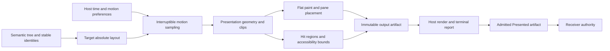

# Separate target layout from interruptible presentation geometry

Status: Accepted; first delivery implements the shared `motion` feature, same-root
survivor transitions, egui configuration and passive decoration tracks. Native
compositor integration, cross-window content flights and exit snapshots remain deferred.

## Context

Dockspace projects a semantic docking tree into absolute geometry and a flat paint list. Animated layout changes must retain pane identity, predictable input and exact presentation authority across immediate, retained and deferred UI hosts. Adding unrelated animation state inside every adapter would make these guarantees framework dependent.

Apple's [fluid interface guidance][apple18] prioritizes immediate response, interruption and one-to-one tracking. It recommends starting with a fully damped spring; bounce is a deliberate response to gesture momentum or a useful hint, not the definition of fluidity. Its examples of scrolling inertia do not require inertia for every manipulation.

Carbon distinguishes [productive and expressive motion][carbon-overview], with productive motion appropriate for task completion. Its [choreography guidance][carbon-choreography] emphasizes semantic and spatial consistency and shared elements. Its grid paths and staggered entrances are Carbon design choices; they are not universal requirements for docking geometry.

Emil Kowalski's [easing blueprint][emil-easing] favors ease-out for user-initiated entrance and exit, and ease-in-out for elements already visible that move or morph. These principles inform distinct motion roles rather than a single curve for every operation.

[FLIP][flip] and [Motion layout animation][motion-layout] separate target layout from visual movement. Their compositor and scaling optimizations are browser specific; both discuss content distortion. Dockspace can reuse the separation without assuming that scaling text, changing native bounds or recomputing a browser layout have equivalent costs.

## Decision

Keep motion in a renderer-neutral presentation stage, after target layout and before artifact publication. Compile the shared motion engine behind a default feature that applications can disable; without it, presentation geometry equals target geometry. Core owns identity, geometry, clips, hit regions, accessibility bounds and sampling state. The host supplies a monotonic clock, motion preferences, rendering and presentation results. Adapters render the sampled result without applying another framework animation to authoritative docking geometry. Arbitrary host rectangle overrides cannot bypass the core geometry and render-input contract.

Ordinary docking commands publish semantics through the existing atomic frame. Presentation geometry describes their visual transition; animation completion never delays a semantic commit, enables input, transfers ownership or proves presentation. The existing native first-live admission still controls ownership transfer. [ADR 0002](0002-atomic-frames-and-presentation.md) governs receiver authority. A newly evaluated pose or candidate does not revoke the admitted output still on screen; newer admitted presentation or the existing semantic/coordinate invalidation rules determine its continued authority.

Preserve target `LayoutProjection` for constraints, future-layout previews and resize solving. Insert presentation sampling between that projection and scene-record generation. Consolidate the existing contained-floating and resize presentation plumbing into this path while retaining their gesture owners and solvers. Do not mutate a finalized plan in an adapter or treat overlapping intermediate rectangles as a valid split partition.

Separate content continuity from layout-slot identity. Within one live workspace epoch, `ItemId` identifies content; root/tabs identities identify slots and chrome. Match visible content between old and target plans without copying old command bases or membership into the target. Give egui content an independent item namespace rather than a slot-derived child ID; test state preservation within a Context and qualify cross-viewport behavior separately.

When panes overlap, one core-owned pane order drives paint, clipping, accessibility exposure and hit precedence. Place pane rank between root layer and control role, so a rear tab cannot receive input through a front pane body. Ordinary geometry and its receiver inventory belong to the same immutable artifact. Focus and drop decoration tracks remain independent and have no input authority.

Use a productive, precise motion character: immediate acknowledgement, local changes and quiet rest. Keep spacing, density, radii and color inherited from the adapter's existing style tokens. Motion introduces no mandatory ambient loops, content stagger, interface sound or additional visual theme.

Use the following motion roles:

| Role | Behavior | Initial tuning proposal |
| --- | --- | --- |
| Direct manipulation | Pointer-driven drag and split resize follow the current constrained pointer position, including on release; no smoothing queue or inertia | Immediate |
| Structural transition | Same-window rearrangement preserves content identity; unrelated regions stay still | Tween; 200 ms ease-in-out |
| Drop preview | The semantic target changes immediately; only its result-area decoration follows a separate trajectory | Tween; 125 ms ease-out |
| Focus and control feedback | Focus and keyboard navigation are immediate; optional color/opacity feedback does not delay them | Reuse adapter tokens; spatial focus travel off by default |

Default tweens have finite deadlines so structural controls recover promptly. A 200 ms spring response can take roughly 600 ms to meet the exact geometry settlement thresholds; springs remain an explicit option for applications that prefer velocity continuity. These values are interaction defaults, not performance thresholds. Carbon's [productive duration tokens][carbon-overview] provide comparison points, not a conversion between tween duration and spring response. Related changes share a start time and consistent timing; equal-width pane moves can share a trajectory, and valid partition changes must share boundary motion.

The compile-time feature and runtime controls are separate. With motion available, provide global `Off`/`System` policy and one explicit `Transition` per effect, including `Instant`. Defaults live in `MotionSettings`, avoiding an additional inheritance layer. Resolve global Off first, then host-reported reduced motion, then the effect transition. A missing system fact remains Unknown and permits motion by default, with an explicit conservative fallback; enabling a feature does not prove OS preference support. `Off` samples target geometry immediately and schedules no motion wakeup. Reduced motion removes geometry travel, scale and bounce, retaining optional short color/opacity feedback and a static cue. Keyboard navigation remains immediate. Applications can replace settings at runtime; a zero timing normalizes to the immediate path before any division.

Keep `MotionSettings` separate from `DockPresentationConfig`, whose revision currently requires fresh layout measurements. Freeze motion settings for one outer update and invalidate only affected tracks when settings change. Changing a curve, duration or effect policy must not stale layout measurements or require a whole-tree remeasure. Reuse existing output identity and invalidation mechanisms rather than adding a motion-revision ledger.

Provide two explicit timing models initially: `Tween { duration, curve }` and `CriticalSpring { response }`. Tween duration is its finite timeline; define spring response as the natural period, `omega = 2 * pi / response`, not an exact settling duration. Apple explicitly separates [perceptual duration from settling duration][apple23]; our response parameter must not silently claim the same definition. Validate parameters at configuration changes. Cubic Bezier x control points follow the [W3C range of 0 to 1][css-easing]; geometry additionally requires bounded monotone output. Custom Bezier curves are supported. Externally supplied samplers, general animation graphs, bouncy spring families and native compositor integration are deferred; they must later reuse the same prepared identity and geometry contract.

For duration-based motion, use semantic presets: ease-out for feedback or entrances and ease-in-out for movement of already visible elements, following [Emil's distinction][emil-easing]. Carbon's exact control points remain an optional aesthetic preset, not a continuity guarantee. Evaluate cubic Bezier output at input time by solving its x coordinate; evaluating y directly at the time parameter is a different curve, as defined by [W3C][css-easing].

For a newly established trajectory, use the latest admitted Presented plan as the visible starting geometry. For an active trajectory's retarget, sample the running model at the current host time and retain its position and velocity, even if that new sample has not yet been presented. Resetting every retarget to an older confirmed frame can rewind past an in-flight frame. Model continuity grants no receiver authority: input still uses the admitted Presented artifact. A hidden/resumed or discontinuous host can explicitly rebase to confirmed geometry or settle to target, without claiming C1 across that reset. Presentation receipts do not themselves prove velocity or display timestamps.

Restarting a fixed timing curve at the current position gives position continuity (C0), but generally changes velocity: for finite initial easing slope, the new velocity is `(new_target - current_position) * easing_slope(0) / duration`, which need not equal the old velocity. Do not describe an ordinary restarted tween as velocity continuous (C1).

For unconstrained structural motion, preserve pose and velocity per independent channel and change the spring target. Apple demonstrates [arbitrary initial velocity, including two-dimensional movement and retargeting][apple23]. A single scalar progress value along a new start-to-target segment cannot generally preserve an arbitrary velocity vector. Use a documented analytic spring model so results depend on time and state rather than frame rate; the initial model fixes damping ratio at 1, with no deliberate oscillatory bounce.

Non-bouncy tuning is not a proof of never crossing a newly assigned target. A large inherited velocity or an abrupt reversal can produce such a crossing even with critical damping. Ownership, finite nonnegative geometry, valid clips and native admission take priority over continuity. For transitions that remain partitions, solve shared boundaries together rather than independently springing neighboring leaves. Topology swaps may overlap and use the explicit pane order. Constraint projection, direct manipulation and policy changes are explicit exceptions to C1; do not clamp progress silently and still claim preserved velocity. Use a bounded tween if a transition requires strictly monotone travel.

Focus and drop decorations use separate visual tracks and may animate while underlying input geometry remains immediate. They neither delay target selection nor create invisible receivers. Preserve the resolved drop target and final candidate bounds in customization callbacks; expose the animated decoration rectangle separately rather than changing the meaning of canonical preview geometry. Structural changes begin together with consistent identity and timing; do not cascade the interactive docking skeleton. Carbon's [20 ms table-entry stagger and 500 ms sequence example][carbon-choreography] is optional inspiration for noninteractive reveal, not a delay budget for resize, hit testing or docking commands.

Prepare target topology, constraints and identity correspondence only when their inputs change. Sample springs analytically, settle using declared position and velocity tolerances, and retire removed tracks. Do not repeat workspace indexing, target solving or full structural validation on every sample. Pane content can still require layout at its sampled size; its cost must be measured separately. Stop requesting frames when tracks settle, pause hidden surfaces and never replay a backlog after suspension. Content uses sampled rectangles and clips; a scaled cached image is not assumed equivalent to live content.

The normal host interface supplies settings, a monotonic `Duration` and system preference once per outer update, and receives whether another animation frame is needed. Multiple egui passes reuse that sample. Retained hosts apply the same sampled geometry to stable content views without running a second independent geometry animation. Output-capacity backpressure waits for the existing terminal wakeup instead of producing a busy redraw loop. No additional executor, async trait, mandatory clock trait or crate is needed.

First delivery covers same-surface/root rearrangement and survivor reflow. Newly visible content without a matching prior pose appears at target; removed content disappears without an exit snapshot. Direct manipulation stays immediate. Where a topology transition has no valid splitter partition, suppress its affected splitter/junction actions and structural drop targets. Restore them only when the admitted Presented artifact contains a valid partition and matching solver geometry; the first delivery can use the final static target frame. Model settlement or presentation of an arbitrary intermediate frame is insufficient. Unaffected roots and valid content actions remain usable, and a new valid operation can interrupt the current track without waiting for completion. Native prospective-child first-live output uses the existing static path, then ordinary post-admission transitions may resume. Do not animate OS window bounds or promise atomic cross-window presentation.

## Alternatives

| Design | Benefits | Costs and reason for decision |
| --- | --- | --- |
| Shared presentation stage with stateful springs and optional tweens (selected) | One geometry contract, deterministic sampling, arbitrary velocity on retarget, equivalent behavior across UI frameworks | Requires constrained geometry and explicit artifact integration |
| Duration-only tween from the current rectangle | Small implementation, exact duration, configurable familiar curves | C0 on retarget but generally not C1; useful as an explicit setting, insufficient as the universal fluid model |
| Native animation in each UI adapter | Reuses framework tools and compositor capabilities | Divergent clocks and easing; core cannot reliably match visible geometry, hits, clips and deferred presentation |
| Animate the semantic layout tree or wait for completion before committing | Apparent alignment between intermediate tree layout and paint | Couples input and ownership to animation, risks repeated layout work and delays semantics; reject |

| Risk | Mitigation |
| --- | --- |
| Reflowing editor content dominates frame cost | Measure content and core geometry separately; keep unaffected regions stable |
| Constraints conflict with inherited velocity | Preserve valid geometry first; expose and test the specified reset/settlement rule |
| Backpressure or delayed frames break visible continuity | Retain immutable artifacts and ordered settlement; qualify smoothness by host scheduling |
| Structural edits change slot identity or overlap | Match content by live item identity; share pane order between paint and receivers |

This ADR does not promise smooth visible motion across dropped frames, cross-Context widget-state migration or OS window creation. Immediate settlement remains supported when continuity cannot be established.

## Acceptance

1. With a deterministic fake clock, retarget a moving pane repeatedly, reverse direction and change both axes. Spring position and unconstrained velocity agree immediately before and after retarget within declared numeric tolerances; tween tests require C0 and explicitly demonstrate the possible velocity change.
2. Exercise a new target close to the current position with large inherited velocity. Assert valid geometry and document any constraint-induced velocity reset; do not assert that damping ratio 1 alone prevents target crossing.
3. Sample the same trajectory at 30, 60 and 120 Hz and with irregular intervals. Position and velocity at equal timestamps agree within declared tolerances; a long pause converges without substep replay or unbounded catch-up work.
4. Paint, pane placement, clips, hit regions and accessibility bounds refer to the same immutable artifact. Dropped, unadmitted or replaced-by-newer-admitted outputs cannot authorize a receiver. Evaluating another candidate alone does not revoke the still-admitted output; semantic and coordinate checks continue to apply while the clock advances.
5. Every constrained split-resize sample matches the pointer-derived target in that frame, and release adds no inertial movement. Switching motion off, requesting reduced motion or performing first-live cross-window transfer takes the specified immediate path.
6. Focus and drop decorations can move or fade without changing the receiver roster. Keyboard and valid content operations remain immediate; unavailable structural actions expose no active cursor or accessibility action. A new valid operation does not wait for animation completion.
7. Active timing and curve overrides take effect by a documented retarget rule. Invalid parameters are rejected without NaN geometry; settled and disabled modes request no further animation wakeups, and removed identities retain no motion state.
8. The same geometry fixtures pass through egui and an independent public host without framework-specific interpolation. Verify item state/focus in the supported egui Context, overlap hit winners and native delayed first-live behavior. Visually review real editor reflow, rapid reversal and reduced motion before accepting defaults.
9. A 16/64-pane benchmark separates preparation, active geometry sampling and content rendering. With unchanged inputs, animation ticks perform zero new target solves or structural-index builds; settled/off mode adds no animation wakeups or per-tick allocations. Record timing against the static path without claiming an unmeasured frame-rate guarantee.

## Sources

Primary pages checked on 2026-11-13. Parameter choices remain implementation tuning decisions.

- [Apple WWDC 2018: Designing Fluid Interfaces][apple18] — response, interruption, tracking, damping and purposeful bounce.
- [Apple WWDC 2023: Animate with springs][apple23] — position/velocity continuity, two-dimensional velocity, retargeting, non-bouncy springs and duration semantics.
- [Carbon: Motion overview][carbon-overview] — productive/expressive styles, curves, duration tokens and adaptive alternatives.
- [Carbon: Choreography][carbon-choreography] — spatial/semantic consistency, continuity, grid paths and staggered entrances.
- [Emil Kowalski: The Easing Blueprint][emil-easing] — easing by interaction role; its 300 ms comparisons are examples, not a universal duration rule.
- [W3C: CSS Easing Functions Level 1][css-easing] — cubic Bezier definition and time-to-progress mapping.
- [Paul Lewis: FLIP Your Animations][flip] and [Motion: Layout animation][motion-layout] — target/presentation separation, browser performance assumptions and content distortion.

The requested [ui-animation skill][ui-animation-skill] and [LottieFiles motion-design skill][motion-design-skill] informed interaction and visual-hierarchy review. Their platform-specific implementation rules and theatrical choreography are reference material, not additional core invariants. In particular, docking reflow does not require ambient loops, staggered panes or a fixed one-third-screen path rule.

[apple18]: https://developer.apple.com/videos/play/wwdc2018/803/
[apple23]: https://developer.apple.com/videos/play/wwdc2023/10158/
[carbon-overview]: https://www.carbondesignsystem.com/building-blocks/foundations/motion/overview
[carbon-choreography]: https://www.carbondesignsystem.com/building-blocks/foundations/motion/choreography
[emil-easing]: https://animations.dev/learn/animation-theory/the-easing-blueprint
[css-easing]: https://www.w3.org/TR/css-easing-1/
[flip]: https://aerotwist.com/blog/flip-your-animations/
[motion-layout]: https://motion.dev/docs/react-layout-animations
[ui-animation-skill]: https://github.com/mblode/agent-skills/tree/402a666823ddf9b8cd9be76c3314b1119078ff01/skills/ui-animation
[motion-design-skill]: https://github.com/LottieFiles/motion-design-skill/tree/f9a8a041b85185ee4881b3471d3415e939aac772/skills/motion-design
