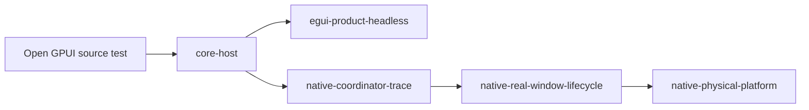

# Open GPUI Docking Conformance Catalog

## Purpose

This catalog selects the smallest high-value behavior set from
`repo-ref/open-gpui/crates/gpui_docking` for the `dockspace` refactor. Each
case records its source evidence and the executor that must prove it. The
catalog prevents a core-only replay or a fake provider from being described as
native multi-viewport product evidence.

## Non-goals

- Porting GPUI `Entity`, `View`, `Window`, panel factory, focus-handle, or
  animation runtime code into `dockspace`.
- Requiring pixel-identical rendering or animation between GPUI and egui.
- Treating a direct `DockEngine` harness as adapter replaceability proof.
- Advertising crates.io egui native multi-viewport support before the
  fork-backed runtime passes its required cases.

## Execution Model

| Executor | Definition | Product claim it may support |
| --- | --- | --- |
| `core-host` | Renderer-neutral public host-frame tests and the bounded private complete-roster fixture. | Topology, revision, prepared action, lifecycle, transaction, and fail-closed semantics only. |
| `egui-product-headless` | crates.io egui product tests using real `Response`, AccessKit, paint, and multipass behavior. | Single logical surface, contained floating, and framework-semantic parity only. |
| `native-coordinator-trace` | Production-shaped ordered platform facts, receiver challenges, effects, outputs, and quiescence without OS provenance. | Native ordering, fail-closed capability, replacement, recovery, and forced-race evidence. |
| `native-real-window-lifecycle` | Fork-backed egui/eframe with real root and child OS windows driven through public product commands. | Hidden creation, staging, first-live, programmatic redock, close, destruction, retirement, and quiescence. |
| `native-physical-platform` | The production provider under Xvfb, Openbox, and XTest, using read-only semantic selection and real Winit pointer events. | Physical drag-out and drag-back on the capability-complete X11 reference topology only. |

## Minimal Case Catalog

A case is complete only when every listed executor has a passing implementation;
an empty executor cell means that executor is not a required proof for that
case. The status column records complete-case status, while the executor evidence
below records partial progress without promoting an incomplete case.

| ID | Open GPUI source evidence | Required executors | Key assertion | Status |
| --- | --- | --- | --- | --- |
| `OGC-01` | `graph_split_tests.rs::repeated_same_axis_edge_docks_flatten_into_nary_split`; `graph_move_tests.rs::checked_move_item_rejects_stale_edge_plan_without_replanning` | `core-host`, `egui-product-headless` | N-ary canonical topology is deterministic; stale plans fail without mutation. | Passing |
| `OGC-02` | `dock_op_fixture_tests.rs::dock_op_sequence_fixtures_hold_canonical_invariants`; `workspace_move_tests.rs::workspace_merge_space_preserves_target_tab_mru_for_followup_close` | `core-host` | Move, merge, and close preserve item ownership, selection, and target-local MRU atomically. | Passing |
| `OGC-03` | `host_interaction_tests.rs::local_release_on_first_target_hit_does_not_commit`; `...::source_only_release_does_not_commit_cached_local_delivery_without_hover_signal` | `core-host`, `egui-product-headless` | A release commits only an acknowledged current preview; cached or first-hit delivery is inert. | Passing |
| `OGC-04` | `host_viewport_route_tests.rs::viewport_runtime_rejects_cached_local_delivery_after_window_facts_go_stale`; `host_viewport_preview_cleanup_tests.rs::viewport_runtime_replacement_clears_routed_preview_for_old_window`; `host_viewport_close_tests.rs::viewport_runtime_late_close_for_replaced_window_keeps_current_viewport_state` | `core-host`, `native-coordinator-trace` | Route/scene/binding changes invalidate old previews and repaint every affected surface; a delayed observation for binding A1 cannot mutate replacement binding A2 even when both reuse one native token. | Passing |
| `OGC-05` | `host_viewport_placement_tests.rs::viewport_runtime_tear_off_opens_viewport_then_moves_item`; `...::viewport_runtime_tear_off_bounds_preserve_drag_cursor_offset` | `core-host`, `native-coordinator-trace`, `native-real-window-lifecycle`, `native-physical-platform` | Tear-off freezes payload, source size, and grab offset. Hidden staging output must precede Show; exact show acknowledgement, Visible observation, and a post-show presented staging output must precede topology transfer; the target remains non-interactive until its first committed output. | Passing |
| `OGC-06` | `host_viewport_placement_tests.rs::viewport_runtime_handle_tear_off_is_not_route_ready_before_first_host_scene`; `...::viewport_runtime_tear_off_fails_closed_when_platform_viewport_windows_unsupported` | `core-host`, `native-coordinator-trace`, `native-real-window-lifecycle` | A created, minimized, unsupported, or unpainted viewport is not routeable or admissible. | Passing |
| `OGC-07` | `host_tests.rs::cross_window_tab_drag_can_drop_into_target_controller_host`; `host_viewport_placement_tests.rs::runtime_opened_viewports_support_cross_window_stack_drag` | `core-host`, `native-real-window-lifecycle`, `native-physical-platform` | Cross-window redock preserves payload order and selection, then performs ownership-aware source vacancy handling. | Passing |
| `OGC-08` | `host_viewport_close_tests.rs::viewport_runtime_merge_back_should_close_records_pending_plan_without_graph_mutation`; `...::runtime_opened_cross_window_drag_clears_state_when_source_window_closes_before_release`; `...::runtime_opened_cross_window_drag_clears_target_preview_when_target_window_closes` | `core-host`, `native-coordinator-trace`, `native-real-window-lifecycle` | Two-phase close uses exact `Allow`, `Veto`, or `Deferred` tokens and commits one complete-roster transaction only after exact destruction proof. Source destruction cancels the global gesture; target destruction clears only that route and preview while preserving the source gesture. | Passing |
| `OGC-09` | `host_viewport_lifecycle_tests.rs::backend_confirmed_activation_consumes_pending_viewport_activation`; `host_viewport_close_tests.rs::close_recovery_does_not_steal_activation_from_another_active_docking_window` | `core-host`, `native-coordinator-trace` | Focus uses exact backend confirmation and priority; close recovery never guesses a panel or steals newer activation. | Passing |
| `OGC-10` | `viewport_coordinates.rs::coordinate_conversion_requires_current_bounds_snapshots`; `...::platform_resize_stales_route_until_host_scene_republishes` | `core-host`, `native-coordinator-trace`, `native-physical-platform` | Physical and logical coordinates remain distinct; resize, scale, work-area, and incarnation changes stale old route authority. | Passing |
| `OGC-11` | `host_interaction_tests.rs::runtime_rendered_mouse_up_with_unknown_button_state_does_not_tear_off`; `host_viewport_matrix_tests.rs::source_only_known_viewport_release_rejects_overlapping_geometry_without_backend_route_selection` | `core-host`, `native-coordinator-trace`, `native-physical-platform` | A global pointer edge plus current receiver/capture receipt is required; unknown or blocked facts cannot infer a release or target. | Passing |
| `OGC-12` | `host_accessibility_tests.rs::accessibility_gpui_mapping_exposes_stable_roles_ids_and_final_tab_actions` | `core-host`, `egui-product-headless` | Final presentation identity and geometry drive accessibility, while local drag decoration preserves the exact final-plan receiver bounds. | Passing |

## Shared Semantic Scenario Evidence

The internal conformance kit uses one bounded product scenario rather than a
generic driver interface. The scenario carries only
semantic item aliases, selectors, actions, expected observations, and required
capabilities. Each executor owns its framework mapping.

| Scenario | Executor | Evidence | Status |
| --- | --- | --- | --- |
| `LocalTabCloseSplitterAndContained` | `core-host` | `dockspace_host_conformance::tests::shared_local_interaction_scenario_maps_to_core_host_semantics` | Passing |
| `LocalTabCloseSplitterAndContained` | `egui-product-headless` | `integration/egui-product-harness/tests/product.rs::shared_local_interaction_scenario_maps_to_egui_product_headless_semantics` | Passing |
| `NativeCreateRedockRetirement` | `core-host` | `dockspace_host_conformance::tests::native_lifecycle_scenario_reports_terminality_presentation_first_live_and_quiescence` | Passing |
| `NativeCreateRedockRetirement` | `egui-product-headless` | `integration/egui-product-harness/tests/product.rs::shared_local_interaction_scenario_maps_to_egui_product_headless_semantics` (capability-negative assertion) | Capability-negative passing |

The private `core-host` transaction fixture freezes a complete two-surface
roster for each mutation boundary; exact output capabilities settle later in
their normal presentation boundaries. Its focused evidence is:

| Required case | Evidence |
| --- | --- |
| Complete-roster commit/drop-abort | `dockspace_host_conformance::tests::private_multi_surface_fixture_commits_and_aborts_complete_rosters_atomically` |
| Stale target without partial mutation | `dockspace_host_conformance::tests::private_multi_surface_fixture_rejects_a_stale_target_without_partial_commit` |
| Superseded output isolation | `dockspace_host_conformance::tests::private_multi_surface_fixture_keeps_the_newer_output_when_an_older_one_is_abandoned` |
| Unknown owner fails closed | `dockspace_host_conformance::tests::private_multi_surface_fixture_unknown_owner_cannot_start_a_drag` |
| Target destruction preserves the source drag | `dockspace_host_conformance::tests::private_multi_surface_fixture_target_destruction_preserves_the_source_drag` |
| First-live and lifecycle ordering | `dockspace_host_conformance::tests::native_lifecycle_scenario_reports_terminality_presentation_first_live_and_quiescence` |

## Executor Evidence

| Case | Executor | Evidence | Status |
| --- | --- | --- | --- |
| `OGC-01` | `core-host` | `dockspace_host_conformance::tests::ogc_01_repeated_same_axis_docks_flatten_and_stale_targets_are_inert` | Passing |
| `OGC-01` | `egui-product-headless` | `integration/egui-product-harness/tests/product.rs::default_features_paint_outer_guides_and_dock_each_edge`; `...::default_features_center_guide_merges_tabs`; `...::stale_prepared_dock_action_is_inert_in_the_product_executor` | Passing |
| `OGC-02` | `core-host` | `dockspace_host_conformance::tests::ogc_02_merge_and_close_restore_the_previous_target_selection_atomically` | Passing |
| `OGC-03` | `core-host` | `dockspace_host_conformance::tests::ogc_03_release_on_first_target_hit_is_inert_without_a_painted_preview`; `...::ogc_03_cached_or_stale_receiver_cannot_authorize_release`; `...::ogc_03_current_painted_preview_commits_exactly_once` | Passing |
| `OGC-03` | `egui-product-headless` | `integration/egui-product-harness/tests/product.rs::default_features_release_waits_for_the_new_preview_to_be_painted`; `...::default_features_discarded_preview_cannot_release_a_drag` | Passing |
| `OGC-04` | `core-host` | `dockspace_host_conformance::tests::ogc_04_stale_window_facts_revoke_receiver_authority_and_require_repaint` | Passing |
| `OGC-04` | `native-coordinator-trace` | `dockspace_host_conformance::tests::ogc_04_late_a1_close_cannot_mutate_same_token_a2_binding`; `egui_dockspace_native::coordinator::tests::replacement::destroyed_owned_child_retains_replacement_on_the_existing_viewport` | Passing |
| `OGC-05` | `core-host` | `dockspace_host_conformance::tests::native_lifecycle_scenario_reports_terminality_presentation_first_live_and_quiescence` | Passing |
| `OGC-05` | `native-coordinator-trace` | `dockspace::engine::tests::native_lifecycle::staging_resource::retained_resource_spans_staging_transfer_and_first_live`; `egui_dockspace_native::coordinator::tests::ingress_create::window_event_outside_all_release_requests_create_without_transferring_source` | Passing |
| `OGC-05` | `native-real-window-lifecycle` | `integration/egui-native-smoke/src/main.rs` proves hidden creation, PreShow/PostShow staging, exact first-live transfer, programmatic redock, and retirement. | Passing |
| `OGC-05` | `native-physical-platform` | `egui-native-physical-smoke` requires a passive fact emitted by the production renderer for the exact native drag preview before releasing the real XTest button, then proves the child reaches first-live before input becomes routeable. | Passing |
| `OGC-06` | `core-host` | `dockspace::tests::viewport_lifecycle::native_ownership_transfer_waits_for_the_exact_first_live_target_output`; `dockspace::tests::product_actions::native_root_tear_off_reports_an_unavailable_host_without_native_enrollment` | Passing |
| `OGC-06` | `native-coordinator-trace` | `egui_dockspace_native::coordinator::tests::work_area::committed_unknown_roster_revokes_the_previous_work_area_route`; native lifecycle and staging-resource tests reject stale, unpainted, or not-yet-first-live children. | Passing |
| `OGC-06` | `native-real-window-lifecycle` | The programmatic real-window smoke observes the child as non-interactive until exact first-live presentation. | Passing |
| `OGC-07` | `core-host` | `dockspace::tests::product_actions::complete_root_cross_surface_float_and_dock_back_use_current_surface`; complete-roster host tests preserve payload and selection. | Passing |
| `OGC-07` | `native-real-window-lifecycle` | `integration/egui-native-smoke/src/main.rs` performs programmatic redock and waits for source retirement. | Passing |
| `OGC-07` | `native-physical-platform` | `egui-native-physical-smoke` moves a child tab through the production Winit journal onto the exact root Center guide, then observes OS child destruction and quiescence. | Passing |
| `OGC-08` | `core-host` | `dockspace_host_conformance::tests::private_multi_surface_fixture_target_destruction_preserves_the_source_drag`; close-plan host tests prove complete-roster atomicity. | Passing |
| `OGC-08` | `native-coordinator-trace` | `egui_dockspace_native::coordinator::tests::close::retain_layout_accepts_close_and_retires_only_after_destroyed_acknowledgement`; `...::retirement::destroyed_binding_cancels_pressed_pointer_before_successor_press` | Passing |
| `OGC-08` | `native-real-window-lifecycle` | The programmatic real-window smoke observes redock, platform close, destruction, and quiescence as distinct phases. | Passing |
| `OGC-09` | `core-host` | `dockspace::tests::viewport_focus::pane_focus_history_has_three_states_and_requires_exact_acknowledgement`; focus-priority regressions reject stale acknowledgements. | Passing |
| `OGC-09` | `native-coordinator-trace` | `egui_dockspace_native::coordinator::tests::focus::exact_dock_focus_requires_the_last_committed_visible_roster`; `...::focus::global_focus_completes_only_after_the_requested_callback` | Passing |
| `OGC-10` | `core-host` | `dockspace::tests::mixed_dpi::changed_placement_facts_advance_the_coordinate_generation`; `...::unknown_work_area_token_fails_closed` | Passing |
| `OGC-10` | `native-coordinator-trace` | `egui_dockspace_native::coordinator::tests::work_area::outside_all_translation_uses_the_exact_committed_work_area`; `...::ambiguous_display_routes_fail_closed_instead_of_selecting_by_order` | Passing |
| `OGC-10` | `native-physical-platform` | The physical smoke derives XTest points from current semantic bounds, window geometry, scale, and exact X11 work-area authority; it never uses fixed coordinates. | Passing |
| `OGC-11` | `core-host` | `dockspace::tests::desktop_global_pointer_journal::unknown_capture_authority_does_not_cancel_a_current_native_drag`; stale and blocked receipts remain fail-closed. | Passing |
| `OGC-11` | `native-coordinator-trace` | `egui_dockspace_native::coordinator::tests::work_area::committed_unknown_roster_revokes_the_previous_work_area_route`; pointer and receiver tests reject unknown event-time authority. | Passing |
| `OGC-11` | `native-physical-platform` | The physical smoke waits for exact event-time hover, delivery, capture, button, pass-through, preview, and release barriers before accepting either transition. | Passing |
| `OGC-12` | `core-host` | `dockspace::tests::open_gpui_presentation_contract::structural_records_are_stable_unique_and_keep_final_accessibility_state` | Passing |
| `OGC-12` | `egui-product-headless` | `integration/egui-product-harness/tests/product.rs::tab_accessibility_bounds_match_the_exact_drag_receiver`; `...::active_tab_drag_leaves_an_accessible_gap_and_paints_one_pointer_ghost` | Passing |

The `core-host` crate depends on the public `dockspace::runtime` facade and
never imports or owns `DockEngine`. Its deterministic driver explicitly marks
every unpainted surface unavailable. For interaction it measures and paints a
core-derived plan, retains an affine output capability until the renderer
reports exact presentation, and submits independently observed framework
receiver facts. It does not turn callback absence into a fact, construct core
receipts, or use the core hit resolver as an external geometry oracle.

The OGC-04 host slice additionally uses opaque native-surface leases. The host
retains its reusable window token while the core privately mints each binding
incarnation. Complete native snapshots must exactly cover the current binding
roster, and their observation generations advance only with a successful host
frame commit. This proves binding ABA isolation and presentation invalidation;
desktop-global cross-window route parity remains assigned to the native
executor rather than being inferred from surface-local pointer input.

## Explicitly Rejected Fallbacks

The following Open GPUI behaviors are evidence of constraints or historical
fallbacks, not core semantics to copy. They must become fail-closed negative
cases where applicable.

- `host_viewport_route_tests.rs::viewport_runtime_hovered_host_release_uses_last_hovered_viewport_when_hover_backend_unavailable`.
- `host_viewport_route_tests.rs::viewport_runtime_source_only_release_uses_current_backend_fallback_not_last_routed_viewport`.
- `host_viewport_route_adapter_tests.rs::global_screen_rectangle_route_records_front_to_back_fallback_source`.
- `interaction.rs::outside_release_poll_*` polling as a substitute for a typed
  global pointer release.
- Radial guide selection, best-valid-after-rejection resolution, geometry
  overlap routing, and callback absence as authority.

`Unknown`, stale, cross-binding, opaque-blocked, or missing facts must reject
the affected action. A rejected geometric winner must not fall through to a
lower-priority target.

## Alternatives Considered

### Copy the Open GPUI runtime

Rejected. It would import GPUI entities, window ownership, scheduling, and
focus implementation into a renderer-neutral core and create a second runtime.

### Treat direct-engine tests as complete conformance

Rejected. Core-local tests can prove reducer behavior but cannot prove adapter
ordering, real receiver ownership, or OS lifecycle facts.

### Selected contract catalog with layered executors

Chosen. It keeps portable graph semantics in the core while reserving actual
window facts and framework execution for the appropriate adapter.

## Success Criteria

| Metric | Target | Measurement |
| --- | --- | --- |
| Catalog completeness | 12/12 cases have provenance and required executor assignments. | This document and named source-test review. |
| Core parity | Every `core-host` case passes deterministically. | Focused core Rust tests in CI. |
| Adapter parity | Every `core-host` and `egui-product-headless` assignment passes without shared raw authority. | Cross-adapter conformance suite. |
| Native claim gate | Every assigned programmatic or physical native case passes on its named executor and capability profile. | Programmatic two-window smoke plus the X11/XTest physical lane. |

## Risks

| Risk | Mitigation |
| --- | --- |
| A fake provider is mistaken for production evidence. | Keep it test-only and require the named programmatic or physical native executor before any native claim. |
| Open GPUI fallback behavior leaks into the core. | Keep the rejected-fallback list as negative conformance coverage. |
| The catalog expands into every historical test. | Add a case only when it protects a distinct invariant or externally visible workflow. |
| Core and adapter behavior drift. | Require the same source case to run through the designated layered executors. |
