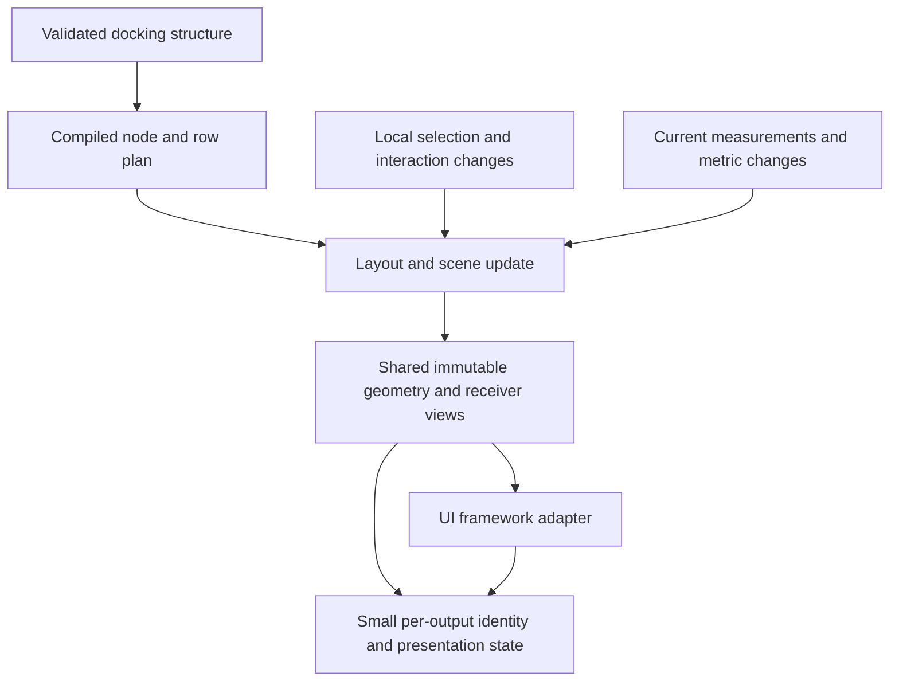

# Docking core cost model and architectural root causes

Date: 2026-11-06. Base: `0a1dcf89727a84f5b58ca852fe2162ff9b3f3713`.

## Judgment

Keep renderer-independent docking as the product's central abstraction. Current
evidence identifies avoidable costs in state ownership, invalidation granularity
and repeated materialization of domain facts. They are implementation choices,
not consequences of using Rust or adapting multiple UI frameworks. Different
capabilities explain which work is required; they do not justify repeatedly
copying or reconstructing unchanged inputs.

The large ImGui gap alone cannot prove an architectural defect. The diagnosis
below relies on actual call paths, the existing renderer-free workload, the
isolated layout probe, and a single-variable immutable-ownership experiment.
No new general ImGui feature-parity or language-speed ratio is claimed.

## Necessary work and avoidable amplification

| Responsibility | Required semantics | Current amplification to address |
| --- | --- | --- |
| Durable docking state | Topology, selected tabs/MRU, stable identities and valid commands | Selection passes through a complete workspace clone, canonicalization and global reconciliation |
| Layout | Derive current rectangles from topology and measured constraints | Rebuild ordered maps/sets and many per-split temporary vectors instead of executing a compiled structural plan |
| Frame rollback | Publish all accepted changes atomically, or publish none | Immutable schema is copied together with mutable candidate state |
| Adapter seam | Accept current metrics and expose renderer-neutral geometry/actions | Rebuild keyed answer maps and rejoin inventories whose keys were already issued and filled by core |
| Scene integrity | Only valid, current scene facts may authorize interaction | Compiler output is subsequently re-traversed to rebuild expected rosters and temporary indexes |
| Historical output | Reject stale/wrong-host input and preserve exact output identity | Do not use output identity changes to force regeneration of geometry which has independent immutable provenance |
| Device support | Correct pointer/touch/keyboard behavior from the shown output | After exact geometry reuse misses, installation derives touch fragments before any query; any lazy redesign must account for first-use cost |

## Reproduction without either UI renderer

The existing `integration/dockspace-host-harness/examples/frame_cost.rs` uses
public core interfaces, a complete ordered recording sink, actual core
selection/resize/drag handling, output receipts and settlement. It performs no
epaint, egui, ImGui, font or GPU work. Default allocation is DHAT-wrapped System;
CPU timing uses its inactive mode, and allocation accounting runs separately.

The baseline uses 12 samples, three warmups and 16/128/1,024 leaves, two tabs
per leaf. ThinLTO and one codegen unit are enabled through the harness's release
profile environment. At 1,024 leaves:

| Scenario, update phase | p50 time | p50 allocation events | Requested bytes |
| --- | ---: | ---: | ---: |
| Idle | 1.971 ms | 4,840 | 18,299,336 |
| Select one tab | 14.206 ms | 116,451 | 54,928,016 |
| Change measurements | 13.225 ms | 69,903 | 77,026,484 |

The measurement-change case changes bounds and tab intrinsic width, not only
surface bounds. Selection uses the public current-item action, not the product
benchmark's two-frame physical click. These timings therefore do not replace
previous product numbers.

Counts include the harness's owned recording output and final commit. Requested
bytes sum allocation requests, including replacement buffers; they are neither
live heap nor RSS. In particular, the large recording Vec is host-owned. Do not
attribute every byte or every event to the core. Same-workload changes can
isolate a core cause while keeping that recorder constant.

The allocation growth at these three scales is broadly consistent with repeated
whole-inventory work and large constants. It does not establish a remaining
quadratic algorithm. The existing probe writes per-case p50/p95/max summaries;
it does not retain every individual timing sample. Treat the timing observations
as diagnosis, not a new formal product qualification.

## Confirmed mechanisms

### 1. Static schema cloned with each mutable rollback candidate

`DockEngine::candidate` clones `PresentationAuthorityState` while sharing the
Workspace Arc (`engine.rs:5916`). The authority owns a derived-Clone
`SceneRequirementManifest` (`engine/presentation_authority.rs:13`). At the base,
its surfaces BTreeMap owns `SurfaceRequirements`, which own sets/maps and
per-tab close-capability maps (`scene_manifest.rs:657`, `:851`). A routine
candidate therefore deep-copies immutable schema even on an idle frame.

The minimal experiment shares only that frozen surface inventory through Arc.
Popup rewriting uses copy-on-write; tickets, revisions, validation, native
routing and record contents are unchanged. The regression first fails because
cloning changes the frozen row's allocation identity, then verifies sharing and
that an active-popup rewrite cannot mutate the retained inactive snapshot.

The unchanged headless workload confirms the predicted allocation reduction:

| 1,024 leaves, p50 allocation events | Baseline | Shared manifest | Reduction |
| --- | ---: | ---: | ---: |
| Idle update | 4,840 | 2,793 | 42.3% |
| Idle settlement | 3,871 | 1,824 | 52.9% |
| Select update | 116,451 | 114,405 | 1.8% |
| Select settlement | 3,879 | 1,832 | 52.8% |
| Measurement-change update | 69,903 | 67,856 | 2.9% |

Each ordinary idle update or settlement avoids 2,047 allocation events at this
scale. Requested bytes decrease by 551,896 in each of those phases. This is a
core-owned change; the full recording sink and workload are byte-for-byte
unchanged. Selection removes 2,046 update allocations, so it has another
allocation for the newly published immutable inventory.

The frozen binaries were then run in two timing-only ABBA groups, 48 samples
and six warmups per process at all three scales. At 1,024 leaves, the four
baseline process medians for idle update span 1.896–2.049 ms; the four candidate
medians span 1.851–1.884 ms. Idle settlement medians span 0.567–0.601 ms versus
0.505–0.517 ms. Selection and changed-measurement update ranges overlap;
no broad latency improvement is qualified for those cases. Every process's
p50/p95/max is archived; these are ranges of separate medians, not pooled
percentiles. No full product requalification is claimed for this small pilot.

The new sharing/popup-isolation regression passed after failing on the baseline.
Workspace all-feature/all-target nextest passed 2,146 tests with the opt-in layout
probe skipped. Independent host default/serde runs passed 292/335. Workspace
correctness/suspicious Clippy, formatting and diff checks also passed. Native
all-feature/all-target nextest passed 556 tests with one existing wall-time
case skipped.

This proves one unnecessary ownership cost. It does not prove that every large
clone is unnecessary or that sharing the manifest resolves the whole gap.

### 2. A local selection uses the general structural transaction path

`ProductAction::SelectItem` becomes `WorkspaceCommand::Select`
(`engine/product_action.rs:610`). Preparation clones the entire workspace,
builds its item multiset, applies the command, canonicalizes and validates the
complete candidate, then compares item sets again (`operation.rs:518`).
`PreparedTransaction::into_parts` also compares the candidate with the original
(`transaction.rs:72`). The actual edit changes one selection/MRU entry.

Atomic rollback and validation remain required. Whole-workspace cloning and
canonicalization are not the only ways to satisfy them. A verified local edit
journal or a split between immutable structure and mutable per-tab state can
retain atomic publication without making selection a topology-sized rebuild.
A direct field assignment is not a valid replacement for the public transaction.

### 3. Selection, structural snapshots and surface rebuilding are coupled

Root fingerprints include selection and MRU along with topology
(`command.rs:135`). `try_rebuild_presentation_requirements` captures full root
snapshots before its unchanged-input early return
(`engine/presentation_authority.rs:235`, `:592`), and its draft derivation walks
all current surfaces/roots (`scene_compiler/requirements.rs:30`). Selection can
therefore rebuild the requirement/index inventory and invalidate Ready for its
entire affected surface even when split structure has not changed.

There is already a useful distinction: per-surface requirement revisions keep
unaffected surfaces authoritative. It would be incorrect to claim that every
selection invalidates every surface. The remaining issue is aggregate derivation
work and the granularity inside the changed surface. Selected content minima
can legitimately change layout, so geometry reuse must depend on actual metric
changes rather than assuming all tab selections preserve geometry.

### 4. Repeated keyed materialization at internal seams

The public `measure_surface_with` loops core-issued requirements and stores
answers in keyed maps (`runtime/measurement.rs:201`). The manifest then validates
the complete key sets again (`scene_manifest.rs:1063`). After compilation,
`PresentationPlanValidator` constructs expected pane rosters by traversing the
graph, and builds pane/bar/control/menu maps to rejoin the compiled rows
(`scene/validation.rs:669`, `:937`, `:991`). Layout projection itself builds
three ordered result maps and multiple vectors per split (`layout.rs:570`,
`:1043`). New scene installation separately derives hit and semantic inventories
and checks static paint executability (`scene/lifecycle.rs:1264`).

Each logical view may be necessary. Keyboard receivers intentionally differ from
clipped pointer receivers, for example (`semantic_manifest.rs:1`). The opportunity
is to construct and validate shared rows/indices once and expose the appropriate
views, not to erase those semantics. Independently delivered/untrusted facts must
still be checked at their real seam. Core-only construction can carry private,
unforgeable validated state rather than rebuilding the same proof by set joins.

### 5. Eager derived interaction geometry after reuse misses

Scene installation first calls `PresentationHitManifest::compile_reusing`,
which compares bounds, touch context and every re-emitted region. An exact match
shares the previous immutable `HitGeometry`, including pointer rows and touch
fragments, while keeping output authority independent
(`presentation_hit/geometry_reuse.rs:40`). A new scene/output therefore does
not necessarily regenerate touch geometry.

When that reuse fails, `compile_with_order` emits all hit rows, canonicalizes
them, builds touch fragments and compacts the result (`presentation_hit.rs:430`).
Touch compilation gathers splitters, protected chrome, allocation fragments and
neighbor structures before any query (`presentation_hit/touch.rs:147`). This
is genuine renderer-neutral functionality, with measured sampled cost during
resize. Further work can target repeated reuse-validation traversal, the eager
derivation after a miss, and safely broader reuse conditions.

A device/gesture-based shortcut is not sufficient: the next touch may target an
already shown output. Any deferred representation must remain tied to that exact
immutable geometry, preserve output lifetime and charge its first-use cost in
an interaction benchmark. No lazy/device shortcut is implemented in this pilot.

## Hypotheses ruled out

- Idle deep-copies the complete Workspace: false. `DockEngine::candidate` shares
  its Arc; existing structural-work tests assert zero deep workspace volume.
- Idle always recompiles the scene/hit program: false. `install_ready` returns
  the retained candidate for exact immutable plan identity or equality
  (`scene/lifecycle.rs:1233`). Existing CPU samples agree with this path.
- Scene validation reruns the full numerical layout solver: not observed. It
  reconstructs semantic rosters and geometry checks; the source does not call
  `project_root` or `measure_root` again in that validator.
- Every paint instruction performs a semantic-ID lookup: false. The ordinary
  program already links typed rows once (`scene/program.rs:715`). Receiver and
  DropTarget joins still incur ID lookup work; that is a narrower target.
- ImGui's drawing pipeline explains all remaining time: false. The headless
  core/recording workload still exhibits substantial selection/change cost.

## Refactor direction

Separate stable structure, mutable interaction state, immutable geometry and
per-output authority. Keep the external adapter interface small and let each UI
framework provide measurements and consume the same core-owned scene.

1. Share frozen inventories instead of copying them with every rollback candidate.
   The manifest experiment is the first narrowly verified instance.
2. Compile stable topology into dense node/child/parent tables. Keep measured
   constraints and reusable scratch storage separate from topology. Execute
   layout linearly over these tables; do not recreate structural traversal maps
   on every projection. The earlier isolated layout probe supplies the baseline.
3. Record actual dirty domains in the transaction, distinguishing topology,
   selection, measurements, policy and output authority. Apply verified local
   edits atomically, while retaining the complete fallback where dependency
   information requires a surface-wide change.
4. Build one canonical scene row inventory and link paint/hit/semantic views
   through private typed indices. Enforce scalar, geometry, membership, ordering
   and authority invariants during construction. Keep independent validation for
   external input and reference-oracle testing; do not simply disable checks.

Rollback, stale-output rejection, epochs, source membership, real Presented/
Dropped settlement, exact callback execution and all existing device behavior
remain requirements. None implies a full deep-copy of immutable schema, a new
ordered map per view, or a topology rebuild for every local edit.

Precise savings for the larger redesign are not established. The next acceptance
checks should include unchanged full product work/counters, scene/input behavior,
public host consumers, historical outputs and cold first-touch latency, alongside
absolute time, allocations and copied volume at all existing scales.

## Evidence and limits

[Evidence directory](2026-11-06-architecture-costs/) retains baseline/candidate
headless summaries and build/source metadata, two frozen timing ABBA groups,
regression failure/success and full scoped checks. `verification.json` checks
coverage, workload/output columns, the one-file source difference and hashes.
Two read-only native subagent dispatches did not produce usable messages; they
were interrupted and the investigation proceeded sequentially. An independent
read-only CLI review confirmed the ownership change, selection causal chain,
allocation comparison and timing ranges. Its P2 finding about existing geometry
reuse was corrected in the table and section 5; the original review and closure
record remain in the evidence archive.

The existing headless probe exposes summaries rather than individual samples;
no exact percentile re-computation from unretained timing rows is possible.
Allocation counts are separately instrumented observations. No claim is made
about GPU/native presentation, real input latency, RSS or all-platform results.
