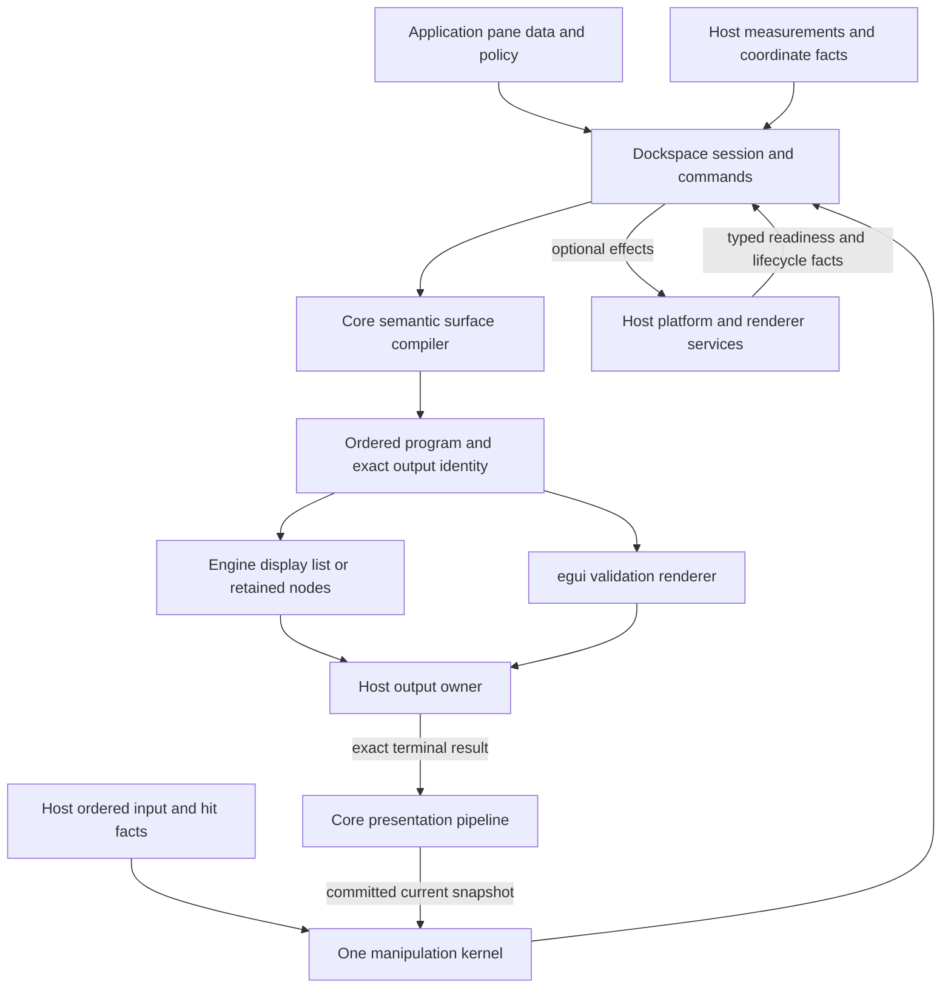
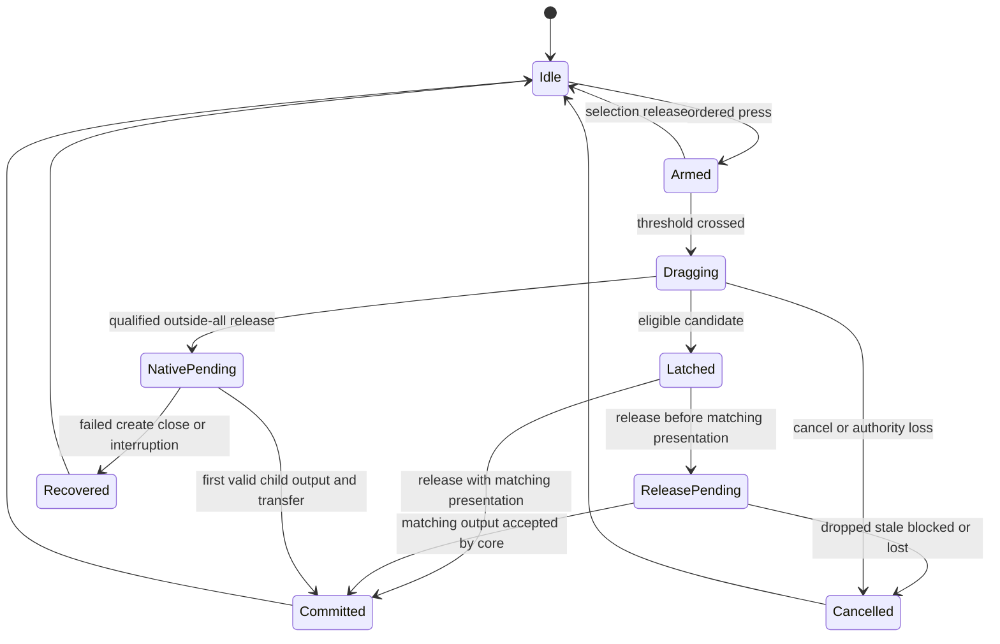
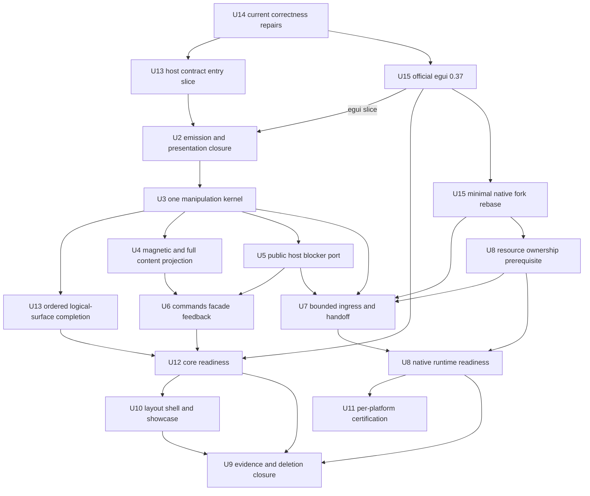

# Dockspace engine host architecture and direct manipulation - Plan

## Goal Capsule

| Field | Contract |
| --- | --- |
| Objective | Deliver `dockspace` as a renderer-neutral docking library for a custom game engine's self-drawn editor UI, with mature local and contained interaction and an optional native multiview host contract. |
| Primary consumer | An engine owns its UI tree or display list, renderer, frame scheduling, input delivery, and platform windows. It integrates through documented public `dockspace` APIs without egui. |
| Validation | A small external Rust consumer proves host independence; egui is the maintained interactive reference adapter. ImGui docking supplies architectural and behavioral comparisons. |
| Authority | Core owns topology, policy, selection, target resolution, transient layout, terminal mutation, persistence identity, and native transfer semantics. Hosts own framework input facts, actual output disposition, and OS or renderer resources. |
| Execution profile | Breaking replacement. Close the current correctness defects, establish the engine host contract, modernize egui, then converge interaction and optional native lifecycle owners. |
| Stop conditions | Reject duplicate topology owners, renderer-selected targets, traversal receipts presented as GPU proof, lost input boundaries, stale output authority, and capabilities inferred from missing facts. |
| Completion owner | Each implementation unit owns its replacement behavior, meaningful verification, obsolete-path deletion, and documentation. No compatibility layer is required. |

Current readiness (2026-11-01): the complete plan remains in progress. The
renderer-neutral public host, local/contained egui behavior, and U3c complete
single-batch Burst matrix have qualified checkpoints, including U12's public
host/package acceptance. No new core blocker was confirmed in the current
bounded review. Continuous X11 input, finite center/edge/nested physical targets,
fractional create placement, selected-capacity models and W16/O256 real windows
have scoped qualifications. Finite native stationary scheduling is qualified
with truthful missing-fact rejection and same-gesture recovery. The native
close/reopen/lock slice has 40 passing final checks; the following renderer-neutral
terminal replacement boundary has 22, including the new-key and replay-rollback
contracts. Both retain their exact source scope in `docs/VALIDATION.md`.

The next completion work is concrete:

| Remaining boundary | Next acceptance |
| --- | --- |
| U10 native layout management | Explicit external Root continuation passes all 61 final checks. Its application Default/preset call sites now retain the correct incoming host and pass eight affected checks, including extended real X11 eight/twelve-edit workflows. This closes the identified example wiring gap; broader U10 stationary acceptance remains open. |
| U10 native overflow | All 59 final checks pass, including the real `overflow-tab-before` X11 journey with exact preview, `[Anchor, Child, Main]` order and cleanup; compiler, disabled control/focus and queued-retirement regressions pass. Positive stationary OS scrolling remains a separate criterion. |
| U7/U8 capacity and service | The finite close/create cleanup plus accepted-release model now passes all 24 affected checks after repairing late-Failed cleanup. Finish the actual fork callback boundary and ordinary-command occupancy claim. Complete synchronous service in the finite 1 kHz profile has real Root/Child/standalone samples; the 2 ms cooperative yield target is not a hard OS scheduling guarantee. |
| U7/U10 positive stationary input | Supply independently proven fresh capture/delivery facts before enabling successful automatic OS selection/scrolling. The current negative X11 journey cannot close this positive criterion. |
| U11 platform claims | Qualify macOS/Windows or additional mixed-DPI/backend claims before enabling them. Their unavailable facts do not block the renderer-neutral host contract. |
| U9 reproducible delivery | Commit the final fork seams, synchronize obtainable dependency revisions and lockfiles, verify a clean checkout without local overrides, and refresh core/adapter package consumers and final documentation. |

Open-GPUI and the user's actual engine remain outside the completion dependencies.
Exact results, limitations and failed attempts live in `docs/VALIDATION.md`;
historical checkpoints below retain their original source scope.

---

## Product Contract

### Summary

`dockspace` is the product; `egui_dockspace` and its native integration are reference consumers.
The core must support both immediate consumption of an ordered surface program and an engine compiling that program into its own display list or retained UI nodes.
The engine need not adopt egui's widget identities, multipass layout, callback lifecycle, graphics backend, or window manager.

The existing stable Item/Root/Surface model, validated layout mutations, measurement separation, and versioned persistence remain useful foundations.
The refactor removes duplicate gesture terminal paths and framework assumptions while retaining exact output identity, stale rejection, cancellation, and recoverable native transfer.

This revision changes the product priority of the earlier experience plan in place.
It preserves R1-R18 and U1-U12 identifiers while revising their host and delivery contracts, adds host requirements R19-R24, separates layout-shell requirement R25, and adds units U13-U15, and leaves implementation progress in Git and `docs/VALIDATION.md`.
The earlier product-boundary plan remains context for persistence and semantic ownership; this plan governs the current host, interaction, and delivery priorities.

### Problem Frame

A renderer-neutral dependency graph alone does not establish a usable engine integration.
Current rendering entry points borrow an active frame, some necessary host APIs are hidden, SourceGap text prescribes widget registration, and the default API requirements conflate application code with renderer-host code.
Input and release decisions also remain distributed across local, journal, and contained reducers.

The native adapter currently embeds framework-specific output, hidden-stage, receiver, and retirement maps around the core lifecycle.
The engine needs the semantic lifecycle guarantees, but should not implement eframe's precise sequence of callbacks and staging passes.
The previous emphasis on an egui product release does not adequately test this distinction.

### Key Decisions

- KD1. Keep this as the canonical interaction and host architecture plan, with the earlier authority and conformance plans retained as historical context. Governs R1-R25.
- KD2. Preserve the stable core topology and transaction authority. Borrow ImGui behavior and platform/renderer separation without importing its binary tree, global context, or per-frame window lifetime model. Governs R2, R9-R15, R19-R22.
- KD3. Permit breaking replacement and delete superseded APIs, reducers, and sidecars with each completed replacement. Governs R9-R16, R19-R24. (session-settled: user-directed - chosen over compatibility layers: correctness and clean ownership take priority)
- KD4. Deliver local and contained engine use before requiring native platform certification. Native multiview remains a core capability with a later readiness checkpoint; individual platform claims require their own evidence. Governs R6, R13-R15, R18-R20.
- KD5. Use one magnetic target solver. Guide icons explain its highest-priority explicit fields; arrangement lock is a separate policy. Governs R3, R4, R7.
- KD6. Make host evidence explicit and framework-neutral. An adapter may advertise only the output and hit authority it can actually supply; an egui limitation does not become a universal core limitation. Governs R11, R12, R16, R19-R22.
- KD7. Make the custom engine host the primary integration audience and egui the interactive validation adapter. Governs R16, R18-R24. (session-settled: user-directed - chosen over egui-first product sequencing: the intended deployment is self-drawn game-engine editor UI)
- KD8. Defer Open-GPUI adapter development and cutover. Its historical algorithms remain optional reference material and do not gate this plan. Governs R18, R19, R23. (session-settled: user-directed - chosen over parallel adapter work: prioritize dockspace and egui validation)

### Requirements

#### Direct manipulation

- R1. A visible tab body is an ordinary drag entry. Below-threshold release selects; crossing the threshold begins one gesture. Ordered press, move, and release boundaries survive delivery within one host tick. Close and group-drag regions remain disjoint.
- R2. Reorder, merge, group drag, center docking, edge split, cancellation, stale rejection, and focus recovery use one semantic manipulation model. Center merge preserves relative item order.
- R3. Core owns magnetic acquisition, priority, latch, hysteresis, and deterministic ties. Explicit guide and tab-gap hits outrank an outer-root band, then the deepest eligible pane basin. A rejected front candidate never silently falls through to another target.
- R4. Release uses the logical latch. A matching current presented preview may commit once; an unpresented preview freezes a pending release until its exact output is accepted as current presentation under R11. Discard, invalidation, or cancellation cannot commit it. No-latch release inside an application surface uses contained placement; outside-all release requires R6.
- R5. Contained move and eight-direction resize project chrome, tab strip, pane content, hit geometry, and semantics together. Durable placement changes only at terminal commit. The active source projection does not hide eligible targets behind it.
- R6. Native promotion requires complete facts for the chosen input lane, target inventory, placement/work area, lifecycle, and release. Missing native facts produce a typed pending, unsupported, or cancelled outcome and preserve a recoverable source; they never silently choose another presentation mode.
- R7. Core exposes common-path semantic commands for select, close, directional dock, float, and dock back. Adapters provide discoverable chrome; the later layout-management shell is R25. Tab, group, contained title, and close controls have one semantic owner; Close Group and Dock Back are distinct operations.
- R8. Manipulations expose typed pending and terminal outcomes, stable deduplication identity, disabled reasons, and semantic focus intent. Hosts choose the visual status surface and accessibility bridge. Feedback never steals focus or replaces pane content; live motion does not announce each pixel.

#### Interaction, output, and optional native lifecycle

- R9. One private manipulation kernel owns arming, sequence, source, lane, target latch, dwell, transient projection, release barrier, cancellation, and terminal result. Framework response adapters and platform journals normalize facts without owning separate terminal reducers.
- R10. Core emits one ordered hierarchical surface program for geometry, clipping, content slots, semantic controls, source gaps, previews, guides, menus, and feedback. It is a semantic composition contract rather than an egui widget or graphics API. Paint, hit, and semantic identities derive from the same snapshot.
- R11. Program acceptance and current presentation are distinct. Successful complete traversal proves emission to an accepting host, not GPU submission. A host reports one exact output's terminal presented or dropped result at the boundary it owns; core validates and commits that observation before promoting interaction authority. Submission alone does not imply presentation, and physical scanout is not claimed. Discard and unwind abandon the exact output. There is no public preview-only acknowledgement bypass.
- R12. Hosts supply typed docking-hover answers for a specific accepted output: candidate, blocked, no receiver, or unknown. Ordinary pane content may pass this lane while popup, modal, foreign overlay, explicit blocker, and ambiguous identity stop it. Framework hit-stack inspection is adapter work; core does not implement an external widget-tree resolver.
- R13. Buffered host input uses bounded, causal, retryable batches under the resource budgets. Idle motion may coalesce before sequencing; active gesture edges and their ordering are preserved. Output, lifecycle, capture, contact, scroll phase, focus, close, inventory, and capability boundaries are barriers.
- R14. Surface-local and desktop-global input have explicit scopes. A gesture freezes its admitted lane; changing providers or scope requires validated continuity of sequence, device/contact, held buttons, capture, and delivery. Local operations never require unavailable desktop-global facts. egui local responses remain adapter evidence, not a distinct core transaction kind.
- R15. One core native runtime owns desired viewport bindings, pending transfer, admission, close, recovery, and retirement by incarnation. The host owns OS and renderer resources. The source retains durable ownership until the child is ready with its exact first valid interactive output; core then publishes transfer once. Hosts may use hidden staging internally, but fixed PreShow/PostShow rendering passes are not universal core requirements. Late predecessor facts cannot affect successors.
- R16. Public integration has two audiences. Application facades hide host plumbing; engine hosts receive documented surface registration, measurement, input, program execution, output disposition, focus/repaint, and optional native-effect APIs. Layout and semantic-command use remains valid without enrolling pointer or native services. Internal graph nodes, reducer internals, provider bookkeeping, and arbitrary target/preview constructors remain private. Required host methods are not hidden documentation seams.
- R17. Pointer, keyboard, menu, and accessibility actions converge on the same prepared commands. Disabled or occluded controls cannot execute. Dwell never guesses pane focus. A SourceGap preserves source identity and explicitly retained semantic behavior; widgets and AccessKit registrations are adapter implementations.
- R18. Acceptance includes semantic journeys through an independent public consumer and egui. Model, recorded-output, real-window, and physical-input evidence are labelled separately. Queues and lifecycle state reach bounded quiescence. Platform capability-negative results do not certify physical interaction.

#### Engine host and dependency independence

- R19. An ordinary external Rust consumer can integrate using only public `dockspace` and application types. Default and persistence-enabled core dependencies and public types exclude egui, eframe, AccessKit, Winit, WGPU, and GPUI.
- R20. A logical Surface is a core layout/presentation boundary, not an OS-window identity. Hosts may use multiple surfaces within one window or render targets, and may bind surfaces to native windows when supported. Local routing, logical coordinates, desktop placement, framebuffer density, and DPI mappings remain explicit rather than inferred from each other.
- R21. Hosts can compile a borrowed surface program into their own owned display list or retained-node update, release the frame borrow, and execute that output later. The opaque output identity survives without cloning internal authority. Superseded, dropped, or retired output cannot promote its receivers.
- R22. The core requires no widget tree, font shaper, graphics device, event-loop implementation, or wall-clock polling. Hosts supply measurements, monotonic event times, typed blocker facts, output disposition, and wake/focus execution. Cached valid measurements are allowed; a new asynchronous layout framework is not required.
- R23. Maintain egui validation on a pinned current stable release and a matching minimal fork where necessary. Core architecture and readiness do not depend on retaining a particular egui fork. egui_tiles remains reference-only; Open-GPUI development is deferred by KD8.
- R24. Host portability and structural cost are verified before declaring core readiness. Immediate and deferred consumption, two logical surfaces without native windows, bounded work at 16/128/1,024 panes, and exact stale-output rejection use the same public host contract.

#### Layout-management completion

- R25. The later editor shell provides closed-item inventory/reopen, arrangement lock, reset/default layout, application-owned named presets, complete overflow ownership, and restore-time focus/missing-pane recovery. These commands use the same core authority and are completed by U10; they do not block U12 common-path readiness.

### Actors and Key Flows

- A1. Engine/application authors own pane data, drawing, UI objects, event loop, platform resources, and policy decisions.
- A2. `dockspace` owns semantic and durable docking state and produces typed host work.
- A3. egui and native adapters translate framework facts and execute host work.
- A4. Independent-consumer, product, and physical executors supply evidence at their stated strength.

- F1. Host supplies ordered input and current measurements; core reduces one gesture and compiles a surface snapshot; host accepts its program and retains the output identity. Covers R1-R5, R9-R12, R19-R22.
- F2. Host finalizes or drops that output; a core commit accepts the exact observation; receivers and a pending release advance together. Covers R4, R11, R18, R21.
- F3. Engine compiles records to owned UI/render work, ends the frame borrow, and later submits or drops its output without retaining internal graph access. Covers R10, R16, R19-R22.
- F4. Optional native create/ready/first-live either transfers the source once or recovers it, followed by close and retirement. Covers R6, R14, R15, R20.
- F5. Application close decisions produce ordinary semantic commands; the later default/preset shell extends them under R25. Adapters render status and focus intent. Covers R7, R8, R16, R17, R25.

### Acceptance Examples

| ID | Given / When | Required outcome | Covers |
| --- | --- | --- | --- |
| AE1 | Drag over a real text editor, scroll region, button, or canvas to three non-guide points in each basin | Correct target preview and one commit; actual child-widget bounds establish the input point | R1-R4, R12, R18 |
| AE1b | A host cannot provide exact target-side blocker facts or terminal output disposition | Typed missing capability and unchanged source; unrelated local operations still work | R6, R11, R12, R14 |
| AE2 | Acquired edge target jitters and releases within its hysteresis margin | The matching latched candidate wins without adjacent flicker | R3, R4 |
| AE3 | Move or resize an overlapping contained inspector | Full pane subtree, hit data, and semantic bounds follow; one durable terminal result | R5, R10 |
| AE4 | Release before the output owner finalizes its preview, including an entire gesture in one tick | Pending release commits only after exact presentation acceptance, or cancels on drop | R1, R4, R11 |
| AE5 | The final output is discarded, superseded, fails, or unwinds | No preview-only ACK can authorize a mutation; prior valid presentation remains consistent | R4, R11, R21 |
| AE6 | Create or replace a child viewport while old callbacks arrive late | Single owner, first-live transfer, recoverable failure, and no successor corruption | R6, R15 |
| AE7 | Sustained high-rate input or uncompressible overload | Ordered accepted edges, bounded queues, explicit terminal overload, and recoverable source | R13, R18 |
| AE8 | Close tab/group/contained root or choose Dock Back | Exactly the named operation and close policy execute, with no overlapping control owner | R7, R17 |
| AE9 | Splitter, keyboard, accessibility, and local touch manipulate a layout | Shared command semantics, rollback on loss/cancel, and ordinary pane scrolling before touch arming; locked-layout cases are certified with U10 | R7, R9, R17, R25 |
| AE10 | Close, dock, reopen, restore, or reject a manipulation | Stable focus successor and one typed feedback outcome without focus theft; reopen/restore is certified with U10 | R8, R17, R25 |
| AE11 | A platform lacks required cross-window facts | Its native claim stays unavailable while proven local/contained operations remain usable | R6, R14, R18 |
| AE12 | An external crate uses only public `dockspace`, fixed metrics, and a recording renderer | Local journeys run with no UI-framework dependency or private test imports | R16, R19, R22, R24 |
| AE13 | Compile to owned records, drop frame borrows, then accept outputs out of order | Deferred output works; obsolete output cannot replace the current receiver artifact | R11, R21, R24 |
| AE14 | Route two logical surfaces in one host window and vary framebuffer density separately from DPI | Correct local coordinates and targets without enrolling native lifecycle | R14, R20, R24 |

### Success Criteria and Resource Budgets

| Signal | Exit criterion |
| --- | --- |
| Host independence | The public consumer satisfies AE12-AE14 with default and serde core configurations and no UI/platform framework dependency. |
| Ordinary docking | Five basins x three non-guide samples x four cadences pass in public-host and egui executors; the Burst row is not ignored. |
| Contained manipulation | Full content/hit/semantic projection during move and eight-direction resize; one terminal mutation. |
| Blocker correctness | Actual child-widget bounds and popup/modal/overlay/front-contained cases verify R12. |
| Structural cost | At 16, 128, and 1,024 panes, counted compiler/resolver work and recorded retained-state size do not regress into repeated full-workspace scans per operation. Native queue budgets are measured separately. |
| Optional native readiness | Programmatic lifecycle, failure/replacement/close cases, and at least the qualified X11 physical reference journey prove the native claims made. |
| Platform claims | Each OS/backend claim has its own deterministic, real-window, and physical evidence; unsupported facts remain explicit. |

The following are initial buffered-input/native-host release budgets, not a requirement for the engine to adopt a particular event loop or allocate a journal when it has no buffered ingress.
Use one injected monotonic time source for age and latency; deterministic tests use controlled time.

| Resource | Budget | Measurement boundary |
| --- | --- | --- |
| Active ingress journal | 4,096 records, 4 MiB resident owned data, 250 ms oldest-record age | Fixed envelope plus owned payload capacity; shared sidecars charged once by their owner. |
| One reduction batch | 256 records or a 2 ms cooperative yield threshold, whichever is reached first | From immutable prefix claim to reducer yield; checks occur between atomic operations, and elapsed overruns remain measured. Barriers terminate a batch and the next claim resumes at its exact ordinal. This is not a hard OS scheduling or indivisible-operation wall-time cap. |
| Release latency | 100 ms under a 1,000 Hz active-input profile | Accepted release edge to typed terminal outcome, excluding an explicitly pending OS create or unavailable renderer. Those outcomes remain visible and cancellable. |
| Retained lifecycle detail | 64 recent terminal summaries per binding and 1,024 monotonic IDs per session watermark | No authority-bearing geometry or receipts in terminal summaries. |
| Lifecycle soak | 10,000 cycles, zero active obligations after quiescence | Bound output, receiver, route, reservation, effect, timer, and retirement state. |

Each active buffered stream reserves an overload terminal latch outside ordinary capacity.
After a cap is crossed, ordinary ingress freezes, accepted predecessors are consumed in order, then overload cancels and restores the last valid source.
The overload path must not allocate another ordinary record or discard an accepted release/capture/lifecycle barrier.

### Scope Boundaries

In scope: core public host contract, ordered semantic programs, local and contained interaction, optional native lifecycle semantics, egui validation and dependency modernization, persistence/layout commands, meaningful conformance, and removal of obsolete paths.

Deferred: Open-GPUI adapter work; cloud/collaborative layouts; physical cross-window touch/pen until their facts are proven; automated Windows/macOS physical infrastructure when no stable environment is available.
Windows/macOS certification remains U11 and gates their capability claims, not generic core readiness.

Outside the product: an actual game engine, ECS integration, a font or widget system, a graphics API, an autonomous window manager, a universal GUI automation DSL, compile-time source scanners, and a security boundary against a dishonest host.
The host is trusted to report real facts; exact identity and ordering reject accidental stale, foreign, or contradictory reports.
No zero-allocation, `no_std`, C ABI, plugin ABI, or arbitrary render-thread scheduling framework is introduced without a concrete consumer requirement.

---

## Planning Contract

### Key Technical Decisions

- KTD1. Separate the application facade from the documented engine-host facade under R16. Keep `DockspaceSession` as the integration boundary and deepen its existing modules before adding another public controller. Implements KD7. (session-settled: user-directed - chosen over an egui-shaped universal facade: engine hosts are the primary consumer)
- KTD2. Keep `SurfaceProgram` as the semantic composition protocol under R10/R21. Input, cancellation, focus and wake processing occur through host input/effect ports rather than as side effects of painting feedback records. A host can consume it immediately or compile records into owned work; batching may preserve compositing semantics but cannot reorder overlapping operations or detach hit semantics from their snapshot.
- KTD3. Put gesture lifetime and terminality in one private module under R9. Move old local/journal/contained decisions into it and delete their independent release and preview-ACK paths.
- KTD4. Keep semantic target acquisition in core under R3. Host hit queries authorize an exact semantic candidate or block it; renderers never choose another target after a rejection.
- KTD5. Preserve the single magnetic profile under KD5. Configure logical distances and dwell in core; adapt cursors, visuals, touch affordances, and accessibility in hosts.
- KTD6. Make the existing presentation pipeline the only current-output promotion path under R11. Execution receipts bind exact attempt/output/contribution/interaction but attest only complete emission. Adapter pass bridges normalize framework finalization and feed the same terminal reporting path; no generic GPU fence or pixel-visibility proof is added.
- KTD7. Separate causal ingress from per-incarnation host resources under R13/R15. Core owns semantic native transfer; the host's runtime joins output, receiver, resource, staging, no-frame, and retirement records without owning a second dock graph.
- KTD8. Support logical-surface input before desktop promotion under R14/R20. Validate handoff only when scope/provider changes, preserving one gesture and one terminal release rather than creating parallel sessions.
- KTD9. Extend the finite shared journey catalog under R18/R24. Add one normal public consumer with a recording renderer, not a new generic GUI DSL or independent target resolver.
- KTD10. Use replacement deletion gates under KD3. No unit completes with old and new terminal owners both callable.
- KTD11. Keep content data, font shaping, draw resources, and named-preset storage application-owned under R7/R22. Core owns stable item identity, close decisions, command results, and versioned docking documents.
- KTD12. Measure boundedness at the owner of each queue or retained resource under R13/R24. Deterministic structural counters cover algorithmic work; host measurements cover wall-clock cost and latency.
- KTD13. Implement R12 as a host port. An engine can answer from its own composed UI; the egui fork may expose a narrow final-pass stack query. Portable egui must expose its exact unavailable boundary rather than approximate popup/modal authority.
- KTD14. Use `integration/dockspace-host-harness/` as an excluded, ordinary downstream workspace depending only on public `dockspace` and small test dependencies. Its recording renderer owns records after the frame borrow and uses the same output reporting contract as real hosts. Implements KD7 and R19/R21/R24.
- KTD15. Upgrade the official egui adapter to 0.37.0 as a separate change under R23. Rebuild only admitted fork seams on the same upstream release before advancing native certification; do not merge stale experimental fork branches wholesale.
- KTD16. Keep first-live as an engine-implementable readiness condition under R15. Distinguish desired binding, renderer/window readiness, durable item ownership, and recovery resources; fixed hidden-stage passes are host strategy rather than universal core phases.

### High-Level Technical Design



```mermaid
sequenceDiagram
  participant H as Engine host
  participant C as Dockspace
  participant R as Host renderer
  H->>C: Ordered facts and valid measurements
  C-->>H: Borrowed semantic program and output identity
  H->>H: Compile into owned records
  H->>C: Complete emission and commit host frame
  Note over H,R: Frame borrow is released; host controls scheduling
  H->>R: Submit owned output
  alt owner finalizes exact output as current
    R-->>H: Host terminal disposition
    H->>C: Report exact presented output
    H->>C: Commit observation
    C-->>H: Current receiver artifact and pending gesture result
  else output dropped or superseded
    H->>C: Report exact dropped output
    C-->>H: No new receiver authority or release commit
  end
```



### Host Boundary

| Host supplies or executes | Core supplies or owns | Kept out of core |
| --- | --- | --- |
| Surface bounds, scale mappings, text/chrome metrics, pane minima | Layout requirements, deterministic geometry, measurement validity | Font shaping, DPI guesses, renderer resources |
| Ordered pointer/contact/keyboard and target-side blocker facts | Gesture sequencing, target policy, cancellation, prepared commands | egui Response lifecycle, raw OS callbacks |
| Accept or compile semantic program, preserve content slots | Ordered composition, identities, clip/hit/semantic records | Galley, AccessKit nodes, vertices, render graph |
| Terminal output disposition and wake/focus execution | Current presentation and exact receiver identity | Output-shape parsing, GPU fences, host scheduling policy |
| Optional create/destroy/place/show and renderer readiness | Desired native lifecycle, pending transfer, close and recovery semantics | OS handles, swapchains, mandatory eframe staging choreography |

### Default Interaction Profile

These defaults implement R1/R3/R5/R7/R8/R17; they remain core logical units rather than egui pixels.
Hosts may style the controls and supply measured dimensions without changing target priority or terminal rules.

| Behavior | Default |
| --- | --- |
| Drag arming | 6 logical-point threshold; below-threshold release selects |
| Magnetic center | Central 52% by 52% of the target content rectangle |
| Other directions | Normalized nearest edge outside the center; outer-root band is 15% of the short side, clamped to 32-72 logical points |
| Target stability | 8 logical-point release hysteresis with deterministic switch advantage |
| Hover selection | Optional 150 ms event-time dwell, reset by target/semantic scene/gesture/stream/policy change; same-geometry emissions preserve the origin, execution needs current output proof; never implies pane focus |
| Temporary suppression | Shift disables magnetic acquisition in the default editor profile; R25 arrangement lock remains independent |
| Local touch | 350 ms long press and 8-point slop; pre-arm movement yields to pane scrolling, early release activates/selects, armed stationary release opens a semantic context menu |
| Resize and controls | Eight disjoint contained directions; existing mouse/pen/unknown geometry stays independent. Explicit Touch requests at least 44 logical points for resize targets before surface, root, protected-chrome and occlusion clipping; junctions outrank ordinary handles and final same-stack ambiguity is rejected |
| Splitter commands | 16-point keyboard/accessibility adjustment; double-click equalizes only the adjacent pair while preserving their combined share |
| Overflow completion | Under R25, one owner at a time: selected-tab reveal, manual scrollbar, active-drag edge scroll, or menu selection; clipped subcontrols cannot execute. Local edge scroll uses a 24-point content band capped at half-width, a 50ms interval and one scroll-line step per current-output continuation |

Focus intent under R8/R17 uses the following successors.
Native window focus and pane-content focus still require actual host facts and are not inferred from semantic selection.

| Action | Semantic successor |
| --- | --- |
| Select | Selected tab; pane-content focus changes only through explicit request/observation |
| Reorder or dock | Moved item; retain intent until its matching presented semantic node exists |
| Close tab | Next visual tab, otherwise previous tab, group handle, then root workspace |
| Close group | Previously active destination/root item when available, otherwise root workspace |
| Popup dismissal | Invoking tab/group/control, or the relevant close/reset successor if it disappeared |
| Reopen, reset, preset restore | Under R25, reopened item or prior stable focused item when present, otherwise primary selection/root workspace |
| Pending, rejected, recovered, or fatal status | No focus change; announce the inert status once |

### Dependency and Fork Adaptation

The 2026-10-27 selection audit chose egui/eframe 0.37.0, released 2026-10-15,
with Rust 1.95 still matching this workspace. The current workspace and official
harness now pin the matched 0.37.0 family. The optional native adapter is locally
qualified against the rebased, unpublished 0.37 fork; its tracked pins still name
the earlier fork and are not evidence that a clean checkout can reproduce the
new native seams. Winit remains on the reviewed 0.30.13 fork; prerelease 0.31 work
is not a prerequisite. The updated local egui_tiles checkout is reference
material; it is not a runtime dependency.

| Change or boundary | Adaptation work | Owner |
| --- | --- | --- |
| egui/eframe, paint crates, kittest, standalone harnesses | Move the matched 0.37 family together, including explicit feature choices and all lockfiles | U15 official slice |
| `WidgetType` replacement and accessibility changes | Audit Role mappings, invisible/clipped controls, popup/modal trees and assertions | egui adapter |
| ID API changes | Audit deprecated `Id::new` and ID-salt APIs while retaining stable docking item identities | egui adapter |
| Font/provider and glyph-cache changes | Keep shaping in adapter; use explicit fonts for deterministic metric tests | egui measurement and harnesses |
| `Context::root_ui`, `run_pass`, repaint observer | Review run/pass entry points and wake handling; public additions do not by themselves prove native finalization | egui pass bridge |
| Screenshot callback, new event/shape variants, scroll source | Update actual matching call sites and inspection/harness code; preserve output order and blocker semantics | egui and smoke code |
| eframe raw motion routing and window restoration fixes | Re-evaluate custom patches against upstream behavior before carrying them forward | native adapter/fork |
| Final-pass hits and host finalization | Compare exact 0.37 source against each admitted seam; retain only missing required facts | U15 native slice |
| Winit desktop pointer and work-area facts | Keep the reviewed 0.30.13 fork until an independently justified migration | native host |

Apply the official dependency update before broad egui refactoring so migration errors remain separable from semantic changes.
The native fork rebase must precede its U7/U8 qualification, but does not block the independent core host work.
Replacement fork revisions are implementation outputs, not invented plan pins.
When changed, manifests, lockfiles, CI pins, seam admission documentation, and runnable examples move together.

### Alternatives Considered

| Approach | Benefit | Cost / decision |
| --- | --- | --- |
| Deepen the current semantic core and expose a complete host contract | Reuses validated topology, persistence and stale rejection; supports engine-controlled rendering | Chosen; requires deleting duplicated terminal owners and framework assumptions |
| Make the egui product facade the universal integration interface | Lowest immediate adapter churn | Rejected; imposes widget/pass assumptions on the engine and cannot prove host independence |
| Replace core wholesale with ImGui/Open-GPUI structures | Concentrated reference behavior | Rejected; imports framework lifetimes and discards useful tested invariants; algorithms may still be reused selectively |

### Reference Architecture Decisions

The updated ImGui reference is `repo-ref/imgui` docking commit `d88f238d1d363ef387382b2e29ad12cf96f826ac` from 2026-10-15 (`1.93.1 WIP`).
Use `ImGuiPlatformIO` and per-viewport draw-data separation to check the host/renderer split, and its centralized docking request/preview code to compare gesture locality.
Its queued frame timing, binary dock tree, global context, previous-frame target acceptance, and `p_open` lifetime are not normative core contracts.
Keep window DPI distinct from framebuffer density; core logical coordinates also support non-window engine surfaces.

### Risks and Mitigations

| Risk | Consequence | Mitigation |
| --- | --- | --- |
| A nominal host API still needs egui behavior | Engine integration fails after the adapter appears complete | U13 consumer uses public core only and exercises deferred records and two logical surfaces |
| Stronger names than the evidence actually supplied | Preview or receiver authority advances too early | R11 assigns emission and terminal reporting distinct guarantees without a GPU-proof subsystem |
| A generic program becomes a widget toolkit | Excessive public API and renderer coupling | R10/R22 restrict the program to docking composition and semantic content slots |
| Native lifecycle remains tied to eframe stages | Every new engine backend duplicates a long choreography | R15/KTD16 separate core admission from host staging strategy |
| Dependency migration hides behavior regressions | Failures become difficult to attribute | Separate U14, U15 official, and U15 native slices with existing gates |
| Portability work becomes another test framework | Maintenance grows without product evidence | One ordinary consumer, finite journeys, no generic selector or GUI automation DSL |

### Sequencing and Readiness Checkpoints



U1's finite journey/oracle work continues as evidence for the behavior each replacement touches; existing valid cases are reused rather than restarted.
Core readiness (U12) means public engine integration plus egui local validation, without waiting for Open-GPUI or every native backend.
U5's common host port and truthful official-egui boundary satisfy U6/U12; exact fork-backed native hit parity is completed with U7/U8 after the native U15 slice.
Native readiness (U8, then U9) adds the optional core host lifecycle and qualified X11 reference.
U8's resource-ownership slice precedes U7's final capacity/overload integration;
its lifecycle and platform readiness verification still follows U7. Inspection
of the native callback path found that exact terminal admission otherwise needs
duplicate reservation maps for sidecars that U8 already requires joining.
This sequencing change preserves every U7/U8 exit criterion.
After the 2026-10-28 held-close ownership checkpoint, resume U3d's finite timed
continuation and U10's shared stationary overflow owner in core and official egui
before expanding the optional native overload/platform work. Metadata capture,
hover dwell and touch arming remain separate implementation/qualification steps;
the existing native resource checkpoint is retained. U3d now has a finite
core-owned stationary continuation, hover selection and explicit local-touch
source capture in official egui. Local active-drag edge scrolling shares that
continuation and the existing overflow owner. The following local-touch slice
binds expanded resize footprints to that same exact output; native stationary
capture still requires its own qualification. This priority change keeps
the custom-engine host central and does not remove U7/U8/U11 acceptance gates.
U11 gates Windows/macOS capability claims separately; unsupported backends remain explicit rather than blocking the generic crate.
These are packaging/readiness gates, not instructions to publish crates or upstream patches automatically.

---

## Implementation Units

### U14. Repair current configuration-dependent correctness defects

- **Goal:** Establish a sound baseline before changing dependencies or owners.
- **Requirements:** R11, R13, R15, R18; KTD6, KTD7.
- **Dependencies:** None.
- **Files:** `crates/egui_dockspace_native/src/coordinator.rs`, `crates/egui_dockspace_native/src/mailbox.rs`, `crates/egui_dockspace_native/src/host_frame.rs`, `crates/egui_dockspace_native/src/surface_driver.rs`, existing coordinator/mailbox tests, `.github/workflows/ci.yml`.
- **Approach:** Move required state updates out of debug assertions and ensure presentation commits drain in the same serial settlement boundary. Unify ordinary/staging/close submission exits where the existing presentation contract requires it.
- **Test scenarios:** With debug assertions disabled, create failure, pointer pass-through acknowledgement, terminal-roster rearm, and close settle correctly. An unchanged redraw followed by no input leaves the exact core/receiver artifact aligned and no pending ACK.
- **Verification:** Existing native tests pass in both assertion configurations; failed or abandoned host-frame retries do not duplicate output retirement.

### U15. Modernize the egui validation baseline and admitted fork seams

- **Goal:** Validate against the selected stable release without coupling core design to it.
- **Requirements:** R11, R12, R18, R23; KTD13, KTD15.
- **Dependencies:** U14 for the native regression baseline; official and native migration are separate reviewable slices.
- **Files:** `Cargo.toml`, all existing workspace/harness lockfiles and manifests, `crates/egui_dockspace/src/`, `integration/egui-official-harness/`, `integration/egui-product-harness/`, `integration/egui-fork-workspace/`, `integration/egui-native-smoke/`, `repo-ref/egui-release/`, `.github/workflows/ci.yml`, `docs/knowledge/egui-native-fork-seam-admission.md`.
- **Approach:** Apply the Dependency and Fork Adaptation table. Update official consumer/tests/examples first. Rebuild the minimal required native patch series on the same stable upstream before U7 qualification. Preserve unrelated dirty reference work.
- **Test scenarios:** Public consumer, font measurement, output-hook discard/unwind, IDs, accessibility clipping, popup/modal blockers, repaint, and native callback identity preserve their documented behavior across the update.
- **Verification:** Official 0.37 validation passes independently; the rebased fork has documented seam reasons and matching exact pins before native tests claim the new baseline. No UI dependency enters core.

### U13. Establish the public engine host contract

- **Goal:** Make self-drawn engine integration a first-class supported path.
- **Requirements:** R10-R12, R14, R16-R24; KTD1, KTD2, KTD6, KTD14.
- **Dependencies:** U14. Does not depend on the native fork rebase.
- **Files:** `crates/dockspace/src/runtime.rs`, `crates/dockspace/src/runtime/{session,host_frame,measurement,paint,presentation,interaction}.rs`, `crates/dockspace/README.md`, `integration/dockspace-host-harness/` (new), `Cargo.toml`, `.github/workflows/ci.yml`.
- **Approach:** Use two slices under this unit. The entry slice documents and exposes the necessary host facade, owned output records, renderer-neutral SourceGap obligations, and a tiny public consumer; it unblocks U2 without claiming complete pointer routing. The completion slice is implemented with U3's single manipulation owner and decouples ordered logical-surface input from native registration. One host-local producer retains one global event order; each edge carries independently qualified delivery/source and hover surface coordinates. Capture belongs to the host input domain, not the currently hovered logical surface. Surface removal or unavailable presentation invalidates the affected route rather than replacing the producer or resetting unrelated watermarks. Both slices are required for U13 completion.
- **Test scenarios:** Covers AE12-AE14. Compile owned records, release frame borrows, delay/drop/supersede outputs, reject stale receivers, and route two logical surfaces without OS-window enrollment. Verify default/serde dependency independence and layout/command use without pointer/native registration.
- **Verification:** The downstream crate uses no private modules, test-only authority constructors, or egui types; the documented host lifecycle is sufficient for its complete local journey.

### U1. Maintain the finite behavior spine and oracle classifications

- **Goal:** Preserve useful evidence while making engine-host and egui results comparable.
- **Requirements:** R1-R8, R17-R19, R24; KTD9.
- **Dependencies:** Reuse existing catalog immediately; add public-host execution after U13.
- **Files:** `crates/dockspace_host_conformance/src/`, `integration/dockspace-host-harness/`, `integration/egui-product-harness/tests/`, `docs/VALIDATION.md`.
- **Approach:** Keep L01-L08 and N01/P01 finite, add host scenarios AE12-AE14, and distinguish normative, characterization, and known-invalid observations. Replace failing behavior rather than relabeling it successful.
- **Test scenarios:** Center/four-edge semantic regions, complete same-tick gestures, hesitant releases, target loss, output drop, and local quiescence produce normalized observations without guide selectors or frame-count authority.
- **Verification:** Each claimed journey executes real public actions in its executor; catalog metadata alone is not a passing behavior test.

### U2. Close ordered emission and atomic current-output promotion

- **Goal:** Finish the existing program/presentation replacement for both engine and egui hosts.
- **Requirements:** R4, R5, R10-R12, R16, R21; KTD2, KTD6, KTD10.
- **Dependencies:** U13's entry slice and the relevant U1 journeys. Changes to the egui bridge additionally require U15's official slice; independent core work can proceed before it. U13's ordered-input completion is qualified with U3 and does not block this output-contract work.
- **Files:** `crates/dockspace/src/scene.rs`, `crates/dockspace/src/scene_compiler/`, `crates/dockspace/src/runtime/{paint,presentation,host_frame}.rs`, `crates/dockspace/src/{semantic_manifest,presentation_hit}.rs`, `crates/egui_dockspace/src/{output_proof,pass_settlement,product_dockspace}.rs`, public host harness and existing presentation tests.
- **Approach:** Retain U2a's canonical traversal and finish U2b's exact output commit path. Give execution receipts R11's limited meaning, remove public preview-only acknowledgement authority, and make receiver/semantic/program promotion one committed artifact. Treat mutable egui shape markers as adapter-local diagnostics unless their limited acceptance contract is explicitly proven.
- **Test scenarios:** Covers AE5/AE13. Complete/failed emission, dropped output, output-hook modification, unwind, late predecessor, failed core commit, and idle post-commit settlement never create mixed artifacts or release authority.
- **Verification:** One exact output path is used by public engine, egui, and native integrations; flat schedule reconstruction and preview-only acknowledgement bypasses are deleted.

Implementation evidence (2026-10-27): official egui now returns complete owned
output and an affine host disposition receipt, feeds exact core emissions, and
removes preview-only ACK and the old renderer-pass bridge. Conservative complete
span and pane callback checks qualify its single-layer contract. See
`docs/VALIDATION.md` for final gates, independent-review fixes and mutation-red
checks. This closes U2 output settlement; U3 retains the Burst and ordered-input
completion work.

### U3. Converge ordered manipulation and terminal state

- **Goal:** Make a gesture's complete lifecycle local to one deep core module.
- **Requirements:** R1-R4, R8, R9, R11, R14, R17; KTD3, KTD8, KTD10.
- **Dependencies:** U2.
- **Files:** `crates/dockspace/src/runtime/direct_manipulation.rs` or a focused module directory, `crates/dockspace/src/runtime/interaction.rs`, `crates/dockspace/src/{interaction,pointer_journal}.rs`, `crates/dockspace/src/engine/{host_frame,pointer_proof,provider_lifecycle,semantic_candidate,pointer_transaction,contained_adjustment,pointer_contained,pointer_splitter}.rs`, `crates/egui_dockspace/src/product_render/actions.rs`, public-host and product gesture tests.
- **Approach:** Normalize ordered input boundaries and semantic commands into one transaction owner. Replace the surface-fixed producer scope with a host-local input domain and event-bound qualified surface routes; retain the existing affine journal, exact receiver validation, drain and rollback. Source manipulation coordinates and target hover coordinates remain independent, including when two surfaces use identical local bounds. A departure from all logical surfaces grants no desktop outside-all fact. Keep semantic controls/scroll separate where their existing subsystem owns them. Remove old release/cancel/ACK terminal reducers and all inference of an event's surface from the producer lease rather than forwarding through them. A single-surface convenience API may wrap the same implementation without another terminal owner.
- **Test scenarios:** Covers AE2/AE4. Same-tick press/move/release, duplicate release, cancellation, capture/source/target loss, discarded preview, and policy changes produce one terminal outcome through both input adapters.
- **Verification:** Complete Burst cases enter ordinary passing gates; one core release barrier and cancellation owner remain.

Implementation is split at the host contract boundary:

1. **U3a — host input domain and shared terminal ownership.** Add one affine
   host-local producer, independently qualified manipulation/hover routes per
   edge, and public multi-surface batch submission without native enrollment.
   Reuse journal sequencing, receiver validation, frame rollback and drain.
   Merge tab/contained release consumption and owner cancellation across the
   existing entry points. Verify a complete public-host Burst, exact preview
   settlement, route isolation and retry before migrating the egui transport.
2. **U3b — ordered egui transport and legacy entry retirement.** Capture raw
   edges once per host/run boundary and qualify each chrome receiver at that
   edge's position. Submit to U3a's owner; UI reruns must not replay consumed
   edges. Remove pointer actions reconstructed from `Response`, the remaining
   local-response owner/frontends and internal preview ACK reducers. Migrate
   internal ACK fixtures to actual complete output observations. Keyboard,
   AccessKit and application commands retain their semantic entry points.
3. **U3c — full product matrix.** Run the original single-batch Burst without
   splitting it into input frames, and prove release/cancel/output/policy loss
   through both adapters. Retire the ignored gate only when this passes.
4. **U3d — timed input continuation.** Complete the already specified hover
   selection and local-touch profile through the same journal/gesture owner.
   Preserve device class and monotonic input time, expose only the finite
   gesture-bound wake/receiver challenge needed for stationary continuation,
   and reject stale output, owner, capture, policy and cancelled deadlines.
   Share that continuation boundary with U10 active-drag edge scrolling. A
   host schedules wakeups; it cannot mint pointer motion or mutate layout from
   a timer. Qualify 150 ms hover selection, 350 ms touch arming, 8-point slop,
   pre-arm pane scrolling, early activation and stationary context release.

The updated ImGui reference preserves event order by trickling queued input
across frames; this is evidence for retaining edges, not a same-frame Burst
implementation to copy. Official egui 0.37 exposes ordered raw events, but its
`Response` is a frame summary and cannot prove per-event widget ownership.
U3b must establish controlled chrome receiver facts; arbitrary application
widgets and blocker interoperability remain U5's explicit qualification work.
U3a alone does not complete U3 or the full U13/AE12-AE14 matrix.

Implementation evidence (2026-10-27): U3a now exposes the host-local public input
domain and shares tab/contained terminal consumption and exact-owner cancellation.
The public consumer executes complete ordered cross-surface releases, including
an unselected source, through actual owned recording-output settlement. Review
regressions cover source-only continuation after Raise, foreign pointer rejection
and presentation-stream takeover. See `docs/VALIDATION.md` for serialized final
gates and mutation-red evidence.

U3b transport progress (2026-10-28): the official egui adapter captures raw
events once at the owned run boundary and submits them before measurement and
paint. Reruns cannot replay successful or rejected packets. Click and drag
receiver lanes remain independent; exact output and completed-pass identities
bind the controlled chrome facts. Explicitly registered ordinary pane widgets
can pass the docking lane; unknown widgets and unsupported layer transforms
remain blocked. This does not certify arbitrary egui widget ancestry or popup
interoperability. Internal preview-only ACK reducers and renderer response-based
docking gesture producers are deleted. The original complete L03 product matrix,
including its unchanged single-batch Burst executor, now passes without ignore.

U3 replacement gate completed (2026-10-28): the core `LocalResponse` owner,
`SurfaceGesturePhase`, local gesture preparation/input APIs, local phase reducers,
local position identity, and gesture-specific `LocalReady` authority alternatives
are deleted. Every gesture now requires an admitted journal stream, a frozen
presented proof, capture authority and a threshold origin. Non-pointer candidate
commands remain in `semantic_candidate.rs` and `contained_adjustment.rs`; they do
not create another gesture owner. Useful presentation, contained and native
tests use actual host input and exact output settlement. U3c's unchanged complete
Burst matrix passes without ignore. Independent proof/continuation review and
fresh downstream gates are recorded in `docs/VALIDATION.md`.

The 2026-10-28 timing audit confirms U3a/U3b/U3c's migration and replacement
gates, but leaves U3d open. The follow-up input slice retains explicit device
class and optional monotonic time through core, local and native facade records.
The existing pointer ledger validates provider-wide time order and stable known
device class per live stream at its normal rollbackable commit boundary. Unknown
samples grant no device/time facts, overload keeps the provider clock, and only
a new provider may use a new origin. The official owned-run adapter forwards
explicit RawInput.time from the original ordered batch; reruns cannot replace it
with egui's predicted time. It retains Unknown device for generic pointer events
and does not claim per-OS-event timestamps.

The finite stationary slice now keeps one opaque continuation on the existing
active drag and returns it through an explicit non-motion journal edge. Its
150ms hover selection uses current framework/semantic receiver facts, retains
the dwell origin across equivalent emissions in the same stream, selects without
requesting content focus, and recaptures the same source for continued drag and
release. A valid source-only continuation may preserve an unselected source's
press activation; it never refreshes stale hover authority. Public-host and
official egui tests cover stationary execution, exact retry, no added focus and
final release. Motion only updates the challenge; timed selection uses an
explicit continuation after the host's accepted raw batch, preserving a release
which arrives at the deadline. Independent review found the source wake getter
too strict; its fix and a mutation-red inactive-source regression are recorded
in validation. A due Move+Release regression also guards terminal ordering.

The local-touch slice reuses the existing Pressed owner and click-bound finite
continuation. Explicit Touch contacts on manipulation chrome wait without Select,
Raise, focus or geometry changes. A current due continuation arms at 350ms;
pre-arm movement beyond 8 logical points yields to application content, early
release activates once, and stationary armed release emits a semantic context
menu request. Armed movement enters the same ordinary tab, splitter and contained
owners. Manipulation entry retains the displayed selection and contained order;
delivery performs the durable action. It does not revoke same-batch target
authority through an eager Select/Raise or broaden stale hover proof. Ordinary
close and strip/menu controls retain tap behavior with movement and release slop,
without a docking deadline.

The official egui adapter retains independent explicit-contact identities,
suppresses duplicate synthesized generic pointer ingress and reuses its existing
root presentation menu and prepared commands. Ordinary egui content input remains
owned by the pane. Public-host and product qualifications are recorded separately
in `docs/VALIDATION.md`; no physical touch-device claim follows from headless
journeys. Expanded local resize targets now share the exact output manifest,
device-aware query, receipt proof and gesture preparation. Explicit Touch uses
at least 44 logical points before clipping; all other device classes keep their
base geometry. Title/tab/close/menu chrome and visible front windows stay
protected; empty or ambiguous targets grant no input. A clipped-empty base
contained direction retains its semantic identity when a nonempty Touch fragment
is visible. Receiver descriptors continue to describe the base geometry. Native
metadata/stationary capture remains open. U10 local active-drag edge scrolling uses the
shared continuation owner; native stationary routing remains separate.
The full behavior plan cannot close before the remaining U3d qualification.

U3's replacement completion does not establish U4 full live-content projection, U5 broader
blocker qualification, U6's full command/focus contract, or U12 structural-cost
and engine-readiness certification. These remain separate gates.

### U4. Complete magnetic behavior and live contained content

- **Goal:** Deliver consistent direct manipulation through the host-neutral projection.
- **Requirements:** R2-R5, R8, R10, R17, R24; KTD2-KTD5.
- **Dependencies:** U3.
- **Files:** `crates/dockspace/src/drop_resolver.rs`, `crates/dockspace/src/scene_compiler/surface.rs`, `crates/dockspace/src/runtime/direct_manipulation.rs`, `crates/egui_dockspace/src/product_render/`, public-host and product projection tests.
- **Approach:** Apply transient placement before compiling contained chrome and pane subtrees. Preserve one target solver, source suppression, event-time dwell and frozen pending-release plan. Use cached valid measurements where possible.
- **Test scenarios:** Covers AE2/AE3. Non-guide basin samples, jitter, hysteresis-edge release, contained move/eight-way resize, target panes behind the source, and cancellation compare program, hit, semantic and durable results.
- **Verification:** Full pane content follows the projection; a window-sized empty ghost is insufficient. Structural cost meets R24.

Implementation boundary established by the post-U3 source review:

- Reuse `compile_contained_record`, `compile_root` and the existing surface
  compiler. Feed a core-owned effective outer rect before clipping, occlusion,
  chrome and subtree layout; do not scale cached pixels or add a second layout
  engine. Compiler and validator must consume the same authorized projection.
- Derive the projection from the active gesture or its frozen pending release.
  Only the existing terminal delivery path writes durable placement. A pending
  release keeps the complete content projection, not just a shell.
- Treat legal same-gesture projection updates separately from real scene,
  coordinate, policy or source loss. Changing the compiled scene must not cancel
  its own gesture or broaden old hover authority. Exact output settlement remains
  the release barrier.
- Separate source pixels from docking-target suppression: show the moved subtree
  once, but exclude the complete moving source from HoverDrop targeting and from
  occluding eligible targets behind it. Partial payloads, other contained roots,
  popups and unknown framework blockers do not gain blanket passthrough.
- Verify cached measurement coverage before introducing a reuse path; existing
  `PresentationLayoutFacts` alone have not yet been proven sufficient for every
  popup/measurement contribution. Do not invent a generic async layout cache.

The first implementation gates are multi-pane move with stable widget identity,
parameterized eight-way resize with subtree/hit/semantic agreement, an eligible
target behind the live source, pending Presented/Dropped settlement, and repeated
updates/cancellation without self-invalidation or redundant compilation.

### U5. Implement the host docking-hover port and egui blocker validation

- **Goal:** Authorize docking through ordinary content without crossing blockers.
- **Requirements:** R3, R12, R17-R19; KTD4, KTD13.
- **Dependencies:** U3 and U13; common egui coverage uses U15's official slice. The fork-backed native extension is qualified with U7/U8 after U15's native slice and does not block U6/U12.
- **Files:** `crates/dockspace/src/runtime/interaction.rs`, `crates/dockspace/src/runtime/native/pointer.rs`, `crates/egui_dockspace/src/product_render/`, `crates/egui_dockspace_native/src/receiver.rs`, the rebased egui hit-test seam, public-host and product blocker tests.
- **Approach:** Consume typed output-bound host answers through one port. Let the engine use its own composed UI facts; keep egui stack inspection in the adapter/fork and expose unsupported portable cases truthfully.
- **Test scenarios:** Covers AE1/AE1b. Actual TextEdit/ScrollArea/Button/canvas bounds, popup/modal/foreground overlay, explicit blocker, front contained root, unknown identity, and stale output prevent fallback through the front result.
- **Verification:** The public host consumes exact typed answers and official egui reports unsupported cases truthfully; no renderer reconstructs target policy from rectangles. U7/U8 additionally prove that the native path agrees on the same host-answer contract.

### U6. Finish core commands and the application-facing adapter loop

- **Goal:** Expose coherent product behavior without hiding required engine host APIs.
- **Requirements:** R7, R8, R16, R17, R19; KTD1, KTD11.
- **Dependencies:** U4 and U5.
- **Files:** `crates/dockspace/src/model/`, `crates/dockspace/src/runtime/{close,report,session}.rs`, `crates/egui_dockspace/src/{builder,product_dockspace,product_response}.rs`, `crates/egui_dockspace/src/product_render/`, existing examples, public-host and close/feedback tests.
- **Approach:** Keep R7 common-path stable-item commands and typed manipulation feedback in core; R25 layout-management commands stay in U10. Fix Close Group versus Dock Back, consume close decisions in examples, and map semantic focus intent to adapter behavior. One-call convenience remains an adapter concern.
- **Test scenarios:** Covers AE8 and the common-path portions of AE9/AE10; their R25 locked/reopen/restore cases remain in U10. Immediate/deferred close resolve exactly once, examples actually complete permitted closes, rejected/pending results deduplicate, and focus returns to the documented successor.
- **Verification:** Both public engine integration and the minimal egui example can discover and complete the common local workflow without raw graph or proof internals.

### U12. Certify core host readiness

- **Goal:** Make the reusable crate independently consumable before expanding native platforms.
- **Requirements:** R1-R5, R7-R12, R16-R24; KD7; KTD14.
- **Dependencies:** U6, U13, and U15's official slice.
- **Files:** `crates/dockspace/README.md`, public host harness, official/product harnesses, package manifests, `README.md`, `docs/VALIDATION.md`, `.github/workflows/ci.yml`.
- **Approach:** Package the core host contract, dependency independence, and complete local/contained journeys. Record adapter capability limits separately from core guarantees and give an engine author a complete integration example.
- **Test scenarios:** A clean downstream dependency resolves the published-shaped core API; the same normal journeys run through immediate/deferred public hosts and egui; no ignored Burst or old ACK remains a claimed passing gate.
- **Verification:** Core tarball, strict docs, dependency tree, public consumer, and common-path validation pass without Open-GPUI or platform-specific native certification.

### U7. Replace native callback throughput and add scoped input continuity

- **Goal:** Make optional native hosting bounded and preserve useful local behavior without desktop facts.
- **Requirements:** R6, R9, R11-R14, R18, R20; KTD7, KTD8, KTD12.
- **Dependencies:** U3, U5, U14, U15's native slice, and U8's resource-ownership prerequisite for final bounded terminal admission.
- **Files:** `crates/egui_dockspace_native/src/{mailbox,coordinator,pointer_event,input_control,surface_driver}.rs`, core ingress/pointer modules, native coordinator tests, public-host scoped-input tests.
- **Approach:** Replace one-callback-per-cycle front/ACK families with bounded immutable prefix claims. Establish surface-local routing and validated desktop handoff through the same core kernel; preserve exact output and lifecycle barriers.
- **Capacity integration:** Keep capture identity and original age through raw-to-core handoff until the committed boundary releases its source reservation. Share immutable recorded payloads across retry batches. On overload, freeze ordinary admission at one fixed capture boundary B; commit all currently replayable accepted input through B before an independent terminal cancellation frame. Accepted lifecycle records parked behind unresolved external dependencies retain their existing owner, capture identity, age and reservation across cancellation; they publish only after their original dependency and commit barriers settle. Post-boundary callbacks that settle existing affine output/create/command/close/window obligations use already reserved, once-only owner slots with original capture order; they do not move B or create a second unbounded journal. Neither an unresolved held-close successor nor an unrelated post-B terminal delays live-input cancellation; source reservations already transferred to core still require their complete original boundary commit. A new ordinary pointer callback rejected after freeze is not an accepted edge; the platform still processes it, and overload cancellation ends the surviving core input. Only successful cancellation commit resets translator state, preserving identity counters and without emitting synthetic releases or claiming an empty physical roster. Pending releases retain their separate exact-output obligations.
- **Storage implementation direction:** Reuse the serialized callback boundary for a bounded raw backing and one shared core/replay work allowance, instead of reserving a complete core payload copy for every queued source or introducing per-allocation authority tokens. Reclaim committed recorder payloads before the next raw transfer, or charge their actual overlap. Effect/presentation preludes and whole atomic terminal groups use the same allowance; the 256-record scheduling limit is not an atomic-group storage bound. Prospective complete-roster size must be checked from borrowed facts before capture, and existing terminal owners must reserve variable backing when their obligation is admitted. The final implementation must state and enforce the maximum complete roster and terminal fanout it can retain, without truncating Exact facts or dropping accepted terminals. Shared roster data is counted by allocation identity through its existing owners, without a persistent address registry.
- **Core capacity boundary:** Keep generic/core host recording unbounded unless its host selects a limit. The optional native profile can preallocate a finite recorder buffer and reserve batch, guard and retirement-receipt transport space for its complete admitted record set, including whole atomic groups. Final admission belongs at the recorder's single append boundary; finite snapshot/checkpoint construction also needs prospective checks. Capacity rejection preserves the existing producer/output owner and allows already accepted input to replay instead of trapping poll in a full-prelude error loop. Enrollment must reject insufficient storage before publishing an ownerless provider, without panic. Resource/adapter data and shared core allowance must be combined before claiming the total 4 MiB gate.
- **Prepared pointer transfer:** The public batch/sequence path uses bounded prepared journals, reserves their handle buffer, and charges journal contents once as they move into the recorder. Prospective final append may subtract only the safely reclaimable committed prefix; the staging peak retains all existing payloads, including committed data. A suspended replay receives no retirement credit. Recording stops at the first nonadmissible item and completes caller iteration and destruction before maintenance or append. Iterator panic, capacity rejection, and invalid later facts preserve the published workspace and producer watermarks. This closes the iterator-collection prerequisite, not the combined 4 MiB gate.
- **Binding terminal fact:** Destroyed-window input termination records one fixed-size exact-binding backend fact. Core derives affected held-button/capture streams and closes their scroll provider tails without adapter-generated pointer fanout. The original physical-window receipt retains once-only recording progress across later lifecycle failures and retirement moves; independent destruction/output/quiescence barriers remain authoritative. Do not reserve a synthetic pointer-record group per active device for this platform fact.
- **Test scenarios:** Covers AE7/AE11/AE14. Retry after a rejected batch, 10,000 interleaved records, sustained 1,000 Hz drag, overload, local touch coordinates, and scope/provider changes preserve one terminal release.
- **Verification:** Resource budgets hold and no unbounded journal or forced desktop-only local route remains.

Local fixed-boundary checkpoint (2026-10-29): ordinary source admission freezes
at 4,096 retained records or 250ms oldest age, retaining the first B. Existing
core boundaries and currently replayable input through B commit before one
exact overload cancellation; parked lifecycle dependencies and post-B terminals
retain their owner without delaying cancellation. Only its matching successful
commit resets translator state. Control/prelude frames remain inert, and the
terminal roster has one inline slot gated by full commit plus exact snapshot
settlement. Recovering and fatal modes are independent. The 4 MiB owned-capacity
measurement/preallocation, native scoped input, load/release latency and soak
remain unfinished; this checkpoint does not qualify the complete U7 budget.

Local capacity-measurement prerequisite (2026-10-29): the public session and
open-frame queries count recorded native transport envelopes, payload/vector
capacity, shared retry data once, replay buffers, and retirement receipt
storage. Commit and retirement do not falsely release backing capacity.
Unsupported semantic shapes fail explicitly instead of returning a partial
count. Host/pending-report buffers, reducer/candidate state and allocation
overhead are outside this narrow query. Actual 4 MiB ordinary admission,
raw-to-core peak reservations and protected variable-payload preallocation
remain unfinished.

The optional recorded-transport primitive now admits a host-selected record and
byte limit while the generic core/default facade remain unlimited. Its fixed
allowance includes actual recorder backing, a complete N-record replay batch,
the overlapping N-record commit guard, and the N-binding retirement receipt.
Payload capacity is charged once through the recorder; rollback and retirement
release only the corresponding retained charge. Enrollment initializes storage
and the first checkpoint before publishing either provider. Complete snapshot
and pointer-roster payload construction has a prospective check and explicit
vector capacities; every final append rechecks actual capacity before minting.
Full abandoned-effect or presentation preludes retain their existing owners and
allow the accepted prefix to commit. Matching partial presentation reports keep
their exact settlement set, and blocked or newly abandoned reports preserve the
input-pending barrier across suspended replay, dropped candidates, and commit.
The subsequent prepared-pointer transfer includes its journal handle buffer in
the fixed reservation and checks contents at both staging and final-append
peaks. The iterator's size hint cannot control allocation, and its construction,
iteration and destruction finish before maintenance. Producer maps and
adapter/resource owners still require the combined 4 MiB admission gate.
This checkpoint does not qualify U7.
Its prepared-transfer source passes 1,777 all-feature workspace tests, 80 public-host tests,
ten doctests, strict rustdoc and correctness/suspicious Clippy. Native tests pass
316 normally and 316 without native debug assertions; the local unpublished-fork
source also completes the macOS programmatic redock journey. These checks do not
certify physical input, mixed-DPI behavior or remotely reproducible fork pins.
A disposable-snapshot negative control prematurely credits committed data during
staging and fails the peak regression; restoring the implementation passes it.

Native owned-data integration now measures the existing host owners together:
raw and two shared roster backings; exact route/index, window/output/close and
retirement entries; snapshot/work-area sidecars; effect/input controls; pointer
devices and retained tombstones; core recorded transport and pending report
queues. Independent same-window entries remain charged, while roster and
abandoned-result backing is counted once through existing ownership. Boxed close
decisions and spare vector capacity are included. Native effect command storage
is restricted to its actual finite Close/Focus producers. The real-window smoke
samples the public app query at root boundaries and records a high-water mark.
This closes the current-data measurement gap, not prospective admission: shared
host/core allowance, original-owner future terminal reservations, constructor
peaks, scoped input and load/soak qualification remain required.
The source passes 1,778 all-feature workspace tests, 80 public-host tests, strict
docs/doctests and correctness/suspicious Clippy. Native tests pass 328 normally
and 328 without native debug assertions; macOS programmatic redock completes
with a sampled root-boundary high-water mark of 2,024,872 bytes. A targeted
duplicate-roster-charge control fails, and restoration passes. The complete 4 MiB
admission gate remains open despite this sampled workload fitting its target.

The native core-capacity slice now clips cursor claims to the facade's explicit
preparation allowance and streams translation into prepared journals. Temporary
full storage preserves the raw owner and translator candidate while the existing
accepted core prefix commits; empty-core permanent insufficiency remains an
explicit error. Effect results reclaim committed storage before retry, preserving
their affine result on rejection and their order ahead of subsequent pointer
recording. The bounded native qualification path is selected internally; default
product recording remains unlimited until future terminal fanout/storage is
reserved before obligation admission. This is not the final 4 MiB product gate.
The slice passes 1,780 all-feature workspace tests, 80 external public-host tests,
ten doctests, strict docs and correctness/suspicious Clippy. Local native gates
pass 330 tests normally and 330 without native debug assertions; the macOS
programmatic redock journey completes with a sampled root-boundary high-water
mark of 2,024,952 bytes. Physical input and mixed-DPI qualification remain open.
A disposable-snapshot control removes only cursor-prefix capacity clipping and
fails the bounded transfer regression; restoring clipping passes that test.

The subsequent binding-input slice removes Destroyed cancellation/reset vectors
and their separate pointer-prefix boundaries. One exact-binding backend fact
uses retained held-button origins, capture dependency across Unknown, and initial
scroll delivery to terminate only matching live input and provider tails. A
physical-window receipt retains once-only recording progress through later
failure and retirement migration. Other windows, pending release/output owners,
pointer sequence and lifecycle/quiescence barriers survive. One-slot/five-stream
core/public regressions, exact-scope/ABA cases and the existing real presented
receiver and pending-release matrix exercise this path. Product recording stays
unlimited until the shared host/core allowance, remaining terminal promises and
constructor peaks are enforced and qualified.
Fresh gates pass 1,786 all-feature workspace tests, 81 public-host tests, ten
doctests, strict docs and correctness/suspicious Clippy. Local native gates pass
332 tests normally and 332 without native debug assertions. The macOS
programmatic redock journey completes with a sampled root-boundary high-water
mark of 2,024,888 bytes. These results do not qualify the total allowance or
physical input.
A disposable-snapshot control omits only binding-fact staged-ledger sync and
fails the real presented-receiver same-batch regression with
`ButtonAlreadyPressed`; restoring synchronization passes the same regression.

The close-decision follow-up removes full plan copies from the native close
owner and its driver. The existing owner retains only `CloseRequestId`; the
public host-frame iterator reads current pending initial tokens without a full
plan clone. Driver request/item preparation and each decision share the current
record/deadline budget. Partial commits retain the exact request and existing
root wake; only a successfully committed, complete request releases its metadata.
Core application reports keep their complete-plan contract. Public bounded
300-pane and drop/retry coverage, native prefix gating and deferred/foreign/veto
cases qualify this contract independently of renderer/platform behavior.
This reduces promised terminal storage but leaves the combined allowance,
output/report obligations, constructor peaks and complete U7 gates open.
Fresh gates pass 1,786 all-feature workspace tests, 84 public-host tests, ten
doctests, strict docs and correctness/suspicious Clippy. Local native tests pass
337 normally and 337 without native debug assertions; the macOS programmatic
redock journey completes with a sampled root-boundary high-water mark of
2,024,968 bytes. This is local unpublished-fork qualification, not physical input
or a complete-budget claim.
A disposable-snapshot control removes only per-decision record charging and
fails the 259-pane/three-record regression; restoring charging passes it.

Final admission work is limited to four existing growth boundaries before the
product profile can be enabled:

1. Output-token owners must reserve ordinary capacity before insertion while a
   bounded root diagnostic/control path still drains accepted input and closes
   its exact token. Rejection cannot merely omit an owner and reinterpret the
   later renderer terminal as a protocol error or require a rejected-token set.
2. Pointer translation must reserve overlapping candidate data and every new
   device/button/tombstone entry before allocation. Moving a device into a
   tombstone does not release its retained-data charge.
3. Presentation/effect obligations must reserve future report/drop capacity at
   emission, so a terminal callback or affine `Drop` never competes with
   ordinary admission for unpromised space.
4. Roster conversion, producer generation maps and work-area/acknowledgement
   sidecars must reserve their construction and replacement overlap before
   materialization, including the still-live old backing.

Use one fixed core/replay allowance plus the remaining host allowance under the
existing serialized bridge ownership. Current owner data, promised terminal
space and construction overlap must fit together; root-boundary sampling is
only a cross-check. Keep the generic core unlimited by default. Do not add a
per-allocation registry, second lifecycle authority or another measurement-only
prerequisite in place of closing these four admission sites. The exact profile
sizes remain implementation choices subject to complete-budget qualification.

The output-admission implementation now checks ordinary output count (256) and
the selected private combined host allowance before entry insertion. One inline
root owner and a preallocated 256-child control/staging backing remain charged
independently of occupancy. Each child physical window can occupy one protected
slot; existing staging retains its original affine terminal until full commit.
Frozen ordinary admission still permits prepaid control progress. Root control
identity forbids new semantic paint/application actions even after cancellation
changes the mode. A new fork `Proceed | Defer` result prevents a busy-slot
candidate from running UI, consuming buffered egui input, entering the output
stack or creating an unowned terminal; both renderer paths ask before input
extraction. Rejection uses the existing durable root wake and no rejected-token
registry. This closes output entry insertion, not the remaining three growth
boundaries or the complete byte profile. Physical text/key retry and configured
product-cap saturation remain later qualification requirements.
The local fork commit is `af92097942f551914644f9d36f73dfba948e4997`, unpublished
with tracked pins unchanged. Native gates pass 339 tests normally and 339
without native debug assertions, plus correctness/suspicious Clippy. Fork Glow,
WGPU and combined-renderer no-assertion gates pass 81, 75 and 81 library tests;
both renderers compile without the seam. Programmatic macOS redock completes
with a sampled root-boundary high-water mark of 2,384,816 bytes, including the
prepaid control backing. Omitting only external-work reservation charging fails
its regression and restoring it passes. These checks do not replace configured
cap saturation, physical input or the remaining combined-budget work.

The pointer-translation slice now promises each accepted raw pointer's maximum
device/button growth before minting its source reservation. Existing translator
data and its overlapping candidate share the same private host allowance. Core
retention, candidate installation, destruction of the old backing and raw-source
transfer precede returning excess growth capacity, under the existing bridge
lock. A rejected recording leaves the original translator and exact source
available for retry. Source count and age still survive until full core commit.
Device-removal and phaseful-scroll tombstones reuse the original device entry;
active/cancelled buttons and their origins share one button entry. Binding,
provider and overload terminals therefore need no new translator allocation,
and retained tombstones keep their full entry-data charge. New pointer admission
checks its growth together with one ordinary output entry, so consuming the last
source allowance cannot strand a retained scroll tail in Recovering.
This closes the second of the four growth boundaries. Future presentation/effect
report promises and roster/producer construction peaks still block product
profile enablement and the complete 4 MiB qualification.
Fresh native gates pass 344 tests normally and 344 without native debug
assertions, plus correctness/suspicious Clippy and the programmatic macOS redock
journey. A negative control removing only output headroom fails its regression;
the exact restored source passes. Validation records the source-saturation,
retained-scroll recovery and real coordinator/core drop/retry coverage.

The remaining admission work uses the final prepared core transition before
publication as the report-prepayment boundary, including document restore.
Presentation terminal storage belongs to the existing pending output; effect
storage must survive request/result/acknowledgement handoff through the existing
owners. Roster conversion must cover the complete live-plus-destroyed merge
(conservatively up to twice the window bound), old/new work-area backing and
producer-generation candidates. Core producer limits need their own selected
finite profile: later adapter route admission cannot retroactively bound an
already published core registration. These are implementation requirements,
not new allocator registries or another lifecycle authority.

The core report-prepayment implementation now prepares the final transition
before publication, including document restore. Presentation output/result
storage is one shared pending slot; Drop fills that slot directly. Retained
generation/recorded metadata and submitted observations use flat backing with
explicit capacities. The selected `NativeReportStorageLimit` separately bounds
unsettled outputs, retained stream history and externally delivered effect
failure-report capabilities. Enrollment validates current replacement overlap
and preallocates before publishing a provider; the generic/default path remains
unlimited.

Effect requests prepay their complete future abandoned-result capacity, transfer
that reservation into explicit negative results and cleanup correlation, and
release it only at successful recording, intentional result disposal or accepted
dispatch. Shared queue draining and adapter retry preserve their existing backing.
Accepted-dispatch acknowledgements keep their existing identity and lifetime
owners; the remaining owner/lifetime growth boundary must combine their storage
with the selected report and transport allowances.

Finite report backpressure cannot roll back an accepted native prefix forever.
Core takes only the delivery prefix that has report storage, leaving its suffix
Requested and undelivered on the original effect ledger. An accepted prefix can
commit first so an older failed/abandoned result can enter freed ingress; the
existing effect is then delivered without a new identity. New application-only
operations which require unavailable effect delivery still reject atomically.
After all inputs, queued native close resolutions are reconciled against their
exact current plan: cancellation invalidates an undelivered Accept, while an
already delivered request keeps its causal predecessor role. Targeted real
staging-show/close and deferred-root-Accept cancellation regressions exercise the
full-prefix rollback/retry, original resources and once-only delivery. Complete
fresh qualification is recorded separately in validation.
The frozen source passes 1,801 all-feature workspace tests, 85 public-host tests,
ten doctests, strict docs and correctness/suspicious Clippy. Five report/progress
regressions also pass without core debug assertions. Native gates pass 344
normally and 344 without native debug assertions, plus Clippy and macOS
programmatic redock. These qualify report storage/progress; producer/lifetime
and constructor overlap, combined-profile load/soak and native scoped input
remain open.
Negative controls independently omit delivery backpressure and obsolete-close
invalidation; each fails its regression and exact restoration passes the three
progress/cancellation cases. No physical or complete-budget claim follows.

The producer/construction slice adds a separately selected
`NativeProducerStorageLimit`. Current and retired exact lifetimes share flat
binding storage until successful quiescence append; current admission and window/
close generations remain on that same entry. Enrollment validates the initial
registry and the complete old/new producer, returned binding/admission vectors,
snapshot facts/generation scratch and payload-construction peak before provider
publication. Every final native host-frame candidate, including layout reset and
document restore, prepares producer replacement and its report before core
publication. Snapshot iteration ignores size hints and installs generation
candidates only after successful recorder append. Snapshot constructors use
in-place sorting and validation without temporary tree allocations.

Registration preflights current, retired and queued lifetime demand before append.
A candidate-local allocation allowance also covers accepted pointer releases,
product tear-off and automatic replacement. Full lifetime storage returns a typed
rejection or host-recovery boundary instead of trapping an accepted prefix in
permanent commit rollback. A release waiting for exact preview presentation has
the same terminal capacity rejection, using its original cause and manipulation
identity; repeated dropped candidates do not duplicate its presentation fact or
terminal feedback.

The native adapter selects the producer's window/display bounds for a separate
fixed snapshot promise under the same private host allowance. Borrowed capture
checks logical bounds before minting a source. Conversion reserves the complete
live-plus-destroyed merge and ACK/focus sidecars; prepared work-area storage owns
the future committed routes, so successful core publication is followed only by
filling and moving existing backing. Capacity rejection preserves the original
roster envelope. Oversized display input revokes only work-area authority before
validation; borrowed and frozen-source deduplication preserve this normalization
and its capacity diagnostic. Generic/default producer storage remains unlimited.

This closes roster/producer construction admission as a selected primitive.
Host lifecycle/command owners still need a common prepaid allowance, including
multiple retained resource entries for one exact lifetime, successful-dispatch
ACK ownership, retirement and deferred/control construction. Those owners must
be bounded before enabling the combined 4 MiB product profile. Configured-cap
load/latency, lifecycle soak, native scoped input and physical platform gates
remain open; neither default-path sampling nor this primitive completes U7/U8.

The next owner-admission slice must use an explicit resource-entry bound for
`(ViewportId, NativeSurfaceBinding)`, rather than assume one entry per window
lifetime. Provider/viewport handoff may retain old awaiting or captured command
owners alongside a successor. New command admission must precede backend queueing;
staging must reserve its whole owner set before core commit. For input control,
the existing effect lease bound E proves at most E held requests/results, but one
accepted queue head can additionally await snapshot after releasing its lease:
pending backing therefore needs E+1 entries. Stable input observations can use
the producer lifetime bound W only if manual quiescence shares the automatic
path's reference guard. Retiring input should rotate the original deque and
move results directly into the prepaid result owner without a replacement deque
or temporary result vector. These are bounded implementation tasks on existing
owners, not another lifecycle registry or a presumed constant fanout multiplier.

Fresh producer/construction qualification passes 1,813 all-feature workspace
tests, 86 public-host tests, ten doctests, strict rustdoc and correctness/
suspicious Clippy. Native gates pass 360 tests normally and 360 without native
debug assertions, plus Clippy and macOS programmatic redock. The latter samples
2,385,753 owned input-data bytes at root boundaries without enabling the product
profile. A control removing only the pending native-release capacity terminal
fails its real gesture regression; exact restoration passes all ten producer
regressions normally and without core debug assertions. Final accounting adds
the empty retirement-receipt Option to transport's resident and prepaid storage;
the matching 27 storage/producer/byte-boundary cases and full workspace pass.
These gates qualify this slice only; the remaining owner-admission and platform
requirements above still apply.

The resource/input/effect-owner slice implements independent M exact resource
entries and C ordinary command entries. Resource keys retain viewport plus exact
binding, so old provider/viewport command owners coexist with successors without
being merged by window lifetime. Finite backing is preallocated and remains
charged after prune/drain. Create/show effect stores share the original E request
lease bound; stable input observations use W exact binding entries and pending
input prepays E+1 for the accepted head which still awaits snapshot. Input
retirement rotates its original deque and transfers affine results directly into
the existing prepaid result owner.

The local eframe seam prepares an affine property command and its exact token
without enqueueing backend work. Adapter focus, visibility and pass-through
dispatch reserve their terminal receipt and retain their original effect owner
before enqueueing. Capacity refusal produces a typed predispatch failure. Native
staging prepares all entry/request/wake backing under the existing host lock,
holds that lock across core publication, then fills existing slots; no callback
can consume the prepared space in between. The public core staging API returns
a borrowed exact-size iterator instead of silently collecting a temporary Vec.
The necessary deferred-viewport declaration copy is explicitly reserved before
releasing the runtime lock to call egui.

Manual binding quiescence now shares the automatic host-reference guard,
including stable input observations, exact routes, unfinished physical receipts,
callbacks and sidecars. Missing pending work alone cannot release W. The selected
private owner allowance combines current resource backing, staging scratch and
external input/effect/declaration promises with the same bridge allowance. This
does not yet prepay retirement/close-control storage, route/index and semantic
wake sets, or coordinator presentation/no-frame ACK storage and retirement
construction. Those remaining existing owners must close before combined-profile
enablement; configured-cap load/soak, scoped input and physical gates remain open.

Fresh owner-slice qualification passes 1,813 all-feature workspace tests, 86
public-host tests, ten doctests, strict docs and correctness/suspicious Clippy.
Native qualification passes 387 tests normally and 387 without native debug
assertions, plus Clippy and macOS programmatic real-window redock. A negative
control omitting the extra accepted-head slot fails, and exact restoration
passes all 18 targeted owner cases. The local unpublished fork commit
`bac446e142f93a5dc92695ab32e15a12e6dc7453` passes Glow 82, WGPU 76 and
combined no-assertion 82 tests, plus both renderers without the seam. These
results qualify this owner slice; they do not enable the complete product cap.

The next retirement/close slice should consolidate materialized and failed-create
retirement entries into one lifetime owner with a shared W backing. Release must
reject an alias collision before moving a physical receipt or acknowledgement.
Close capture retains its exact binding, current request and one parked successor;
it needs an independent entry allowance rather than an assumed W multiplier.
Its entry must exist before Hold, while cancellation, Destroyed and cleanup
callbacks only fill the original prepaid fields. Retirement route preparation,
quiescence and close-policy iteration should eliminate avoidable collected
vectors and prepay any necessary affine preparation before irreversible moves.
Subsequent route, semantic-wake and ACK owners require their own admission:
current routes are a W subset, but retained exact-binding presentation and
no-frame obligations cannot inherit W or the released effect lease bound E.

The local lifecycle-owner implementation now uses one sorted retirement Vec
for Window and Unmaterialized receipt kinds, with exact-binding lookup and
lifetime exclusion across both kinds. Route/create admission prepares the
future terminal backing before accepting the obligation. Refused release and
failed-create transfers return their original capabilities. The selected finite
close store prepays an independent L exact-entry bound and keeps each current
capture, cancellation receipt and parked successor inline; full storage still
admits existing-owner terminals and exact duplicates.

Current viewport routes use one W-sized Vec, with window publication,
pointer suppression and focus reportability on the original route. Surface
and window reverse maps and the focus set are deleted. A W-sized exact marker
Vec preserves retirement guards even after a successor occupies the viewport.
Whole-batch validation and backing preparation precede marker installation.
The retirement guard owns a single routes Vec plus an output-owner-sized token
sink; commit moves both buffers instead of cloning routes or collecting one
temporary token Vec per binding. Quiescence visits exact candidates individually
and retains blocked or append-rejected owners. Close policy selects requests and
decision tokens individually, compresses completed IDs into its one prepaid L
buffer, and settles those IDs only after frame commit. Fresh native gates pass
410 tests normally and 410 without native debug assertions, correctness/suspicious
Clippy and the macOS programmatic real-window redock. Independent retirement,
route and close-driver reviews report no remaining concrete blocker in this
slice. Semantic wakes, presentation/no-frame ACK ownership and remaining output/
construction backing still precede combined profile enablement; the complete
4 MiB, configured-cap load/latency, soak and physical gates remain open.

The subsequent observation slice moves presentation ACK and NoFrame state into
the original M exact resource entries and deletes both coordinator maps. Route
admission prepares that entry before mutation; its backing pin is refreshed from
existing routes and announced outputs. Exact observation/callback obligations
survive retirement and settlement, while a pin alone remains idle. NoFrame
abandonment and retention are atomic under the host lock; readiness and surface
selection reuse one prepaid ready Vec and one repaint Vec. Roster compilation
borrows ACK lookup under the destroyed-observation lock without another copy.

Semantic wake state is inline on each viewport route, replacing both sets and
the production ready Vec. Same-viewport replacement preserves its wake, exact
removal ends it, full clear boundaries release it, and repaint calls occur after
claiming one route outside the lock. Ordinary output's existing O=256 bound now
has fallibly prepaid sorted backing; root and child control stores retain their
independent capacity. Shared admission charges this backing in the baseline
instead of promising another per-entry output increment.

Fresh gates pass 427 native tests normally and 427 without native debug
assertions, correctness/suspicious Clippy and macOS programmatic real-window
redock. A pin-removal negative control fails the finite NoFrame regression;
exact restoration passes all 19 selected observation/wake/owner cases. Independent
wake/output/observation reviews report no remaining concrete blocker in this
slice. Output-prefix, unfinalized and quarantine construction, complete initial
combined admission and full-O/configured-cap load still precede product-profile
enablement. The complete 4 MiB, latency, soak, scoped input and physical gates
remain open; ordinary prepayment does not by itself qualify saturation.

The output-construction follow-up replaces output-prefix and unfinalized-output
vectors with one frozen journal-ordinal range. Next copies an entry from its
original output owner's terminal ingress, advances before callers remove that
owner, and never reapplies Replay or the submitted-prefix skip. Missing members
remain a protocol error. Quarantine claims one original output at a time, drops
paint and notifies pass-action cleanup outside the lock, then cancels unstarted
effects one at a time. Pass-action cleanup selects the two existing stores'
minimum key instead of collecting a token set or intermediate error vector.

Independent review found two additional shutdown boundaries: a create with a
physical capture still retains its original request before Created reduction,
and an unattached unsubmitted NotPresented terminal behind an earlier callback
must be abandoned during fatal drain. The existing route/receipt and output
owners now supply both checks. A core-effect owner regression covers admitted
and captured create models through repeated quarantine; no fork output or create
token is fabricated. Real Created terminal ordering and full-output saturation
remain explicitly separate from this model's strength. Fresh qualification passes
428 native tests normally and 428 without native debug assertions, correctness/
suspicious Clippy and the macOS programmatic real-window redock. Final independent
review closes both findings. Complete initial combined admission, full-output
saturation, actual batch/release timing and the remaining configured-cap/soak
and platform gates still precede product-profile enablement.
A negative control restoring the awaiting-attempt cancellation check fails the
captured-create regression; exact restoration passes the four selected create/
replacement/shutdown cases. Initial-constructor primitives are prepared in a
separate unqualified slice and are excluded from this tested source state.

The following initial-storage slice replaces raw journal and both roster
payloads' infallible vector allocation with checked fallible preparation and
actual-capacity validation. A fresh bridge reservation query accounts for all
initial backing. The private combined profile checks fresh bridge, pointer retry,
snapshot, complete owner and core I/P/R allowances plus uncovered coordinator
inline before allocating owners or publishing a provider. The existing bridge
allowance carries all selected promises afterwards without recharging complete
O, P or R resident state. Snapshot/work-area preparation now also precedes core
enable. A controlled-clock 4 MiB fixture proves complete initial difference-of-one
rejection, exact enrollment and pointer-growth refusal before capture identity.

Fresh gates pass 439 native tests normally and 439 without native debug
assertions, correctness/suspicious Clippy and the default-path macOS programmatic
redock. A negative control removing pending pointer growth fails the finite
regression; exact restoration passes 15 selected initial/owner tests. Two
independent constructor reviews report no remaining concrete blocker. The app
does not yet select the combined profile: real finite execution, saturation
recovery, full-output pressure, 1,000 Hz/release timing and 10,000-cycle soak
remain its enablement gates. No full U7/U8 or physical readiness follows.

The bounded-host qualification slice exposes `NativeStorageLimit` as an explicit
application choice, reusing the same combined constructor rather than changing
generic/default hosting. The app can report selected reserved bytes separately
from resident capacity. The smoke accepts bounded or unlimited storage through
one environment selector; bounded root boundaries require resident <= reserved
<= 4 MiB, and its output labels the selected profile. A preliminary bounded
macOS redock completes first-live and retirement under that same limit.

The saturation regression now drains the exact accepted prefix, retries a
dropped prefix frame, drops/retries cancellation, requires one overload terminal
and verifies fresh input can enter without raising the allowance. Coalescing and
retained core pointer reduction share one budget, after committing the freeze
prelude before raw replay. A separate 10,000-lifetime model reuses one coordinator,
resolves rebased surfaces through a stable application item and checks exact
Destroyed/tombstone/route/quiescence ownership and plateaued idle capacity.
Periodic candidate/preparation drops and late predecessor callbacks exercise
retry and incarnation isolation. Fresh qualification passes 442 complete normal
native workspace tests plus one public-only profile test, 443 complete tests
with native debug assertions disabled, correctness/suspicious Clippy and strict
rustdoc. Both complete runs execute the 10,000-lifetime model. The bounded
macOS redock completes first-live and retirement with sampled resident peak
3,005,859 bytes and reservation peak 4,122,680 bytes under the selected
4,194,304-byte limit; the explicitly unlimited comparison samples 2,750,705
resident bytes. This qualifies explicit bounded application construction,
finite real-window redock, byte-saturation recovery and external-root model
lifetimes. It does not qualify physical input, full O256 pressure, configured-cap
child/staging fanout, 1,000 Hz/release timing, native scoped/stationary behavior
or complete U7/U8. The separate Linux-only handler-forwarding correction is not
included in these gates.

The subsequent Linux-only physical harness migration preserves the inner close
disposition, forwards property-command retirement and rejects Retired pointer
commands as unapplied. Its actual Linux build and 29 unit tests pass; bounded
Xvfb/Openbox redock completes with resident/reservation peaks of 3,005,827 /
4,123,712 bytes under 4 MiB. At this checkpoint the XTest journey fails before release
because the production native preview is missing after observed press,
threshold, routed outside motion and pass-through ACK. This physical blocker
remains open; callback migration does not certify U7/U8.
Subsequent minimal tracing directly identifies the premature cancellation:
ordinary fresh-roster recapture has both fixed backings borrowed with two
retained records and 2.67 ms oldest age, while byte/raw/output checks pass.
That transient shortage currently freezes ingress and commits InputOverload.
The subsequent roster-backpressure slice preserves the gesture through the
existing protected roster receipt and prepaid root control outputs. A borrowed
backing requests one coalesced fresh recapture; true window-capacity exhaustion
still freezes admission. The first abandoned ordinary output also suppresses
semantic/application work. No third payload or relaxed cap is introduced.
All 11 roster protocol tests pass. The unchanged real X11/XTest driver now
completes drag-out preview-before-release, child first-live, Center-guide
drag-back preview-before-release, exact DestroyNotify, inventory removal and
quiescence under Xvfb/Openbox/software GL. Frozen identities and the physical
log are retained in `/tmp/dockspace-roster-backpressure-snapshot.json` and
`/tmp/dockspace-roster-backpressure-physical-x11.log`. This closes the specific
missing-preview blocker; non-guide-point and mixed-DPI certification remain open.
The same frozen slice passes native 444/444 normal/assertion-disabled tests,
including both same-instance 10,000-lifetime model runs, Clippy, strict docs,
default/bounded macOS redock and all three macOS/Linux O256 pressure journeys.
The physical journey and delayed-output journeys remain separate evidence.

The next output-pressure slice uses a dedicated real-window binary with actual
eframe token/result callbacks and a bounded 258-result test proxy. After one
real child staging request is waiting, the proxy defers that candidate, pauses
new complete inventory capture and fills the independent O256 owner backing.
It proves root control and protected child staging admission with their exact
NotPresented/Presented terminals, then requires root Defer before returning the
original FIFO. Fresh inventory resumes on the next framework candidate; normal
first-live/redock/retirement and a final zero-output-owner boundary are required.
Duplicate and reordered terminal journeys run in separate processes and must
retain the exact order-violation fatal while completing original cleanup without
extra errors. The selected I64/W2/R258/E2/M4/C2/L2 configuration remains under
4 MiB; proxy storage is measured separately. This isolates O256 and does not
replace the full-roster/configured-cap cross-saturation gate.

The implementation also repairs consumed repaint acknowledgement after native
Defer, repeated full-owner prefix preparation, and quarantine's order-error /
accepted-staging cleanup barriers. Prefix membership uses bounded original
tokens and ordinals; its overlapping fixed scratch is charged to the existing
owner allowance. Consumed native wakes preserve real-pass repaint history, and
root close passes retain their framebuffer without issuing post-exit semantic
output obligations. The final terminal and window-exit checks require no
remaining output owner. Native application construction rejects profiles with
no root resource or close-request slot before provider enable.
Fresh qualification passes native 443/443 normal/assertion-disabled tests,
fork Glow196/WGPU190/no-assert196, both renderers without the seam, Clippy,
strict docs, default/bounded redock and all three macOS pressure journeys.
The pressure journeys sample 2,843,172 resident / 3,807,664 reserved bytes below
4 MiB, with a separately bounded 18,576-byte proxy. The bounded redock samples
3,005,859 resident / 4,155,496 reserved bytes. A disposable-snapshot negative
control removing only consumed-wake acknowledgement fails; exact restoration
passes. The local fork is committed at `86feb7f8cc49217bff54a8924b2cb525f4af3285`
without changing the earlier remote manifest pins.
The same source subsequently passes all three pressure journeys on Linux/arm64
under Xvfb/Openbox/software GL, sampling 2,843,140 resident / 3,808,176 reserved
bytes under the same 4 MiB profile. This confirms real-window delayed output
delivery on that backend without claiming physical pointer qualification.
Transferred first-live without a captured terminal at fatal,
the broader physical matrix, 1,000 Hz/release latency and native scoped/stationary continuation
remain explicit work. No complete U7/U8 claim follows from this slice.

The following fatal-cleanup slice adds one explicit host-frame cancellation for
an untransferred native create, selected from the current candidate and routed
through the original abort/BindingCleanup protocol. Pure cleanup commits under
occupied effect-report storage while ordinary application input keeps its
capacity gate. Native shutdown cancels at most one create per complete input
boundary, charges the shared dispatch allowance and preserves overload terminal
ordering. Focused core/model regressions cover rollback, report backpressure,
late captured-create facts, repeated shutdown and exact retirement. The real
Linux `late-staging` pressure journey also passes: the protected original
terminal returns only after fatal quarantine, source ownership remains intact,
and cleanup drains after test repaint demand stops. Earlier production source
with all 258 terminals returned still times out in Draining. Frozen source and
logs are retained under `/tmp/dockspace-late-staging-*`. This does not recover an
already transferred first-live create and does not complete U7/U8.
Final frozen gates pass workspace1,815/public86/doctest10, native446/446
normal/assertion-disabled, both 10,000-lifetime model runs, Clippy, strict docs,
default/bounded macOS redock and all four macOS/Linux output-pressure scenarios.
The unchanged Linux physical journey also passes. A subsequent design audit
requires the transferred-first-live recovery slice to use the exact existing
bound obligation, native-admission barrier and retained resource, followed by
ordinary vacancy/BindingCleanup. If its recovery host is Stale, shutdown's
Deferred frames cannot rebuild measurement authority: obtain actual current
host measurements in a committed measurement-only boundary before retrying
recovery. Do not use stale fallback geometry, fabricate Presented/Destroyed,
or add unconditional per-frame retries for a blocked recovery. Multiple
simultaneous transferred reservations need their own exact-authority tests.

The subsequent first-live recovery slice (2026-10-30) uses that existing bound
obligation with exact saga/binding/barrier/resource and normalized roster checks.
Public hosts can enumerate candidates and select one child precisely. Applied
and Blocked attempts remain rollbackable, budgeted and report-addressable;
Blocked does not consume ownership or imply repaint progress. Native shutdown
continues past blocked candidates until one recovery applies, then commits the
original vacancy/BindingCleanup protocol. Actual matching Ui measurements can
restore host Ready in a separate committed boundary; foreign hosts use their
existing directed viewport wake. A derived pending-create query prevents false
quiescence. Concurrent contained-source and transferred-source reservation
guards now protect their respective current owners. Removing a recovered
surface changes global popup routing, so another host must refresh its invalid
measurement ticket before the next recovery; no same-tick authority bypass is
introduced. Focused core11/native4 pass, including two independent root hosts,
rollback/report pressure, exact phase/binding isolation and late first-live
rejection. Frozen identities and the old production negative control are under
`/tmp/dockspace-first-live-*`. Load/release timing, native scoped/stationary
input, configured-cap cross-saturation and the broader physical matrix remain
required before U7/U8 completion.
Final frozen qualification passes workspace1,824/public86/doctest10,
native448/448 normal/assertion-disabled with both same-instance 10,000-lifetime
model runs, core/native Clippy, strict docs and formatting. Default/bounded
macOS redock and all five macOS/Linux real-window output scenarios pass; the
unchanged Linux physical XTest journey passes independently. The late-first-live
case has ordinary3/control1 and one withheld real terminal, while the separate
O256 journeys retain their own capacity assertions. It does not certify input
load/release timing or the remaining native scope/platform/combined-cap gates.

The controlled active-ingress qualification (2026-10-30) admits 10,000 distinct
raw cursor moves at injected 1 ms intervals into one bounded coordinator and
dispatches each 16 ms cadence with one shared callback/core budget. Exact
record-count, nonempty age and lower/upper budget assertions pass. Its bridge
backlog peaks at 16 records / 15 ms; sampled owned input data peaks at 3,021,220
bytes within the combined 4 MiB reservation. Release remains one pending result
with unchanged source topology until its exact painted output is reported and
settled; the next dispatch delivers Dock once with the same manipulation ID.
The controlled accepted-release-to-terminal delay is 31 ms. Native normal and
assertion-disabled focused gates each pass seven tests; native Clippy passes.
An active-prefix coalescing mutation in the disposable snapshot is rejected by
the recorder-count assertion. This qualifies callback-to-core recording and
model latency only: dispatch time is frozen, native property effects remain
undispatched, and OS 1,000 Hz / real-time release / 2 ms service timing still
need host evidence. Native scoped/stationary input, cross-saturation and the
broader physical matrix remain U7/U8 work. See `docs/VALIDATION.md` and
`/tmp/dockspace-active-load-qualification.json` for evidence and exclusions.

The following metadata/suppression slice keeps original journal capture time on
both single-event and cursor-prefix translation, freezes it with the receiver
candidate and exposes it on native receiver queries. Touch keeps its observed
class; unknown scroll classes stay unknown. Touch callback snapshots now freeze
the filtered delivery route instead of recovering a suppressed lifecycle
binding. The 256-move retry fixture checks original points, times, classes and
order; touch regressions cover original capture, cancellation/Ended and retired
binding isolation. This does not close native local input or stationary work.
Its frozen gates pass workspace1,824/public86/doctest10, native452/452 normal
and assertion-disabled (both same-instance 10,000-lifetime runs), core/native
Clippy, strict docs and formatting. Bounded macOS programmatic redock reaches
quiescence at 3,005,859 owned input / 4,155,496 reserved bytes. Independent
review finds no remaining P1/P2 in this slice; this is not R15 ownership-frontier
qualification. Evidence is under `/tmp/dockspace-native-pointer-metadata-*`.

Next scoped-input work preserves one joined provider and backend order but
replaces its desktop-only enrollment with a host observation domain. Each
gesture separately freezes a local endpoint/generation or desktop lane through
Pressed, Armed, Dragging and pending release; the next gesture on the same
pointer may choose again. Do not widen headless HostLocal or the standalone
local producer guards to implement joined native input. Keep real Native
delivery/capture and their binding-retirement dependencies. Retain callback-local
physical coordinates with their event-time conversion proof; delayed translation
must not apply a newer scale to an older sample. Missing desktop position must
not disable proven local operations or grant outside-all authority.

The first positive local-to-desktop handoff is an ordered atomic lane change for
an active docking drag on the same binding/generation, with same-stream
contact/button/capture continuity and a same-sample coordinate mapping. It keeps
the provider, stream, session and source, revokes obsolete preview/continuation,
and uses the existing exact-output terminal. Unsupported phases, coordinate
rebases or incomplete continuity reject the upgrade without swallowing the real
release/cancel. Provider replacement and checkpoint reset are not handoffs.
Only after that contract is executable should native long-press, hover dwell
and edge-scroll continuations be enabled through current output proofs, after
accepted raw input, and within the same budget.

Keep these changes in three independently reviewable slices. First, expose the
joined-native local lane through the public host contract and complete one
same-endpoint tab reorder without desktop pointer position or work-area facts.
The gesture retains its lane through pending release; exact output acceptance
delivers once, and the next gesture on the same pointer may choose again.
Stale binding/generation, foreign equal-coordinate endpoints, frame retry,
Dropped output and local exit remain explicit negative gates. Preserve Native
delivery/capture and their retirement dependencies; standalone local guards
remain unchanged. Keep local content coordinates distinct from desktop
placement; an unknown global origin cannot be replaced with invented desktop
bounds to make a local scene Ready. Second, qualify the positive atomic
local-to-desktop handoff described above. Third, expose native continuation
requests and implement their deadline/output-result scheduling for hover, touch
and edge scrolling. Reuse
the local/contained U12 qualification throughout these native-only slices.

The local-geometry prerequisite (2026-10-30) allows the
existing window coordinate record to become locally Ready from client size
and both scales without desktop content bounds. Existing bounds still establish
their size, and contradictory explicit sizes reject atomically. DirectPrepared
first-live uses positive client area; desktop conversions, placement and spatial
recovery still require real desktop facts. The coordinate generation and scene
capture remain the only geometry authority. Focused public and core regressions
pass. Historical desktop recovery retains its last complete observed tuple
across local updates; contained minimums retain their separate exact local-scene
proof. All 29 frozen gates pass: 1,851 workspace tests, 96 default / 103 serde
public tests, 458 native tests normally and without native debug assertions
(each including the same-coordinator 10,000-lifetime soak), ten doctests,
core/native Clippy and strict docs, formatting, macOS default/bounded redock,
X11/XTest physical smoke and five output-pressure scenarios on each platform.
The bounded macOS sample remains within 4 MiB at 3,000,339 resident / 4,152,792
reserved bytes. Main and native snapshot match across all 430 Rust paths. X11
physical redock is guide-targeted; non-guide physical acceptance remains open.
The joined provider, per-gesture local lane, positive handoff and stationary
scheduling above remain required and are not claimed by this prerequisite.

The following public-input slice is qualified (2026-10-30). Joined enrollment now
owns a NativeJoined host scope, distinct from standalone DesktopGlobal and
affine local producers. A press freezes its lane in the existing gesture owner;
there is no additional pointer/gesture map. An opaque local-coordinate capability
projects only committed binding/generation/local geometry, and capture checks
event-generation facts against callback and committed geometry before converting
once. Delayed translation carries that sample unchanged. Native-local input
keeps Native delivery/capture, exact endpoint receiver proofs and binding
retirement; unknown or incompatible terminal coordinates consume the real edge
and retire the old gesture. Native timers remain disabled. All 29 frozen gates
pass: 1,874 workspace tests, 105 default / 112 serde public tests, 458 native tests
in both configurations (each including the same-coordinator 10,000-lifetime
soak), ten doctests, Clippy, strict docs, formatting, macOS default/bounded
redock, X11 physical smoke and five output-pressure scenarios per platform.
Nine public journeys cover exact pending reorder, retry/drop, geometry/identity
isolation, committed capability grant, stale samples, terminal reuse, inactive
source continuation and a new Desktop gesture on the same pointer. A real joined
focus regression repairs ordinary activation after a complete released-button
roster, while held and unknown buttons continue to suppress restoration.
The bounded sample remains at 3,000,339 resident / 4,152,792 reserved bytes under
4 MiB. X11 physical redock remains guide-targeted. The egui adapter still needs
event-generation geometry from its Winit/eframe callback seam; the public slice
alone does not certify that seam or positive handoff.

The next adapter slice freezes routes and the local sample in one immutable
callback payload owned by the existing raw record, rather than enlarging every
preallocated event slot. Keep the original WindowEvent inline and charge the
complete shared payload data, including temporary capture/translation peaks,
before issuing its ordinal. Retry only shares that payload; reclaim its charge
after the last host-held clone is released. The existing viewport row retains
the committed capability. Do not add a capability registry, omit allocation
descendants from accounting, lower slot promises or increase the total budget.
Compaction compares frozen coordinate authority, not Arc address or position.
Actual layout, merged admission, delayed-scale, successor and quiescence tests
must qualify the implementation; static size estimates are not acceptance.

That callback slice is now qualified (2026-10-30). Winit supplies event-generation
local geometry on macOS/Wayland, eframe preserves independent callback/client
geometry, and the adapter freezes the sample in one charged shared payload.
The route refresh includes first-live and partial-input commits. A positive
original-geometry guard preserves X11 synthetic focus moves as Desktop(Unknown),
with an event and full raw-to-output red/green regression. Thirty-four focused
adapter tests, Winit macOS15/Linux36, eframe Glow87/WGPU81/noassert87, and all 29
main/adapter gates pass. The latter cover workspace1,874, public105/serde112,
native476/476 (both same-coordinator 10,000-lifetime soaks), doctest10, Clippy,
strict docs, formatting, macOS default/bounded redock, X11 physical smoke and
five pressure scenarios per platform. The bounded root-boundary input sample
is 2,146,235 owned / 3,298,688 reserved bytes under the unchanged 4 MiB/4,096-slot
contract. Initial three native fact-equality failures required only client-size
fixture migration; the original attempt remains recorded. The qualified clean
local forks are Winit `e8dd500f` and egui/eframe `154ac8e77`; remote pins still do
not reproduce them. Native-local OS and Wayland claims, handoff and stationary
work remain separate from this callback contract, and the physical X11 smoke
continues to use a guide-targeted release.

The explicit public handoff slice is now locally qualified. One immutable
dual-location packet retains the original NativeLocal sample and independent
desktop facts without looking up a session at record time. The ordered candidate
accepts only active Dragging/Moved, exact stream/session/source/binding/generation,
the original Primary press and complete capture continuity, plus an exact
same-sample mapping through the current observed source content origin. It
rebinds the existing source continuation and discards target/timer/position facts
from the old lane inside the same candidate transaction. The receiver uses the
destination desktop projection even when source manipulation and hover points
differ. Rejected upgrades preserve the original local event and terminal;
cross-window delivery retains its separate observed-Applied route requirement.
Eleven public traces cover positive same/cross-window delivery, invalid authority,
output loss/late result, inactive source, whole-frame rollback and exact retry.
All 29 frozen gates pass: workspace1,889/public116/serde123/native476/476,
both same-coordinator 10,000-lifetime soaks, doctest10, Clippy, strict docs,
formatting, macOS default/bounded redock, X11 physical smoke and five pressure
cases per platform. The bounded sample remains 2,146,235 owned / 3,298,688
reserved bytes within 4 MiB and 4,096 raw slots. Two independent review lanes
find no confirmed P1/P2. Source and commands/results are frozen under
`/tmp/dockspace-handoff-*`; all 435 Rust paths match the native snapshot.
See the current evidence in `docs/VALIDATION.md`. The next checkpoint qualifies
adapter dual-location emission; native-local OS evidence and stationary
scheduling remain subsequent work. This implementation alone does not close U7/U8.

The callback-emission follow-up is now locally qualified. It preserves the local
sample in the existing shared callback payload only when a real CursorMoved
also has original event geometry and finite desktop facts; desktop coordinates
remain in the original event. The adapter emits facts without looking up or
owning a gesture lane. Button/wheel selection, X11 synthetic focus and Unknown
local compaction boundaries remain explicit. The new complete raw-to-output
handoff regression fails on the preceding adapter at preview publication, with
its ordinary Desktop control passing; both now pass with six new inline cases
and 25 focused tests. All 21 affected native gates pass: 484/484 normal/noassert,
both same-coordinator 10,000-lifetime soaks, Clippy, strict docs, formatting,
macOS default/bounded redock, X11 physical smoke and five pressure scenarios
per platform. The bounded sample remains 2,146,235 owned / 3,298,688 reserved
bytes within 4 MiB and 4,096 raw slots. Only three native source files change;
core/public/official-egui sources are hash-identical, preserving the preceding
1,889/116/123 qualification without rerunning it. All 435 Rust paths match the
new snapshot, with no confirmed P1/P2 in independent review. Evidence is under
`/tmp/dockspace-handoff-emission-*`. This does not qualify native-local OS
handoff, native touch/stationary behavior or the complete U7/U8 gates.

The native-touch follow-up must retain original contact geometry as well as
identity. Winit's current Wayland touch `up`/`cancel` paths convert a retained
logical point with the then-current scale. Do not use that result as a new
event-generation physical sample. Freeze the position/geometry pair on the
original down/motion and preserve it through the terminal, so a later scale
change rejects that old coordinate proof while still consuming the real end.
Unknown geometry and unqualified backends must remain explicit; callback size
alone cannot reconstruct original touch authority.

The coordinate-pair follow-up is implemented and locally qualified. Touch now
carries existing PointerEventFacts; Wayland keeps a single private Copy sample
inside its original touch-map record. Down/motion freezes point and geometry
under one window lock; motion replaces the whole sample and end/cancel builds
from it without current-scale conversion. Other backends remain default facts.
The adapter validates the exact finite position/pair and current coordinate
capability, remains NativeLocal Unknown on failure, and preserves DesktopUnknown
for backends without original geometry. No dual handoff, capture capability or
automatic scheduling is added. Eight adapter cases and forty Linux Winit tests,
including four production sample/constructor regressions, pass. All 34 affected
gates pass: native491/491 and both 10,000-lifetime soaks, eframe94/88/Linux89,
strict docs/lints/formatting, both macOS redock profiles, X11 real query and
physical guide-targeted redock, and five pressure cases on each platform. The
bounded sample is 2,302,971 owned / 3,455,424 reserved bytes within 4 MiB.
All 439 main Rust paths match the snapshot; unchanged core/public source
preserves its preceding qualification. Winit `6c10c87da2a06871371de7d30fedc656cf7c3681`
is committed but unpublished. These results do not establish Wayland physical
Touch, native automatic stationary scheduling or complete U7/U8 qualification.

The public native stationary contract precedes adapter automatic scheduling.
It exposes a Native-specific read-only projection of the existing
`PointerContinuationRequest`, with NativePointerId/event, deadline, target
surface/point/token, the original source binding and, for NativeLocal only,
its still-current committed local-coordinate capability. These are scheduling
and sampling inputs, not a sampled position or new capture authority. The
Surface and Native getters must filter their own provider domains. Reading a
request must not mint a token or advance input; pending recorded native input
suppresses scheduling until it commits. The adapter must additionally drain
accepted mailbox input, which the public session cannot inspect.

Keep this slice within the existing gesture owner and exact-output state:

- Add explicit HostLocal/SurfaceLocal and NativeJoined+NativeLocal/Desktop
  eligibility only at timed/touch entrances; do not widen `scope.is_local()`
  or standalone DesktopGlobal behavior.
- Native Continuation requires the exact current stream/session, original
  Primary press and freshly known Native source capture/delivery. Unknown
  capture cannot execute or later resurrect a revoked challenge. Keep ordinary
  pointer events and real terminals on their existing rules.
- Pass the validated Desktop delivery route into Touch slop/long-press handling;
  never use target hover coordinates for source motion. Preserve explicitly
  observed Touch metadata in NativeJoined Desktop hit validation, including
  its expanded target footprint.
- Reject an obsolete same-stream continuation token before lane mismatch and
  before generating receiver challenges. A Local token cleared by handoff must
  not cancel the surviving Desktop drag. Retain structural rejection for a
  different pointer/stream and exact cancellation on real capture loss.
- Reuse finite hover dwell, Touch long press/yield/tap and one-step edge scroll.
  Each scroll step waits for the target's exact accepted output. Fresh native
  facts enter through ordinary NativePointerInput::Continuation; a dual packet
  cannot upgrade because handoff remains Moved-only. A dropped frame retries
  the already recorded immutable sample rather than sampling again.

Public acceptance reuses the recording native fixture and the existing local
timed/touch/edge-scroll journeys. Cover NativeLocal without desktop origin,
ordinary Desktop and post-handoff Desktop; deadline boundaries, source/target
point independence, same-gesture/source retention, no extra focus, expanded
Desktop Touch hits, yield/tap/real ContactEnded, exact-output/Dropped waits,
read-only/domain-isolated projections, pending raw terminals, stale/foreign
capture or receivers, coordinate rebase, obsolete tokens and frame drop/retry.
Only then add adapter deadline/output-result wakes through its existing shared
input budget. Public fact-based tests do not qualify OS Touch or fresh native
stationary observation; those seams remain separate work.

The public stationary implementation is now locally qualified against 438
frozen Rust paths. Native read-only projection, explicit timed/touch lane
eligibility, exact original press/capture/source, Desktop Touch delivery/hit
proofs, obsolete-token isolation and per-step output barriers are implemented.
The recording consumer covers local/desktop hover, Touch, edge scrolling,
expanded Desktop Touch resize, wrong pointer/reused stream, rollback and real
terminal handling. A cross-window post-handoff dwell requires confirmed Applied
routing and retains independent source/target points and source binding.
Independent review found a non-Primary capture gap; the public Unknown→exact
recovery trace reproduced old-token resurrection. The shared capture reducer
now handles those buttons and matching-native scroll facts; scroll keeps its
ordinary reduction while revoking Touch deadlines. Red/green and the purposely
interrupted initial gate remain recorded. All 29 fresh gates pass:
workspace1,889/public130/serde137/native484/484, both same-coordinator
10,000-lifetime soaks, doctest10, Clippy, strict docs, formatting, macOS
default/bounded redock, X11 physical smoke and five pressure cases per platform.
The root-boundary sample remains 2,146,235 owned / 3,298,688 reserved bytes within
4 MiB/4,096 raw slots. Fourteen new public journeys and independent reviews
qualify this host contract with no remaining confirmed P1/P2. One final fixture
line-wrap was mechanically cargo-fmt-only; its original format failure and exact
refreeze proof remain recorded. Source and commands/results are under
`/tmp/dockspace-native-stationary-*`. Adapter wakes, fresh native stationary
observations and OS Touch are not enabled by this public fact-based slice;
complete U7/U8, non-guide physical input and dependency packaging remain open.

The next adapter seam audit confirms that the root prelude/post-report path,
output-result wakes, raw barrier, shared clock and NativeInputBudget can own
deadline scheduling and ordered commits. Winit/eframe currently provide no
fresh stationary observation request. Add the smallest native request/result
seam rather than replaying cached event facts: identify the expected window and
exact native device, then freeze the correlated observed endpoint, desktop
point or local point/geometry, hover and capture, or explicit
Unsupported/Unavailable. Keep core continuation/token types in the adapter;
the fork must not depend on dockspace. Reuse one bounded in-flight owner and
the existing mailbox admission, original capture time and retry budget. Drain
accepted raw input and output results, then re-query before requesting facts.

The initial candidate is X11 Desktop Mouse. XI2 has reusable position/button
and hover queries, but fresh capture continuity has not yet been qualified.
Current buttons plus an old implicit-owner cache are insufficient evidence.
Prove the exact device/source/capture boundary before enabling this backend;
Wayland and Touch active sampling remain explicit Unsupported until their
native protocols supply a qualified path. This is a next-step design boundary,
not implemented scheduling or physical qualification.

The fresh-observation prerequisite is implemented conservatively. Independent
review rejects deriving a queried capture from the existing implicit-owner cache:
an ancestor frame can unmap/remap without a source UnmapNotify or guaranteed
Ungrab crossing, and a queued pre-command press can overwrite same-client
invalidation. XIQueryPointer identifies neither the grab owner nor a protocol
freeze. The new seam therefore leaves capture and delivery Unknown and does not
enable automatic native stationary gestures.

Position and hover must share one root XIQueryPointer reply. A mutable foreign
hierarchy cannot be traversed through several replies and claimed as one atomic
observation; repeated root/point checks do not exclude an intermediate path race.
Only a direct root child known to the current event loop, or no root child, gets
a definite hover route. An unrecognized child, including a WM frame, stays
Unknown. Do not add a second native topology model or a server-wide grab to
manufacture stronger facts. Native-event expansion and pre/post query pending
checks prevent this seam from overtaking native event dispatch. Eframe reuses
its existing typed property queue and retirement callbacks, correlated to the
expected physical window and exact device. Unsupported and unavailable results
remain terminal results of that request; no synthetic CursorMoved is generated.
This prerequisite is locally qualified by 34 final gates: eframe Glow94/WGPU88,
Linux89, native484/484 with both same-coordinator 10,000-lifetime soaks, strict
docs/lints/formatting, real X11 pointer queries, macOS default/bounded redock,
X11 physical guide-targeted redock and five pressure cases on each platform.
The bounded sample remains 2,146,235 owned / 3,298,688 reserved bytes. Main
core/public sources are hash-identical to their previous qualification. Local
Winit `98642f5e8460677a5b96bcefb611ac8af437da9b` and egui
`70f7b51712284561d3408950273f128ff556a81b` are committed but unpublished.
Detailed evidence and the limited test coverage are in `docs/VALIDATION.md`.
Automatic stationary scheduling, native Touch and complete U7/U8 remain open.

The adjacent native prerequisite measures actual raw backing capacity and
removes work-area/roster conversion clones. Unknown work-area settlement
preserves token history while revoking routes. The frozen local source passes
306 native tests normally and without native debug assertions, Clippy and a
macOS programmatic real-window redock; this does not qualify byte admission or
physical input.

Low-frequency semantic ingress is now boxed so the largest `EngineInput` no
longer inflates every pointer payload allocation. The arm64 artifact's fixed
payload data decreases from 584 to 248 bytes. The native query includes the
separate semantic box while retry batches share it; this does not impose the
unfinished byte cap.

The facade also reclaims committed transport payloads before its next recording
operation, preserving recorder backing capacity. Caller-owned batch iteration
finishes before maintenance, and suspended atomic candidates skip reclamation.
The committed-256/next-256 and atomic-257 continuation checks pass with all 1,748
workspace tests and Clippy. Remaining capacity work must still bound other
prelude/fanout growth and protected variable payloads.

Raw callback storage is now preallocated for 4,096 entries and cannot expand on
push. Ordinary and terminal rosters share two preallocated 256-window/64-display
backings with exact borrowed fact deduplication; a busy pool freezes admission
and closes the current output as diagnostic without minting another roster.
Route/resource/retirement lifetime union admission reserves a complete window
slot before create or binding. Display overflow revokes only work-area authority
to Unknown without dropping window facts or backing capacity. Shared core/replay
byte allowance, prelude/fanout growth, load and soak are still unfinished.
The frozen source passes 316 native tests normally and without native debug
assertions, Clippy and a macOS programmatic real-window redock. Removing the raw
push guard fails the overflow regression; restoring it passes. A quarantine
DeviceRemoval journey commits both preexisting mouse/touch stream terminals
through the production gate. This is not a complete 4 MiB or physical-input
qualification.

DeviceRemoval no longer expands into per-stream synthetic pointer/scroll
records. One exact-provider backend fact invokes the shared live-input reset
kernel, preserves pointer sequence and accepted release/output obligations,
keeps the frame open for subsequent input and supports fresh roster recovery.
Adapter state is forgotten only after recording succeeds. Destroy-binding
fanout is superseded by the single binding-terminal fact above; caller atomic
groups and remaining variable terminal data still need shared work admission.
Qualification passes 1,753 workspace tests, 79 public-host tests, strict docs
and Clippy, 316 native tests in both normal and no-debug-assertion builds, and
the macOS programmatic real-window redock. A real presented-receiver regression
also reuses the same pointer after removal in one backend batch and requires a
new stream incarnation. Removing only DeviceRemoval staged-ledger sync fails
that regression with ButtonAlreadyPressed; restoring the implementation passes.

The next combined-capacity checkpoint is locally qualified. One original 4 MiB
fixture simultaneously holds an active drag, two prepared command receipts,
a complete one-window roster and 743 accepted raw records. A later ordinary
rejection spends no ordinal; both protected command retirements still record.
The accepted release candidate drops/retries, retains source ownership until
its exact output settlement, delivers once and then survives overload cancellation
and full quiescence. It completes 750 budgeted records and samples 2,780,113
owned bytes. The new case and adjacent load/freeze cases pass 3/3 normally and
3/3 without assertions, plus Clippy/format/diff. Production source is unchanged.
This finite combination does not certify O256 cross-saturation, maximum rosters
or fanout, real 1 kHz service time or physical release latency; those remain open.
Detailed assertions and evidence are in `docs/VALIDATION.md`.

The physical pane-center follow-up is locally qualified. It retains the
existing guide control and exercises three fixed points inside real pane
content, excluding every actual renderer guide hit after physical rounding and
again before release. Full current pane/workspace, guide and painted Dock
emission scenes must stabilize; no-authority control passes are not successful
samples. Transitional side previews retry within a bounded deadline. Final real
model tabs must be [Main,Child], then exact DestroyNotify, semantic retirement
and quiescence complete the journey. The diagnostic is program emission only;
Contained projection cannot be presented as a Dock projected path. The three
non-guide points and guide control pass after a runner-only stable retirement
lookup correction. All 36 final gates pass: workspace1,891/public130/serde137,
product114/official15, native494/494 and both 10,000-lifetime soaks, doctest10,
strict docs/lints/formatting and core dependency isolation. Both macOS profiles,
all four final X11 real journeys, runner32 and five pressure cases per platform
pass. The bounded sample remains 2,302,971 owned / 3,455,424 reserved bytes.
All 439 Rust paths match the source snapshot; review corrections and failed
attempts remain in the detailed evidence. These three points are finite native
smoke additions, not shared L03 complete60-case coverage. Non-guide edges,
nested-target competition and high-rate input remain subsequent work; this
does not close U7/U8 or the full native matrix.

The continuous-X11-input follow-up (2026-10-31) is locally qualified.
Its optional 1,000-motion XTest load now releases immediately after injection,
without an inspection or idle-drain barrier. It exposed raw backlog cancelled
at the original 250 ms age limit and a separate missing pending-release wake.
One token now drains multiple individually committed prefixes within its
original 256-record/2-ms budget. Core derives pending-presentation queries and
missing-paint report entries from its existing release/rehome state; the native
adapter retains exact semantic and output-terminal wakes and counts those
obligations in quiescence. No second registry or synthetic pointer edge is added.
Six optimized, 2-CPU, single-thread-software-GL runs each match all 1,000 native
callback points at 989-1,005 Hz and bound release-to-model commit at approximately
30-70 ms, then verify real tabs, destruction, retirement and quiescence. All 37
main and six supplemental gates pass: workspace1,894, public130/serde137,
product114/official15, native496/496 with both 10,000-lifetime soaks, runner37,
doctest10, strict docs/lints/formatting, core packaging/dependency isolation,
macOS default/bounded redock, four non-load X11 journeys and five pressure
cases per platform. The final 440-source manifest and exact measurements are
in the validation evidence. Earlier
debug, overload, idle-stall and renderer-contention failures remain recorded.
This finite XTest profile is not hardware polling or the separate 2 ms service,
maximum-roster/O256, edge/nested/mixed-DPI or automatic stationary qualification.
See `docs/VALIDATION.md` for exact profile and evidence. U7/U8 remains open.

The finite four-direction X11 pane-edge smoke is locally qualified (2026-10-31).
North/South/East/West now use physically rounded non-guide inner-pane points,
exclude the outer-root band and every actual guide hit, and wait for their
corresponding exact half-root Dock preview. The final model must preserve the
original root and produce the requested axis/order with two equal-weight
singleton tabs leaves. The earlier center-only wait caused a bounded timeout
followed by explicit cleanup release and a legitimate split; it was a runner
error, not a Winit-synthesized release or core ownership failure. All eight
finite real journeys and 40 Linux runner tests pass, together with Clippy and
formatting. Only three runner Rust files change; production source remains
unchanged from the continuous-input qualification. The 1-kHz extension remains
center-only. Tab-half insertion, nested targets, mixed DPI, automatic native
stationary input, maximum-roster/O256 and reducer-service qualification remain
open. Native reproducibility still requires unpublished local fork overrides;
U7/U8/U9 and the full Goal are not complete.

The next positive stationary slice must first prove the X11 platform contract,
then extend the existing observation owner with an exact original Primary-press
identity and fresh button, capture and delivery evidence. Current query success
does not provide these facts. An explicit device grab with source-directed
delivery is a candidate only after docking owns the press; capture interruption
must invalidate that original press rather than become a successful re-grab.
The [X.Org XIGrabDevice contract](https://xorg.freedesktop.org/archive/X11R7.5/doc/man/man3/XIGrabDevice.3.html)
defines device ownership, owner-events routing, asynchronous operation and
automatic loss when the grab window ceases to be viewable. The
[Xlib crossing-event contract](https://xorg.freedesktop.org/archive/X11R7.6/doc/libX11/specs/libX11/libX11.html)
also defines grab/ungrab notifications, but these alone do not establish the
required uninterrupted same-device Primary press. Validate window/ancestor
unmap-remap, local ungrab/freeze and queued release/repress before minting a
held receipt. Keep absent evidence Unknown. Acceptance needs one real XTest
move followed by no injected motion until dwell commits exactly once through
the matching output; ordinary pane input must remain unchanged.

The 2026-11-01 bounded X11 probes now reproduce the key negative contracts on
the isolated Xvfb/Openbox reference display. Exact-master, source-directed,
unconfined asynchronous XIGrabDevice delivers Motion to A while the pointer is
over B. Unmapping/remapping A's parent removes the grab even though a later query
sees A viewable. A same-client ungrab while the pointer is in the grab window
produces no crossing notification. A separate client's master-keyboard grab with
paired synchronous pointer mode leaves XIQueryPointer reporting Primary down
after physical release; an asynchronous pointer renewal returns GrabFrozen (4).
Thaw then delivers the release. Evidence is
`/tmp/dockspace-x11-capture-contract-probe.json` and
`/tmp/dockspace-x11-freeze-contract-probe.json`; these are platform probes, not
positive docking qualification or proof for other devices/window managers.

The next implementation must bind queries to the original Primary press on the
existing capture row, make every supported local grab mutation invalidate that
identity before dispatch, and reject queued predecessor events through a
server-ordered fence. Primary release ends its eligibility even while another
button remains held. Renewal can only maintain an exact still-valid lease;
failure cannot recreate it. Sample freshness also needs the post-sample
asynchronous check and unchanged event boundary, not just one pre-query success.
Ancestor coverage remains an admission condition; a first bounded profile may
require a direct-root source while reparented/embedded windows stay Unknown.
Neither a second lifecycle registry nor a new input clock is justified by this
platform work. The current backend still fails closed for positive stationary
input, and no new OS capability is enabled by these observations.

The W16 combined-profile model now qualifies its configured maximum roster and
property/Destroyed fanout (2026-10-31). Sixteen concurrent lifetimes, one complete
roster and 32 original property identities coexist while ordinary input reaches
its byte allowance. All 32 property terminals and 16 Destroyed callbacks remain
admissible after ordinary freeze; candidate and whole-batch retirement drops
retry, and all lifetimes reach quiescence. The new case and three existing
admission/accepted-release controls pass 4/4 normally and 4/4 without native
debug assertions, with sampled owned/reserved input data of
2,325,314/4,194,296 bytes under 4 MiB. Only a test changes. The separate W2/R258
O256 real-output profile is not combined with this W16 fixture, and other owner
classes and wall-time service remain subsequent acceptance work.

The adjacent real `combined` output-pressure scenario now qualifies an explicit
I64/W16/R258 profile with full O256/control2/protected-staging1 occupancy and
all 16 exact window identities in the same fresh root-roster callback. Complete
roster capture stays enabled throughout filling. All 258 original terminals
drain, 15 real children redock/Destroy/retire, a fresh one-window roster returns,
and the exact `[1..16]` Main tabs and final zero output owners are checked.
The new case and five preceding pressure journeys pass on macOS and X11 under
4 MiB, with separately reported fixture backing. This closes that finite
window/output cross-saturation gap, while remaining close/create owner classes,
actual wall-time service and broader native qualification remain open. See
`docs/VALIDATION.md` for exact profiles, measurements and source evidence.

The 2026-11-01 active-input service slice now measures the actual output
admission-to-Terminal-finalizer interval, including input preparation and Repeat,
and separately measures standalone native service in the same 1,000-motion run.
Only entries beginning between the first matched native motion and Primary
release qualify; admitted tails keep their complete duration. Missing Terminal
passes, including interruption after Repeat, are failures rather than zero-cost
samples. Linux 57 runner tests, Clippy, native 570 cases in both assertion modes
and formatting pass; the unchanged 10,000-lifetime profile is not repeated.
The optimized real run matches all 1,000 callbacks after 999.7 Hz injection with
20.874 ms release-to-model upper bound, and 25 Root/Child/standalone samples with
0.329/0.176/0.985 ms maxima. Measurements and source boundaries are in
`docs/VALIDATION.md`; they do not prove hard OS-loop latency. Primary alone now
controls stationary lookup eligibility. The mixed close/create cleanup and
accepted-release regression was still under investigation at that checkpoint;
the following qualification records its independent closure.

The mixed-owner follow-up found a late Failed result could leave cancelled
create cleanup awaiting appearance forever. The original create ID is not a
destructive cleanup effect, so the effect-index lookup missed it after saga
cancellation. The existing owner now consumes only its exact compensated create's
DispatchFailed/Unsupported before any window observation or destructive lineage.
Normal drive/Finish still releases staging and creates the provider-bound guard;
quiescence continues to reject a missing guard.

All 24 affected final checks pass: workspace 1,942, public 148/176,
product/official 114/15, native 571 in both assertion modes, Linux library 525 in
both modes, Clippy/docs/doctests/formatting and both platforms' optimized
late-staging/late-first-live journeys. The unchanged 10,000-lifetime soak is not
repeated. The finite W4/A1, E1, M4/C0/L2 model cancels the create saga before
starting its new gesture while retaining the admitted OS-attempt owner. Its
accepted release survives fixed freeze B, dropped candidates, overload
cancellation and unrelated presentation; only its exact output delivers once.
That qualification does not prove actual fork callbacks or nonzero ordinary
command occupancy. Exact source and failed fixtures remain in
`docs/VALIDATION.md`.

The next bounded OS acceptance should use one Linux-only opt-in fixture with
Root, first-live child A and cancelled-creation child B, reusing real eframe
create attempts, held-close requests and renderer output values. Request q1 must
reach Veto and its actual cancellation callback before a new WM close can mint
distinct q2; q2 parks until q1 Clear commits. Allow ends with actual Destroyed,
not another Clear. Hold one actual preview result, capture Primary release,
cross the existing ingress-age freeze without a test freeze API, then interleave
the real cancellation and Created callbacks. Require accepted-prefix order,
unblocked overload cancellation, exact release delivery, source preservation,
actual destruction and final quiescence under 4 MiB. Use a small explicit C2/L2
profile, and distinguish configured C2 from proven ordinary-command saturation.
Keep any test observation within existing owners; do not add a public testing
API, a GUI DSL or alter the user's independent CI changes. This next native
qualification remains open.

An explicit ignored release test now measures each actual callback-prefix
claim/translation/core-poll segment with the same system clock as ingress age
and the shared outer-turn budget. The first Linux and macOS samples preserve 257 active
edges and exact release/output delivery, including deadline expiry during a
receiver, its retained successor and the zero-progress same-budget probe.
Measured segments above 2 ms remain in the results. This establishes a finite
measurement entry point, not a hard wall-time cap; commit/paint and actual
event-loop yield remain outside this segment. Ordinary CI retains deterministic
clock assertions. Full host-service, broader capacity and native readiness
qualification remain open.

The physical reference runner now also qualifies both insertion halves of a
single fully visible Main tab (2026-10-31). It keeps the original Tab semantic
drag bounds, adds opt-in passive full-visible-tab geometry, excludes close and
all actual guides after rounding, checks the precise insertion marker before
physical release and the ordered final tabs after Destroyed/retirement.
All ten finite X11 journeys and 42 runner tests pass, along with 70 adapter,
114 product and 15 official-egui tests. This closes the stated finite tab-half
gap, not clipped/overflow insertion, nested/mixed-DPI or remaining native
qualification. Exact evidence is recorded in `docs/VALIDATION.md`.

The finite close/create follow-up exposed missing core terminal guards for
never-created incarnations. The correction reuses existing cleanup indexes and
exact-provider quiescence, including published Pending bindings whose Create
delivery is delayed by report backpressure. One provider tag in the existing
effect row records actual binding publication independently from emission;
same-candidate cancellation retains no external obligation. Failed create,
replacement discard, cancellation and layout-reset retirement share this
boundary, including restore's never-created fast exit. Retention diagnostics
now use `terminal_binding_guards()` rather than the destroyed-only name. The
finite W4/A1, E1, M4/C0/L2 model checks two close successors and one Failed create
across ordinary freeze, dropped candidates, exact retry and final reclamation.
Final qualification passes 1,897 workspace tests, public 130/serde137, product114,
official15, native502 normally/noassert with both 10,000-lifetime soaks, strict
docs/lints/formatting and ten doctests. The finite model passes normally/noassert
on macOS and Linux under 4 MiB. Both platforms' six pressure journeys, macOS
default/bounded redock and ten X11 physical journeys pass. Exact evidence and
local fork limitations are in `docs/VALIDATION.md`; full host-service, broader
capacity combinations and native readiness remain open.

The next finite native qualification adds a complete synchronous output-host
measurement: admission entry through the last inner pass finalizer's return,
including commit/effect scheduling, shared-budget retries, lock release and
fixture bookkeeping. A real repeated root output retains its original start;
root/child/Draining/Defer observations and over-2-ms counts remain separate.
Renderer/GPU and terminal delay, actual OS-loop yield and sustained active
input are outside this interval, so no hard service upper bound follows.

The pressure run exposed a queued child callback whose surface was absent
from the current frame roster. The driver now retains its previous output,
commits only actual roster contributions, preserves the existing child wake
and attaches the next root cycle to the exact terminal owner. It does not
manufacture a measurement or expand the roster.

The fixed nested physical center/west journeys preserve an empty central
source, both ancestor weights and the unaffected sibling. They exposed an
adapter-only integer-request restriction: a legitimate 179.75-pixel source
created a core request that the native host rejected. The platform request
conversion now rounds positions and expands positive extents to whole pixels;
the core retains its desired request, while readiness and first-live consume
actual observed geometry. This does not add integer-platform assumptions to
renderer-neutral layout or fabricate observation authority. Exact source and
qualification are recorded in `docs/VALIDATION.md`.

The automatic native stationary slice now reuses the existing core continuation,
coordinator, shared clock/budget and prepaid command terminal receipts. Only a
final non-Repeat pass can dispatch a due Desktop Mouse query. Unqueued
preparation pre-pays the shared budget before application painting, survives
Repeat of its exact outer output, and grants no callback authority until final
revalidation and receipt reservation. One observation
remains in flight through its full ordered commit, including stale or rejected
results. Future deadlines request a timer; a due deadline which exhausts the
shared budget attaches one root wake to the current exact output terminal.
Observation callbacks freeze native routes once and retain their original
journal ordinal/time. Unavailable or unsupported results do not mint input, and
each unchanged core token is queried at most once. Only core can issue its
successor. Exact target-output acceptance remains the existing continuation
rearming boundary. Nineteen focused adapter models pass. Full native526/526,
workspace1,897, public132/serde139, product114 and official15 are freshly
qualified, alongside real window/pressure and the ordinary X11 physical matrix.

The current X11 query still has Unknown fresh capture/delivery, so successful OS
stationary execution remains unavailable until those facts can be proved. The
bounded negative physical entry passes with a real Observed callback under a
3 ms UI suffix and real Repeat; missing facts cannot select Main, and the same
held Child gesture resumes via real motion and redocks/retires. Core now revokes
the timed action rather than inferring gesture loss from missing query facts;
explicit owner loss remains cancelling. Absent queries or Unavailable cannot
substitute for that physical entry. No fallback from the
expected source identity or cached implicit capture is permitted. NativeLocal
and Touch automatic sampling remain outside this Desktop Mouse implementation.

### U8. Consolidate optional viewport hosting and certify native readiness

- **Goal:** Preserve core native semantics while making resource ownership engine-implementable.
- **Requirements:** R6, R11, R13-R15, R18-R22; KTD7, KTD16.
- **Dependencies:** The resource-ownership prerequisite needs U15's native slice and the existing exact lifecycle contracts; native readiness and certification need completed U7.
- **Files:** core native transfer/admission/runtime modules, `crates/egui_dockspace_native/src/`, public host harness, `integration/egui-native-smoke/`, native fork seams and conformance tests.
- **Approach:** Join per-binding/incarnation host sidecars into one resource record, keeping semantic transfer in core. Remove universal assumptions about exact eframe hidden-stage passes. Make first-live the single durable transfer boundary and preserve failure recovery.
- **Resource-ownership prerequisite:** Consolidate exact physical-window/create and command/output reservations before adding U7 protected terminal admission. Reserve finite terminal storage when the obligation is established; late results consume that existing slot exactly once and cannot mint another owner. Root control outputs must still run the shared budget and close the current output token while ordinary admission is frozen. Retained diagnostic control passes must not continuously append new ordinary output records. This slice does not certify U8 or bypass first-live, close, replacement or quiescence verification.
- **Command and window identity:** Focus, visibility and pointer pass-through results must echo the exact host command identity; ordinary framework commands cannot settle those owners. Scheduling a typed property operation must not leave an unowned ordinary property command which can survive window retirement. Physical-window terminal reservations outlive logical route suppression when an OS obligation remains; reusing a viewport for a successor cannot overwrite or satisfy the predecessor's terminal slot. Reuse the existing create-attempt, held-close and retirement owners rather than introducing another lifecycle authority.
- **Test scenarios:** Covers AE6. Hidden or directly prepared backends, delayed first valid output, A1/A2 replacement, no-frame, pass-through, close/veto/defer, failure recovery, redock, retirement and quiescence preserve one owner. Qualified X11 physical input docks at non-guide points and retires the child.
- **Verification:** Public host lifecycle traces, programmatic real-window tests, and qualified X11 physical journeys pass; old distributed maps and obsolete staging contracts are removed.

R15 corrective boundary (2026-10-30, ownership replacement locally qualified): the earlier
PostShow protocol published workspace/root/item ownership before exact semantic
first-live presentation. The replacement compiles the prospective child's full
program from a checked temporary transaction candidate while source ownership
and version stay durable. The scene slot retains provenance, and only exact
current first-live acceptance atomically publishes transfer, revision, admission
and resource release. Active popup dismissal requires a fresh Inactive child
output; ordinary exact-roster popup gates still control later interaction.

Pending Item/Tabs/Subtree source proofs share one freeze guard. All pending
creates can cancel without moving source content, including content readiness.
The old transferred-create recovery API, early-transfer terminal branches and
create-resource ownership inside surface recovery are deleted. Newly admitted
targets carry exact tick-final vacancy authority for same-frame dock back.
Stable pending scene provenance avoids unnecessary counterfactual compilation;
recovery barriers still require full publication revalidation.

Frozen qualification passes 1,837 workspace tests, 86 public-consumer tests and
10 doctests; native normal and assertion-disabled gates each pass 453 tests,
including their same-instance 10,000-lifetime model. Core/native
correctness/suspicious Clippy, strict rustdoc and formatting pass. macOS
programmatic redock passes with unlimited and 4 MiB bounded storage; the X11
physical drag-out/first-live/guide-targeted drag-back/retirement journey and all five
output-pressure scenarios on both macOS and X11 pass. The final independent
review reports no P1/P2 in the ordered application version, prospective-child
paint and shutdown-boundary changes. Evidence and local-fork reproducibility
limits are recorded in `docs/VALIDATION.md`. The previous green transfer/recovery
results qualify their earlier protocol.
The preparation-strategy cutover below closes the universal staging assumption.
Native scoped/stationary expansion follows this ownership gate; R15, U8 and the
Definition of Done remain unchanged.

Preparation-strategy cutover (2026-10-30, locally qualified) keeps one native
create/replacement owner with an enrollment-frozen `DirectPrepared | Staged`
strategy. A custom engine
reports exact create acknowledgement, explicit renderer preparation, visibility
and a complete current coordinate envelope in the existing window snapshot.
Created and Prepared may arrive in the same post-emission snapshot; unchanged
geometry does not require a new coordinate generation. Dispatch acceptance alone
does not prove creation or renderer readiness. The egui adapter explicitly
selects Staged and preserves its exact hidden/pre-show/show/post-show evidence.
Both strategies produce one private readiness proof and use the existing
prospective program, exact first-live barrier, transfer and cleanup path.
DirectPrepared emits no mandatory staging paints or ShowWindow request.

Preparation facts stay in the existing per-binding observation record. There is
no second readiness registry, lifecycle controller, output acknowledgement or
topology graph. Replace the duplicated native-create/bringup phase mirror with
one private tagged preparation state and a semantic status projection. Readiness
withdrawal revokes its scene provenance and output floor without reissuing an
already applied create; stale facts or outputs cannot revive that readiness.
Replacement windows must support the same selected strategy. Public downstream
qualification covers both strategies, failed preparation, cancellation with late
facts, exact binding/coordinate/readiness revocation, and source-version
revalidation through successful first-live publication. Staging resource
conservation and the R15 popup barrier remain mandatory in both strategies.

The implementation removes the create/bringup phase mirror and separates typed
create acknowledgement from Show acknowledgement. Preparation facts stay inside
the existing window record with its original observation sequence. Compact
readiness basis joins scene provenance and first-live barriers; compatibility
keeps it stable, while withdrawal resets the existing preparation phase and
output floor without reissuing creation. Failed renderer preparation and
provider handoff include waiting-first-live replacements in exact cleanup.
Twelve public preparation journeys and three focused coordinator regressions
pass. The early Staged acknowledgement and replacement-readiness recovery cases
have production red/green evidence. Replacement recovery reuses valid measurements
with a fresh semantic ticket above its new first-live floor. Frozen core gates
pass 1,842 workspace tests and 91 default / 98 serde independent-consumer tests;
native default/assertion-disabled gates each pass 458 tests, including both
10,000-lifetime models. All 10 doctests, core/native Clippy, strict rustdoc and
formatting pass. macOS unlimited/bounded redock and all five output-pressure
scenarios on macOS/X11 pass. The X11 physical trace proves guide-targeted redock,
Destroyed and quiescence; prior non-guide wording was incorrect, and actual
non-guide physical acceptance remains open. The complete Created/Unknown-visibility
OS trace, scoped/stationary input and U7/U8 exit criteria remain separate work.
Native reproducibility still requires the unpublished local fork override.

Local resource-ownership checkpoint (2026-10-29): command/output reservations
and deferred-window sidecars now have joined owners. An admitted create attempt
also retains one non-Clone success/failure receipt; failure moves it from the
route into the existing unmaterialized retirement entry. Raw handoff and partial
commit do not release it, and an unrecorded failure result cannot reach
quiescence. HostRecords owns the sole retirement state and the complete frame
commit hook. This native work is locally qualified against the unpublished fork
and committed locally with the adapter. The physical-window follow-up reserves
one non-Clone Destroyed receipt on attach and moves it to the same retirement
owner across route displacement, unbind and release. Admission checks both live
and retired binding/WindowId ownership, and terminal receipt commit gates
tombstones and quiescence. A same-window rebind is allowed only before Destroyed
capture; old pointer-reset and semantic tombstone ownership cannot be reassigned
afterwards. Held-close ingress now captures into the sole HostRecords close
owner before Hold. Its cancellation receipt commits only at a complete frame
boundary plus successful semantic Clear; one fixed successor retains the original
journal reservation until then. The duplicate window-resource close slot and
lifecycle close counter are removed. Exact command receipts now hold their
callback envelopes inline, preserving capture order and age across route
retirement and A1/A2 replacement without another terminal queue. Queued property
commands retired before execution settle those same owners through the local
fork's exact Retired result. Fatal-quarantine roster rearming inspects both raw
and owner-held callbacks. Fresh native gates pass 271 cases normally and 271
without native debug assertions; 63 fork host-seam tests, WGPU compilation,
independent production review and programmatic macOS redock qualify this local
ownership slice, not a real canonical Hold/Veto input journey. The required fork
commit `1f7c541fde99fd69192622a1a36cb642de58ed29` remains unpublished and tracked
dependency pins unchanged. Protected overload admission and the U7/U8 exit
criteria remain open; these checkpoints do not establish native readiness.

The next local U7 storage prerequisite moves output, staging and close
cancellation envelopes into their existing inline resource slots. Close
successors become ready inside their original owner rather than re-entering the
ordinary queue. Output submission and partial replay retain the same ordered
head until full commit. Create/Destroyed storage and unified route/resource
observation still precede final protected admission; these changes do not
establish the record/byte/age caps or fixed-boundary cancellation.

The single-state follow-up joins route and resource observation under one
private host mutex, removes separately shared route handles, and performs
staging/no-frame checks on that same state. Existing receipts retain sole
ownership. Local native compatibility passes 277 tests normally and 277 with
native debug assertions disabled. Create/Destroyed storage and the final U7
admission scheduler remain subsequent work.

The create/physical-window follow-up stores their callback envelopes inline on
the original receipts and joins live and retired receipt ingress into the same
ordered head and count/age/binding retention. Destroyed capture does not create
a retirement entry; an exact Received preflight precedes its reducer-side move.
Pointer suppression is inline on the route. Created window index insertion is
also deferred to its reducer, with exact route fallback and peer exclusion in
the interim. Complete receipt commit requires both semantic transfer and
original envelope handoff. This completes the existing owner terminal-storage
prerequisite; fixed-boundary admission, capacity, load and the U7/U8 exit gates
remain open. Variable-size terminal-roster storage must also be reserved and
accounted before final protected-admission qualification.

### U10. Complete layout management and a bounded editor showcase

- **Goal:** Validate realistic editor use without building the user's engine.
- **Requirements:** R7, R8, R17-R19, R24, R25; KTD11.
- **Dependencies:** U12; optional native showcase paths also require U8.
- **Files:** core layout/persistence commands and tests, `crates/egui_dockspace/examples/`, `crates/egui_dockspace_native/examples/`, product persistence and overflow harnesses.
- **Approach:** Finish reopen/closed inventory, lock/reset/defaults, application-owned named presets, overflow ownership, focus recovery, and an editor-shaped egui showcase. Use representative text/scroll/canvas content; do not introduce engine/ECS or another docking implementation.
- **Test scenarios:** Restore with missing panes or changed surface geometry, close/reopen, preset changes, layout lock, overflow owner transitions, and focus recovery preserve stable identities and expose typed outcomes.
- **Verification:** Public commands and representative egui workflow agree; native features are labelled by actual backend capability.

Local U10 implementation checkpoint (2026-10-28, remaining acceptance open):

- Reuse `OpenItem` for reopening stable application catalog entries. New content
  selects and requests the existing pane-focus intent; `Existing` remains inert.
  Missing anchors reject explicitly, with fallback chosen by the shell from the
  current public view rather than an engine-owned placement-history sidecar.
- Arrangement locking is an independent revisioned policy restriction. It blocks
  content membership and layout geometry edits while preserving navigation,
  content input, focus and permitted contained raise. Lock/unlock preserves all
  configured item/source/surface rules. Live replacement requires a committed
  unlock; irreversible native teardown/recovery retains its existing authority.
- Pointer tab selection is independent of docking-source eligibility. A
  policy-denied single tab may select/focus without arming a drag; group/title
  drags and other errors remain rejected. Required contained raise still obeys
  its original rules.
- The persistence example supplies an eight-pane editor shell, application-owned
  closed inventory, immutable default and eight user preset slots, with text,
  scroll and drawn content. It resolves restored surface/root identities from
  the current view and retains application pane data across close/reopen/reset.

The subsequent restore slice preserves semantic focus across shared live
replacement with one successor intent, a deterministic selection/workspace
fallback, rollback and old-observation rejection. Native destinations wait for
fresh eligible bindings; mixed logical/native surfaces retain their distinct
scope. Known keys with temporarily unavailable pane content keep their layout
identity and render recoverable placeholders; key rejection still rejects the
whole document. Product acceptance also covers locked overflow navigation and
contained raise/focus with protected geometry.

The layout-only reset slice adds an opaque, session/version-bound prepared
value and standalone/native reset-frame entries without requiring serde or
document lineage. Reset and document restore reuse one replacement phase and
ordered native prefix. A dropped frame retains the same preparation for retry;
success invalidates it. Reused defaults rebase retired surface/root/floating
identities after reserving every incoming fresh identity, keeping application
items, selections and rectangles intact. A document-bound reset may reuse
registered closed items but cannot introduce unknown numeric items or replace
key history, placement sidecars or save generation. The egui facade and Default
button use this core entry. Measurement installs Ready scenes at commit for
painting in a later frame; it does not grant an immediate replacement paint.

The optional native showcase and complete overflow-owner acceptance remain
open. These local checkpoints do not complete U10. Qualification for the
layout-only reset is recorded separately in `docs/VALIDATION.md`.
The local overflow slice adds active-drag edge scrolling through the existing
ordered pointer kernel. Edge scrolling and hover selection occupy one mutually
exclusive continuation; a step uses fresh current-output clearance, excludes
close/control receivers, writes through the shared tab-strip offset boundary and
waits for exact presentation of the new geometry. Manual scrolling and menu
actions revoke timed work; smooth manual ownership blocks reacquisition until
its terminal boundary. Product journeys cover automatic scroll, explicit strip
scroll, menu selection and selection reveal, with independent public-host
stationary, retry, terminal-order and receiver-proof checks. Deferred renderer
results wake an idle official-egui host once for acceptance. The finite Desktop
Mouse native scheduler is qualified, while successful OS stationary execution
and the complete native layout-management showcase remain open; full U10 readiness still
requires their stated qualification. See `docs/VALIDATION.md` for current gates.

The bounded native `basic` showcase now contains eight representative panes,
with text, scroll and canvas content, refreshed `PaneView` content-widget IDs,
stable focus IDs and the existing native presentation commands. Its external
X11 input owner checks four real focused edits through first-live, Dock Back,
a second child lifetime and OS-close recovery, preserving every stable item
and exact application text. Native physical pane targets now cover registered
TextEdit content; completed-pass receiver tests also cover Button/canvas and
frontmost overlay blocking. See the dated validation record for the exact
qualified source and remaining gates.

This slice exposed native content input being consumed by an empty retained
pass. The adapter now settles ordered prefixes before input extraction and
defers without consuming backend input when the shared budget cannot finish.
Child retries reuse the existing semantic wake. Ordinary successful surface
outputs settle in a coalesced native host-service event instead of scheduling
another paint or waiting for user input; their original age, ordinal and
resource reservation remain intact. Exact first-live, required geometry,
stationary and lifecycle wakes remain explicit.
Application UI runs normally after admission, without speculative post-UI
framebuffer retention. Each standalone event uses the existing shared clock and
bounded input profile; output admission continues to use its exact token's
existing budget. No new graph, registry or input replay was introduced. The
native reset/persistence facade and U8's full acceptance criteria remain
separate work; this slice does not close U10 or expand any platform claim.

The subsequent native application-command slice exposes selection, reopening,
item/root close requests, initial/deferred decisions, current close-plan
discovery and arrangement locking through the same single command/result slot.
Core close and policy inputs now return exact submission identities; policy
reports retain each input's actual intermediate version. The final root frame
appends configuration after local and pane-focus observations. No second close
plan inventory, topology or lifecycle registry is introduced.

The fixed host surface is an explicit facade constraint: a close that would
remove its last presentation returns `HostSurfaceRequired`, including an exact
Allow for a chrome-issued plan. Closing all individual panes in a central root
retains its empty dock area; reopening and lock/unlock remain usable. A group
may close atomically while another presentation remains. Complete removal and
replacement/rebinding of the fixed host remain part of the next native layout
replacement boundary, not an implicitly completed behavior. Nine native
coordinator regressions cover these boundaries in addition to seven new core
exact-result/discovery regressions. Forty final checks pass, including native
543/543 normally and assertion-disabled, the same-coordinator 10,000-lifetime
soak, two-platform finite pressure refresh and five real X11 edits. The fifth
edit follows actual widget focus recovery after close/Allow/reopen; lock rejects
a native move while selection remains available. Exact final qualification is recorded in
`docs/VALIDATION.md`.

The terminal replacement follow-up adds `DockspaceHostFrame::submit_layout_reset`
and serde `submit_document_restore` for a host that has already completed its
bounded native prefix. Synchronous conveniences reuse those submissions, and
the old replacement-specific pending-candidate rebuild path is removed.
Document input retains the old key scope until the final scoped restore admits
the reconciled target keys; failures poison the same unpublished candidate.
This renderer-neutral boundary passes 22 final checks: workspace 1,907/1,907,
public host 134/134 default and 145/145 serde, the native compatibility gates
and five real X11 edits. It prepares the native facade's default/preset/document
work without completing host rebinding or application preset storage in this slice.

Native default/document integration now passes 43 final checks. The existing
single command/result slot prepares layout reset and optional serde restore,
rejects busy save and returns stale queued replacement as a nonfatal typed
result. The core report retains original native prefix settlements before its
unique replacement terminal. Under the existing bridge lock, native resource
backing is prepaid before core publication and retained physical root windows
receive exact successor routes after commit. Old output/property receipts keep
their original binding. Fresh presentation reestablishes input and focus.
The current facade accepts a single incoming host surface, retires old children
through the shared protocol and explicitly rejects automatic multi-surface
window recreation. The native example adds immutable defaults, eight named JSON
slots and recoverable missing-pane content. Independent review exposed and
closed predecessor producer-slot retention and locked-restore admission gaps.
The shared retirement owner and core terminal guard reclaim old roots after
exact quiescence; a two-slot model repeats eight resets. Core 1,907, public host
137/149, native default 554 including 10,000 lifetimes, serde/noassert 557 each
and Linux library 513 in both modes pass. X11 six/seven real focused edit
journeys, an explicit real-renderer old-output test and both platforms' six
pressure modes pass. Real over-2-ms timing remains recorded without a hard
real-time claim. Full native multi-surface restore, overflow insertion and
the remaining U7/U8/U9/U10/U11 criteria remain open.

The native multi-surface follow-up first closes a missing document contract.
Document V2 and its existing per-surface preference component bind explicit
Root/Child hosting and child recovery-host references, separately from optional
physical placement. The content graph stays unchanged. Capture uses exact
runtime roles and recovery ownership; restore validates cross-surface references
and rebases both ends with the graph. Public session/prepared/frame projections
grant no window or presentation authority. V1 is rejected before payload/key
inspection because its rectangles cannot establish these declarations. Initial
internal and five public-host tests pass, including first save after current
child/root records retire. Eighteen final compatibility checks pass: workspace
1,915, public 137/154, product/official 114/15, native serde/noassert 557 each,
Linux serde library 513 and a seven-real-edit V2 X11 preset workflow. Detailed
source scope and deliberate V1 rejection are recorded in `docs/VALIDATION.md`.
After this prerequisite, an existing logical surface must enter the shared
create preparation and first-live owner without repeating a topology transfer.
No synthetic Destroyed, external-root registration or second host registry may
stand in for that initial materialization. This does not complete multi-surface
restoration or remove the remaining U10/U7/U8/U9/U11 gates.

The initial-materialization slice now shares that owner with typed Initial and
Destroyed origins. Explicit creation keeps an existing surface's complete
topology and version, requires exact semantic first-live presentation, and
supports a fresh-incarnation retry after failed or cancelled initial creation.
Healthy attempts remain single-owned; failure without observed coordinates
preserves the full frozen roster. Independent review exposed and repaired a
fine-grained Native policy omission for initial creation and retry; the pure
evaluator now checks the complete root/item set. All 42 final checks pass:
workspace 1,927, public 147/164, product/official 114/15, native serde 558 including
10,000 lifetimes, assertion-disabled serde 557 without repeating that soak, and
Linux serde library 513 in each assertion mode. Both platforms' six pressure
modes and default/bounded compatibility workflows pass, with six/seven real X11
edits. The new Initial API itself has public recording/coordinator evidence;
these platform compatibility runs do not claim an additional real Initial
creation journey. Source and limitations remain in `docs/VALIDATION.md`.

The native document cutover uses one terminal replacement plus a core-owned
initial-establishment continuation. Generate Child intents only after document
surface/recovery-host rebasing, require explicit Child hosting and positive
saved placement, and retain the real configured Root successor. Keep the
pre-create wait phase inside the existing establishment lifecycle without a
fabricated binding, Create effect or Destroyed observation. It freezes the full
roster while waiting for a fresh post-replacement capability snapshot and exact
quiescence of a conflicting old child. A subsequent budgeted native frame may
start one eligible initial create before its application terminal input. The
first dispatched attempt consumes that automatic intent; Failed or Cancelled
requires explicit retry. Shutdown cancels an undispatched wait without emitting
Close. The adapter validates declarations and advances this existing owner;
scanning saved preferences for unbound surfaces must not create a perpetual
reopen loop or a second pending-window registry.

The unbound branch carries only the requested surface, recovery host, placement
and its exact restore dependencies; no recovery obligation is issued before
normal initial creation. Its frozen complete roster uses the existing recovery
store. Waiting and stopped states both remain structurally occupied and
suspended, while only Waiting counts as pending creation for shutdown. Explicit
creation revalidates and consumes the same intent atomically. The fixed physical
Root may omit a saved role declaration when its current external Root record and
retained successor prove it; a saved Child role for that Root still rejects.
Additional surfaces always require explicit Child declarations. Waiting for the
restore's exact retained cleanup/terminal guards, including Root predecessors,
is an acceptable conservative gate; surface-name equality cannot replace exact
binding quiescence after rebasing.

Acceptance covers rebase of both references, old-child delayed output/Destroyed
and route retirement, missing/fresh capability snapshots, dropped/failed frames,
finite capacity, explicit retry and shutdown quiescence. `DocumentRestored`
means the document and intents committed atomically; each child still requires
its own preparation and first-live admission. Additional roots or absent
placement remain typed unsupported in the fixed-root reference facade until
their separate hosting contract is implemented.

Implementation now passes all 43 final checks. The native application slot
submits the new opt-in terminal restore; normal budgeted service advances the
existing unbound owner, and shutdown only cancels. Independent review exposed a
retained external Root/declared Child conflict, now rejected atomically before
enqueue. Final Child IDs also join the existing native focus wait. A public
finite-capacity regression exposed cancellation-before-appearance facts being
rejected despite a retained cleanup owner; the existing producer row now derives
that exact cleanup observation permission without restoring current admission.
Generation and authority isolation have a focused regression and bounded review.

The native example now saves all explicit Root/Child layouts. On the final
source, its X11 serde journey passes eight real focused edits across six Child
lifetimes, including two simultaneously live saved predecessors, their actual
destruction, two fresh first-live successors, an edit in the new Inspector and
both Dock Back destructions. Nine public recording journeys and eight adapter
layout tests pass, including policy-stop/retry. Workspace 1,928, public 147/173,
product/official 114/15, native serde 561 with 10,000 lifetimes, noassert 560 without
repeating that soak and Linux library 516 in both assertion modes pass. Both
platforms' default/bounded workflows and six pressure modes pass; exact source
and measurement limits remain in `docs/VALIDATION.md`. These checkpoints do not
complete U10 or the complete Goal.

The next finite overflow acceptance can reuse the existing three-item physical
fixture without waiting for positive stationary capture facts. Give its three
tabs one fixed width so the two-tab target still overflows after Child leaves.
Use actual XTest backward-scroll/selection clicks and wait for fresh output;
require the selected Main tab to remain partially clipped. Extend only the
existing passive diagnostic switch with member full/visible bounds, visibility,
strip viewport and maximum scroll offset from the public paint records. Choose
one safe point inside the clipped fragment and the original tab's left half,
outside controls, guides and edge-scroll bands. Require the exact insertion
preview, `[Anchor, Child, Main]` final order with Child selected, exact old-child
destruction and quiescence. This is a fixed geometry oracle, not a second target
solver or a claim of successful stationary OS auto-scrolling.

The focused X11 journey now passes that full sequence. Real input exposed a
disabled overlay-control lane fallthrough, clipped-close chrome suppressing an
otherwise operable tab, and stored OS focus surviving into a retiring child's
cleanup snapshot. The fixes retain the same core geometry, hit authority and
focus stream; exact retired queued focus becomes effectively Unknown only after
raw generation/envelope comparison. Final compiler, native receiver, ordered
focus and compatibility qualification now passes all 59 final checks: workspace
1,936, public 147/173, product/official 114/15, native 564 with 10,000 lifetimes,
noassert 563 without the duplicate soak, Linux library 517 in both modes, both
platforms' six output-pressure modes, editor workflows and fifteen real X11
physical journeys. The first workspace failure exposed a left-clipped tail
contract mismatch, now fixed with 16/20/48-point coverage; disabled overlay
controls retain both pointer lanes without keyboard focus or AccessKit actions.
The 1 kHz journey matches all 1,000 callbacks with a 42.750 ms release-to-model
upper bound; pressure service maxima still include values above 2 ms. Exact
source and measurement limits remain in `docs/VALIDATION.md`. This checkpoint
does not close the complete U10 or Goal.

The host-removal slice now permits an explicit external Root continuation
from the current exact binding to a different incoming logical surface. Resolve
the incoming surface through the existing layout/document rebase before preparing
that pair; the old host surface may disappear from the replacement graph. Reuse
the existing registry reconciliation and predecessor terminal guards, with no
Root Create/Destroy or synthetic Destroyed fact. Native route, physical-window
receipt and predecessor resource ownership must consume the exact pair rather
than matching only surface names or window tokens. Publish the application
`root_surface` alongside the successful core/bridge commit, before returning the
report, so failed commits and replayed settlement cannot split those identities.
Acceptance covers cross-surface reset, document Root/Child reference rebasing,
resource-failure rollback, late predecessor output and bounded quiescence. This
is continuation of one external physical Root; OS-window destruction remains
with the existing application/close owner.

The 2026-11-01 continuation checkpoint passes 61 final checks: workspace 1,940,
public 148/176, product/official 114/15, native 571 with the same-coordinator
10,000-lifetime soak, noassert 570 without repeating it, and Linux library 524 in
both assertion modes. Both platforms' lifecycle and six pressure modes pass,
alongside all fifteen physical X11 journeys. The real Root-continuation extensions
complete seven/ten edits without destroying the original Root; persistence
forces the saved Root through rebasing. Exact measurements and initial failed
fixtures live in `docs/VALIDATION.md`. An occupancy precheck now distinguishes an
active target from a retired route whose surface will rebase, and later ordinary
continuation rejection settles only its command. This checkpoint does not close
the complete U10 or Goal.

The following application-only slice now chooses the immutable Default's host
and saves each bounded named preset's Root alongside its JSON. Ordinary
same-surface replacement remains unchanged; differing hosts request explicit
continuation without inspecting document internals or predicting rebase IDs.
Eight affected checks pass, including the original X11 six/eight-edit workflows
and extended eight/twelve-edit workflows. The extension invokes these application
methods after Root replacement and verifies fresh focused editing, stable pane
IDs/text/tabs/selection, original physical Root continuity, exact Child retirement
and final quiescence. Core/native library source remains `c011e98`; its full
qualification above is unchanged. Detailed source/measurement scope is recorded
in `docs/VALIDATION.md`. This closes the identified Default/preset wiring gap,
not positive native stationary input or the complete Goal.

### U11. Certify Windows and macOS capability claims

- **Goal:** Add verified native platforms without delaying generic core delivery.
- **Requirements:** R6, R14, R15, R18, R20, R23; KD4.
- **Dependencies:** U8.
- **Files:** Winit/eframe platform seams, native capabilities, physical smokes, `.github/workflows/ci.yml`, `docs/PLATFORM_SUPPORT.md` (new), seam admission documentation.
- **Approach:** Prove each platform's event-time coordinates, hover/capture/release, lifecycle, work area, and mixed-DPI mappings independently in a stable CI or recorded release environment.
- **Test scenarios:** Same-window and cross-window drag, first-live, redock, close, Retina/mixed-DPI, focus interruption, missing facts, and quiescence preserve the admitted lane and ownership.
- **Verification:** Enable each platform claim only after its own deterministic and real-input matrix passes. Wayland/global-position limits remain explicit; proven local operations remain available.

### U9. Close evidence, deletion, documentation, and native packaging

- **Goal:** Make repository claims match the final core and adapter contracts.
- **Requirements:** R1-R25; KTD9, KTD10, KTD12.
- **Dependencies:** U8, U10, U12. U11 evidence is included only for platform claims being enabled.
- **Files:** core/public/product/native tests, `.github/workflows/ci.yml`, `README.md`, `docs/VALIDATION.md`, migration/platform documents, module inventory and fork admission records.
- **Approach:** Reconcile public-host, egui, model, real-window, and physical evidence; remove superseded APIs/tests/helpers and update package boundaries. Preserve historical reference provenance without requiring Open-GPUI cutover.
- **Test scenarios:** Full local journey parity, assertion-disabled native operation, stable retained output, long-run lifecycle quiescence, public packaging, and stale-output rejection pass with the documented host capabilities.
- **Verification:** No obsolete terminal owner, hidden required host API, ignored release blocker, or fork-only requirement is marketed as generic core support.

The 2026-11-01 archive checkpoint at `7809e57` packages and verifies `dockspace`
and `egui_dockspace` together with Cargo 1.95's temporary local registry. All
274/36 Rust files and both READMEs match the source. Independent consumers of
the extracted archives pass public default 148, public serde 176, official
egui 15, the self-drawn engine example and dependency isolation. Official egui
0.37 remains registry-sourced; only the extracted core patches the adapter's
declared core dependency. Exact hashes and local evidence are recorded in
`docs/VALIDATION.md`. Registry publication, optional-native fork reproducibility,
the retained yanked `clipboard-win 5.4.1` lockfile warning and the remaining
native/overall acceptance are separate work; this checkpoint does not close U9.

The 2026-10-31 local dependency audit confirms a concrete reproducibility
dependency: egui `92c921f7235c` still pins winit `f378b50f29ca` internally, despite
using the pointer-observation APIs from local winit `6c10c87da2a0`. Close that
inner dependency and its lockfile first, commit the resulting egui state, then
synchronize all eight integration egui-family patches and smoke's direct
`egui_inspection` dependency plus their shared lockfile. The tracked integration
egui pin `0716beee5b72` omits nine currently consumed local fork commits; the
tracked winit pin omits three. Local origin tracking refs alone cannot establish
remote availability, and local path overrides do not qualify a clean checkout.
The root/official/product registry dependencies already use egui 0.37.0 and are
separate from this optional-native repin. Native output/service, command
correlation, close control, callback geometry and pointer-observation seams are
current consumers, so deletion must follow actual dependency use rather than
the number of fork-history commits.

---

## Verification Contract

Use `CARGO_BUILD_JOBS=1` for local Cargo builds and `--test-threads=1` when serial test execution is required.
Nextest's `-j` controls test concurrency; do not confuse it with Cargo compilation parallelism.
Reuse existing target directories and serialize builds when the machine is busy.

| Gate | Command or evidence | Proves |
| --- | --- | --- |
| Core | `cargo nextest run -p dockspace --all-features --all-targets --locked --test-threads=1` | Model, transactions, input, output identity and lifecycle semantics |
| Public engine consumer | `cargo nextest run --manifest-path integration/dockspace-host-harness/Cargo.toml --all-features --locked --test-threads=1` | Public-only immediate/deferred integration and logical-surface independence |
| Core dependency boundary | `cargo tree -p dockspace --all-features` plus review of packaged/public API | R19 dependency independence; no compiler/source parser gate |
| Shared journeys | `cargo nextest run -p dockspace_host_conformance --locked --test-threads=1` | Finite normalized behavior and honest oracle classifications |
| egui product | `cargo nextest run --manifest-path integration/egui-product-harness/Cargo.toml --all-features --locked --test-threads=1` | Interactive reference behavior and exact supported boundary |
| Official egui | `cargo nextest run --manifest-path integration/egui-official-harness/Cargo.toml --locked --test-threads=1` | Crates.io adapter compatibility independent of forks |
| Native default | `python3 scripts/run_egui_fork_harness.py` | Fork-backed coordinator contracts |
| Native without debug assertions | `cargo nextest run --manifest-path integration/egui-fork-workspace/Cargo.toml --package egui_dockspace_native --lib --locked --test-threads=1 --no-fail-fast --config 'profile.test.package.egui_dockspace_native.debug-assertions=false'` | Required state updates execute in release-style assertion configuration |
| Native output/lifecycle | Existing programmatic smoke and qualified X11/XTest CI; later per-platform U11 environments | Actual backend lifecycle and physical input, separately labelled |
| Performance | Public-host structural fixtures; host ingress/lifecycle soaks under the Resource Budgets table | R13/R24 cost, latency, retained-state and quiescence |
| Docs and packaging | Strict core/adapter rustdoc, core tarball verification, adapter package contents and downstream builds | Documented host contract and usable package boundary |
| Patch integrity | `git diff --check`; formatting for affected workspaces | Changes remain reviewable and formatting gates pass |

A planned harness or platform document must be created by its owning unit before its command is claimed runnable.
The current official eframe callback-only path and caller-owned run path have different capability claims; test both honestly.
Manual output owners, egui discard/unwind, delayed engine records, stale identities, foreign overlays, and no-input settlement all exercise the same R11 boundary.
No test uses a traversal receipt, cumulative frame number, guide center, screenshot, or synthetic capability token as a substitute for the fact being tested.
Real-window and physical evidence is never inferred from a recording renderer.

---

## Definition of Done

- The public `dockspace` host contract supports an engine-owned UI/render loop without any UI/platform framework dependency.
- Immediate and owned/deferred consumers use the same semantic program, stable identities, exact output lifecycle, and core manipulation semantics.
- Complete same-tick gestures, non-guide center/edge docking, full contained content projection, cancellation, stale rejection, close, feedback, and focus intent pass ordinary gates.
- One manipulation owner and one presentation pipeline replace old local/journal/contained terminal paths and public preview-only ACKs.
- Local operations work without desktop facts; optional native input and lifecycle are bounded, causal, incarnation-safe, recoverable, and quiescent.
- First-live publishes durable ownership once; fixed host staging passes are not mandatory for every engine backend.
- egui 0.37 validates the adapter contract, with exact documented limits for ordinary eframe, caller-owned output, and fork-backed native hosts.
- Native capabilities are advertised only for proven platforms; Open-GPUI integration and the user's actual game engine do not gate this work.
- Required public host APIs are documented, packages are usable downstream, and obsolete APIs, duplicate state owners, stale fork seams, and misleading acceptance claims are removed.

---

## Appendix

### Research Baselines

- Initial core research baseline: `3216855` plus the then-uncommitted U2b work; 2026-10-27 audit evidence is recorded in `docs/VALIDATION.md`.
- Updated ImGui: `d88f238d1d363ef387382b2e29ad12cf96f826ac`, `repo-ref/imgui/imgui.h` (`ImGuiViewport`, `ImGuiPlatformIO`), `imgui_internal.h` (`ImGuiDockNode`), `imgui.cpp` (docking and viewport update), and platform/renderer backends.
- Current official adapter dependency: egui `0.37.0`. The tracked native workspace pins egui fork `0716beee5b7284389f2e80ffb6b24b5af6ae2910` and Winit fork `f378b50f29cafafec31cd8675c17646b4ef57d70`; current native qualification uses explicit overrides to local egui fork `8231fb5ab0f37b72684f1c0f7807716be16c877e` and Winit fork `6c10c87da2a06871371de7d30fedc656cf7c3681`. That unpublished local qualification does not establish reproducibility from the tracked remote pins. Native dependency packaging remains U9 work.
- The dirty `repo-ref/egui` checkout is not the fork currently selected by native manifests; `repo-ref/egui-release` is the reviewed pinned source.
- Upstream egui 0.37.0 release, workspace manifest, core/epaint/egui-winit/egui-wgpu/eframe changelogs, `Context` and `Plugin` sources were inspected for U15.
- Exact upstream sources: `https://github.com/emilk/egui/releases/tag/0.37.0`, `https://github.com/emilk/egui/blob/0.37.0/CHANGELOG.md`, `https://github.com/emilk/egui/blob/0.37.0/Cargo.toml`, and the corresponding per-crate changelogs.
- Earlier design context: `docs/plans/2026-08-08-001-refactor-dockspace-product-boundary-plan.md`, `docs/plans/2026-08-18-001-interaction-floating-multiview-conformance-plan.md`, `docs/knowledge/egui-native-fork-seam-admission.md`.
- Open-GPUI's current `spike/dockspace-core-adapter` already depends on this core and is not an independent behavioral oracle; historical algorithms may be consulted without resuming that adapter.
