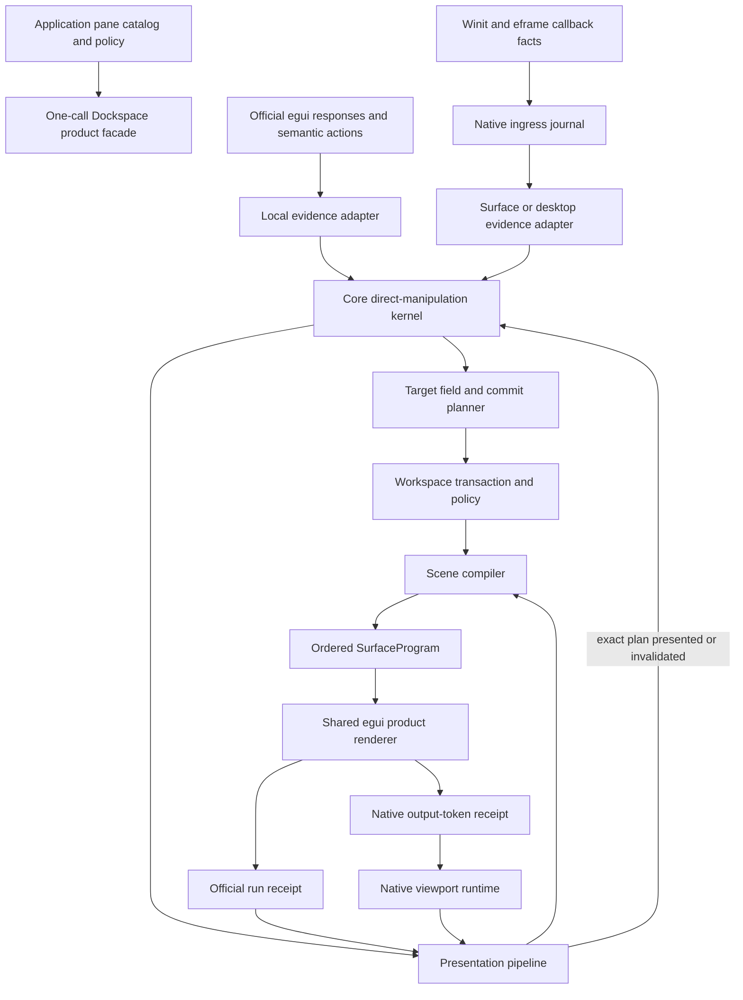
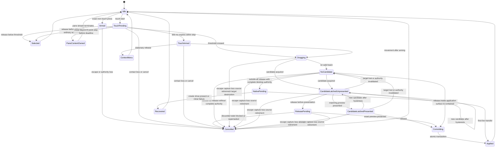
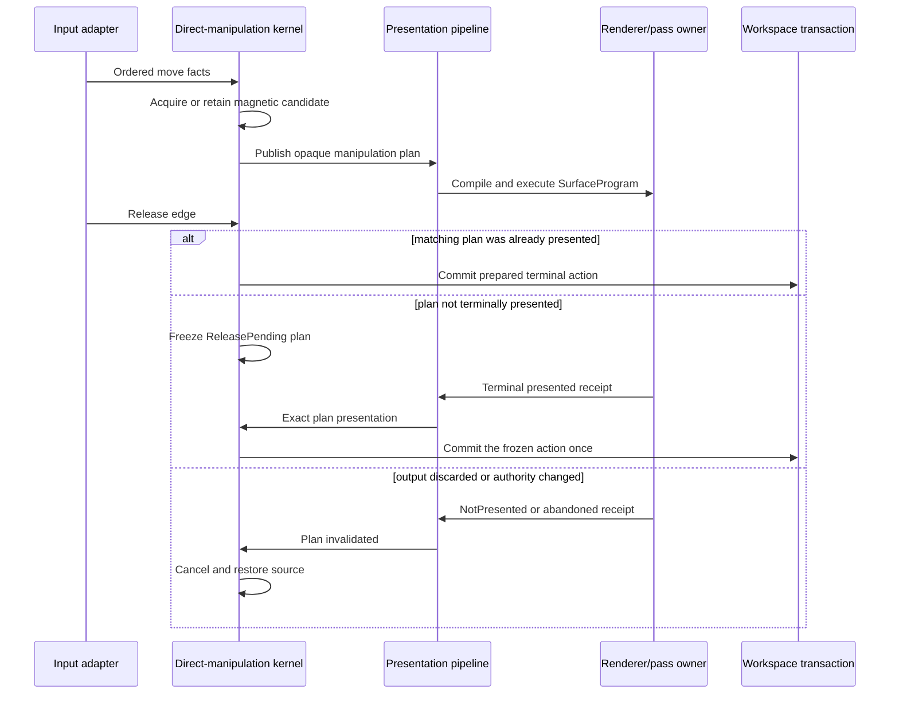
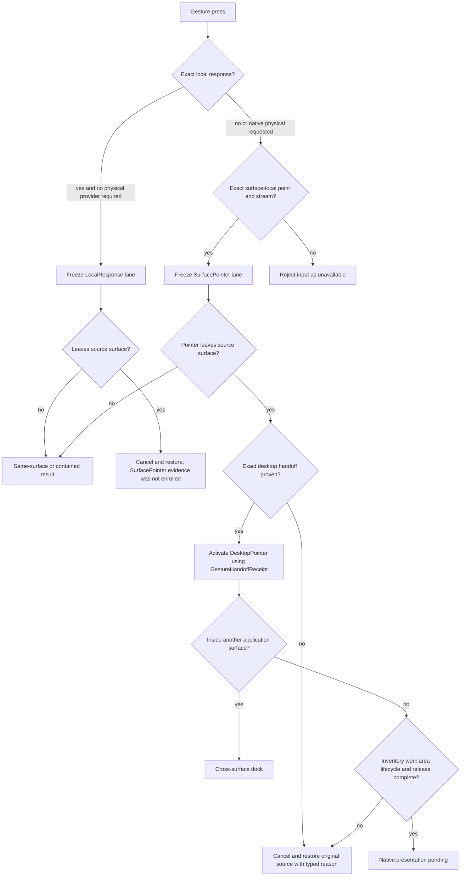
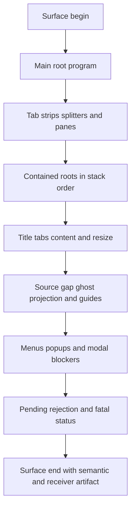
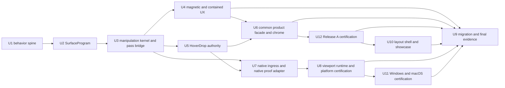

# Dockspace direct-manipulation experience and interaction foundation parity

## Goal Capsule

| Field | Contract |
| --- | --- |
| Objective | Make Dockspace feel like an editor-grade docking workspace: tabs and groups move predictably, contained windows follow the pointer as full windows, ordinary pane content remains dockable, magnetic targets make common releases forgiving, and native multiview extends the same behavior only where platform facts are complete. |
| Means | Replace the fragmented interaction and presentation seams with a core-owned direct-manipulation kernel, a core-compiled ordered surface program, proof-strength presentation adapters, and a bounded native ingress/runtime split (KTD1-KTD13). |
| Authority | `dockspace` remains the sole authority for topology, selection, durable placement, target choice, revisions, policy, preview/commit, and native ownership. Renderers execute core programs; platform adapters report facts and effects; neither may infer a durable result from geometry or callback order. |
| Execution profile | Breaking, replace-not-layer refactor. Restore same-surface and contained direct manipulation first, then reconnect native lifecycle and certify physical cross-window behavior per platform. |
| User baseline | The old `egui_tiles`-based workspace and Dear ImGui docking are experience references, not architecture templates. The target keeps the current core's stronger atomicity, accessibility, stale rejection, and first-live lifecycle. |
| Stop conditions | Stop a slice rather than ship it if it creates a second topology owner, requires users to aim at a guide icon, commits an unseen preview, guesses an unknown platform fact, leaves old and new gesture paths active, or enables a platform capability before its real-window gate passes. |
| Tail ownership | Each implementation unit owns its production change, replacement tests, old-path deletion, documentation update, and a runnable dogfood checkpoint. |

---

## Product Contract

### Summary

Dockspace already has stronger correctness foundations than the former tiles implementation: a renderer-neutral topology owner, atomic revision-bound actions, exact scene and receiver authority, presentation-qualified release, native first-live admission, typed platform capabilities, accessibility records, and deterministic stale rejection. The product nevertheless feels worse because common manipulation paths expose that infrastructure instead of hiding it. Users must discover narrow chrome, aim at exact guide buttons, tolerate compact ghosts instead of a moving window, and interact with examples that do not exercise a realistic layout workflow.

This plan restores mature docking behavior without restoring the tiles tree as an authority. It treats guide icons as explanations for a larger core-owned magnetic target field, freezes the visible candidate through release, paints a full-window live contained projection, makes ordinary pane widgets transparent only to the docking-hover lane, and gives application authors a one-call default facade. The same private gesture transaction later consumes native facts without changing product semantics.

### Problem Frame

The current implementation optimized for proving authority and lifecycle contracts. That work was necessary, but its tests often navigate to an exact AccessKit guide center, advance a fixed number of passes, or drive programmatic product actions. Those tests prove that a protocol path can succeed; they do not prove that a person can casually drag a tab over a text editor, release near a side, and get the previewed result.

The implementation also distributes one user gesture across `interaction`, `engine/local_response.rs`, `engine/pointer_transaction.rs`, `drop_resolver`, `presentation_authority`, renderer-side scheduling, pass settlement, and native sidecars. Local responses, contained transforms, and native pointer journals reuse some state but retain separate resolution and terminal paths. The result is high correctness inside individual seams but low locality across the whole manipulation.

The former tiles version had the opposite trade-off. It concentrated tab, group, hover, full-window movement, and nearest-target behavior, which produced better feel, but it let renderer traversal and mutable tree state own too much product truth. The target architecture must combine the current system's authority with the old system's locality and mature docking defaults.

### Key Decisions

- KD1. **Create a new parity/refactor plan instead of extending the multiview conformance plan.** The earlier plan remains evidence for authority and lifecycle work; this plan owns direct-manipulation feel and the infrastructure replacements required to support it. Governs R1-R18. (session-settled: user-directed — chosen over patching the existing plan: the requested scope includes product experience and foundational seams, not another incremental conformance pass)
- KD2. **Preserve the current core authority and use tiles/ImGui only as experience references.** Renderer-owned trees, nearest-center mutation, global raw-pointer state, and multiple floating owners do not return. Governs R4, R9-R15. (session-settled: user-directed — chosen over reverting to the former `egui_tiles` architecture: the current core's deterministic authority is a product asset)
- KD3. **Allow breaking replacement and remove obsolete seams rather than maintaining compatibility layers.** Every replacement unit has a deletion gate for the prior path, API, and implementation-level tests. Governs R9-R15, R18. (session-settled: user-directed — chosen over compatibility shims: the user explicitly authorized fearless refactoring where the foundation is wrong)
- KD4. **Phase platform work within one plan.** Same-surface and contained interaction become the first usable vertical slice; X11 then requalifies the native path; Windows and macOS remain typed capability-negative until their facts and physical gates pass. Governs R6, R13-R15, R18. (session-settled: user-approved — chosen over making every platform block the first experience release: local and contained quality can improve without weakening platform truthfulness)
- KD5. **Magnetic docking is the only default targeting model; explicit guides are a high-priority explanation and hit field, not a second guide-only product mode.** Arrangement lock remains an independent policy. This keeps precision interaction inside the same target solver and avoids a second targeting state machine. Governs R3, R4, R7.
- KD6. **Separate the public compatibility promise from proof-strength adapters.** The crates.io `egui_dockspace` facade must support local and contained interaction without leaking proof bookkeeping. Exact completed-pass HoverDrop, native child windows, and cross-window physical promotion are fork-backed capabilities until an upstream host can mint the required receipts. No public API or documentation may imply that an unmodified crates.io `eframe` provides those facts. Governs R11, R12, R16, R18. (review-settled: derived from the existing fork-only proof seams and the user's requirement to preserve truthful platform behavior)

### Requirements

#### Direct manipulation and docking feel

- R1. A visible tab body is the ordinary drag entry. Moving below the configured logical threshold selects without dragging; crossing it begins exactly one drag; the close control and group-drag region remain disjoint and never steal each other's action.
- R2. Tab reorder, cross-group merge, group drag, center merge, edge split, cancellation, stale rejection, and focus recovery use one semantic gesture model. Center merge flattens the moved items into the target tab stack and preserves relative order.
- R3. A pane or root exposes a core-owned magnetic target field. Direct guide and tab-gap hits outrank an active outer-root band, which outranks the deepest eligible pane basin; within a basin, center merge outranks normalized nearest-edge split. An acquired target enters a latch before presentation proof and remains latched through small pointer jitter. It changes only after deterministic hysteresis, explicit target invalidation, or an authority change.
- R4. Release is decided by logical latch state, not by re-testing the raw release point. Any release while a latch remains active—including within the release-hysteresis margin outside its acquire basin—uses that latch. `LatchedUnpresented` enters `ReleasePending` and commits only after its exact plan is presented; `LatchedPresented` commits immediately. A no-latch release inside an application surface commits contained placement. A no-latch release outside all application surfaces enters `NativePending` only with complete desktop authority; otherwise it cancels and restores. A discarded, stale, blocked, or superseded preview cancels without mutation and restores the source.
- R5. A contained root moves and resizes as a full live projection of its chrome, tab strip, pane content, receivers, and accessibility bounds. Durable placement changes only once at terminal commit; the active source projection is suppressed from target selection so panes behind it remain dockable.
- R6. A release inside an application surface but outside every valid dock basin creates or keeps a contained presentation. A release outside all application surfaces may create a native child only when the selected input lane, inventory, work area, lifecycle, placement, release, and presentation capabilities are complete. Missing native facts never silently change the result to a different presentation mode.
- R7. The default product surface includes discoverable tab and group context menus, directional docking commands, `Float`, `Move to New Window`, `Dock Back`, close/reopen, layout lock, reset/default layout, and application-defined named presets. Tab bodies drag one item, a persistent group handle drags a group, contained title background moves the contained root, and each close control has one owner. Overflow has one scroll-owner state machine: selected-tab reveal, manual scrollbar input, active-drag edge scrolling, and menu selection cannot fight or expose executable clipped controls.
- R8. Pending, cancelled, stale, unsupported, rejected, and recovered outcomes are visible through one typed product feedback model. Pending status is anchored to the source/target and announced once; delayed success, cancellation, stale, rejection, and unsupported results deduplicate by manipulation identity and remain in a non-modal inert status surface until the next related action or explicit dismissal. Focus recovery, disabled reasons, popup focus containment, and suppression of per-pixel projection announcements are part of the same accessibility contract.

#### Deep interaction and presentation foundations

- R9. One private direct-manipulation kernel owns gesture state, source ownership, normalized input sequencing, candidate selection, latch/hysteresis, dwell timing, live projection, preview token, release barrier, cancellation, terminal commit, and typed outcome. Local egui and native input remain distinct evidence adapters, not distinct reducers.
- R10. Core compiles one ordered hierarchical surface program that carries paint, hit, accessibility, action, source-gap, ghost, full-window projection, guide, popup, and feedback identities in one traversal order. The egui renderer does not regroup flat records or reconstruct z-order.
- R11. Renderer pass settlement is one conceptual seam with truthful adapters. The public crates.io facade may use only a host-owned receipt that the host can actually mint; the pinned egui/eframe fork additionally proves completed-pass hit stacks and exact output-token finalization after all plugins, with an exact abandonment tombstone on unwind. Durable local actions survive discarded or retained passes, while presentation evidence only advances on terminal output.
- R12. The egui fork provides a completed-pass docking-hover query that can pass through ordinary widgets inside the same pane while stopping at popup, modal, overlay, explicit blocker, foreign layer, or ambiguous identity. The native adapter consumes that typed result and never scans rectangles or falls through to a lower core target on its own.
- R13. Native input is submitted through bounded, causal, retryable batches. Idle-only motion may coalesce before core sequencing; active gestures are lossless. Output, lifecycle, button/contact, capture, scroll phase, device removal, focus, close, inventory, work-area, capability, and receiver boundaries remain barriers.
- R14. Input capability is selected and frozen per gesture or stream as `LocalResponse`, `SurfacePointer`, or `DesktopPointer`. Surface-local facts support same-window and contained interaction without desktop-global authority. A cross-window transition requires sealed `GestureHandoffEvidence` from the same native ingress authority, binding the old provider lease/final committed watermark, new provider enrollment checkpoint, canonical device/tool/contact correlation, complete held-button roster, capture/delivery route, and one causal ordinal. Core validates that evidence before minting `GestureHandoffReceipt`, atomically retiring the old lane and opening a new evidence epoch with the same manipulation/source ownership. Unknown or conflicting evidence cancels and restores the source; no adapter may silently upgrade the lane.
- R15. Native viewport lifecycle is owned by one session-owned `NativeViewportRuntime` containing per-binding/incarnation records. It atomically reconciles cross-binding roster, ownership transfer, output artifact, receiver index, create/hidden staging, visible staging, first-live, pass-through, no-frame state, close, retirement, and quiescence under one causal operation id. Source ownership remains until first-live; predecessor observations cannot affect a successor incarnation.

#### Public surface, accessibility, boundedness, and evidence

- R16. The default public API is a one-call direct-manipulation loop: application code supplies a stable pane catalog, titles/content, close policy, default layout, and named-preset store; it does not supply surface bootstrap, pass acknowledgement, receiver geometry, scene stamps, output tokens, native receipts, or frame counts. Synchronous close and deferred close both resolve exactly once by stable item key. The default native facade hides host-handler/finalizer plumbing, while fork-backed native capabilities are explicit in the capability report.
- R17. Pointer, keyboard, context-menu, and AccessKit actions converge on the same prepared product commands. Disabled or occluded controls remain discoverable when appropriate but cannot execute; dwell selection does not guess pane focus; layout lock disables arrangement mutations without disabling ordinary pane interaction.
- R18. Acceptance is organized around semantic user journeys, not exact guide centers or fixed frame counts. The same normalized journey runs through core-host and egui-product executors; real official eframe, programmatic native windows, and platform physical input add progressively stronger evidence. Active queues, retained artifacts, lifecycle sidecars, timers, tombstones, and detailed histories are bounded and reach quiescence.

### Actors

- End users manipulate tabs, groups, contained windows, splitters, menus, presets, and native child windows without understanding rendering or lifecycle protocols.
- Application authors provide stable item identities, pane rendering, titles, close policy, default layouts, named presets, and optional diagnostics.
- `dockspace` owns semantic and durable authority, direct-manipulation state, target selection, transactions, and native presentation intent.
- The official-egui adapter owns `Response`, AccessKit, visual execution, repaint scheduling, and only the completed-run facts its host can actually mint.
- The native adapter owns ordered OS facts, exact completed-pass receiver authority, platform effects, window observations, and terminal output settlement.
- Conformance and physical executors drive semantic journeys without becoming geometry, topology, or lifecycle authorities.
- The compatibility/release owner records whether a gate is crates.io-compatible, fork-backed, or capability-negative; a fork-only proof seam never silently becomes a public requirement.

### Key Flows

- F1. **Ordinary local dock.** Press a tab, cross the threshold, enter a pane's magnetic field, see a latched center or edge preview, release immediately, and either commit the already presented plan or wait for its exact presentation before committing.
- F2. **Contained direct manipulation.** Float inside the current surface, move or resize the full contained window, raise it on the first effective press, then re-dock through the same target field while its durable rect changes only at terminal commit.
- F3. **Qualified native promotion.** Freeze a desktop-capable gesture lane, prove outside-all space, retain the source while create/staging/show/first-live completes, then transfer ownership exactly once or recover the source on failure.
- F4. **Layout operation.** Invoke a tab/group/menu/keyboard/AccessKit command, resolve close or preset policy, atomically apply the layout mutation, and surface a typed result without exposing geometry authority.
- F5. **Causal input and presentation.** Claim an ordered host prefix, reduce a bounded batch, resolve typed completed-pass receivers, compile/execute a surface program, settle the terminal output, and only then promote preview, focus, receiver, or lifecycle evidence.

### Acceptance Examples

- AE1. **Fork-backed center dock through real pane content**
  - **Given:** The fork-backed editor tier is active, and a source tab and target pane containing a multiline editor are both visible.
  - **When:** The user drags into three different points inside the target center basin, none intersecting the guide icon, and releases immediately.
  - **Then:** Each journey previews and commits the same center merge once; the editor remains an ordinary pane control rather than an opaque docking blocker.
  - **Covers:** R1-R4, R12, R18.
- AE1b. **Portable capability boundary**
  - **Given:** The portable crates.io tier has a valid caller-owned run receipt but no completed-pass HoverDrop stack seam.
  - **When:** The user performs supported tab/group/contained gestures and then drags across an ordinary child widget that requires final-stack passthrough.
  - **Then:** Supported gestures complete normally; the child-widget target reports typed `HoverDropUnavailable`, does not consume a fabricated final-hover/rectangle result, and leaves the source recoverable.
  - **Covers:** R1-R6, R11-R12, R16-R18.
- AE2. **Stable edge selection under hesitation**
  - **Given:** A pointer has acquired the left docking basin.
  - **When:** It jitters, briefly overshoots the acquire boundary by less than the release-hysteresis threshold, and releases before returning, with the final move in the same batch.
  - **Then:** The visible left candidate remains latched and the committed result matches it; no adjacent direction flickers or wins at release.
  - **Covers:** R3, R4, R9, R13.
- AE3. **Full-window contained move**
  - **Given:** A contained inspector overlaps docked content.
  - **When:** The user drags its title across the surface and releases where no dock candidate is active.
  - **Then:** The whole inspector follows the pointer, panes underneath remain eligible targets, AccessKit bounds follow the projection, and one durable placement update commits on release.
  - **Covers:** R5, R9, R10, R17.
- AE4. **Release before preview presentation**
  - **Given:** A target candidate has been compiled but the output carrying it is not terminally presented.
  - **When:** The user releases immediately.
  - **Then:** Topology remains unchanged while the gesture is `ReleasePending`; the matching presentation commits once, while discarded or foreign evidence cancels and restores the source.
  - **Covers:** R4, R8, R9, R11.
- AE5. **Capability-qualified native behavior**
  - **Given:** Same-surface pointer facts are exact but desktop hover or authoritative release is unavailable.
  - **When:** The user performs local reorder, contained move, and then drags outside the window.
  - **Then:** Local and contained operations work; native promotion is unavailable with a typed reason; no guessed child window or alternate contained result is created. A failed handoff cancels and restores the original source rather than falling back to another presentation mode.
  - **Covers:** R6, R8, R14-R16.
- AE6. **Burst input remains causal**
  - **Given:** An active drag receives high-rate moves interleaved with output, capture, and lifecycle records.
  - **When:** The host reduces the records in bounded batches.
  - **Then:** No causal barrier is crossed, the final move/release pair uses the last valid preview, backlog returns below its high-water mark, and cancellation leaves no route or gesture state.
  - **Covers:** R11, R13-R15, R18.
- AE7. **Layout reset, reopen, and lock**
  - **Given:** The user has closed panes and modified a named preset.
  - **When:** They reopen a pane, lock arrangement, attempt a drag, then reset to the default layout.
  - **Then:** Reopen uses stable item identity, lock blocks only arrangement actions with an accessible reason, and reset atomically restores the application-defined layout.
  - **Covers:** R7, R8, R16, R17.
- AE8. **Group and chrome ownership**
  - **Given:** A narrow tab group, a single-tab contained root, and a partially clipped close control are visible.
  - **When:** The user drags the group handle, drags the contained title background, invokes the group menu, and attempts the clipped close control.
  - **Then:** Group and contained movement have distinct persistent entry regions; only the labeled tab close closes one pane; clipped/occluded controls cannot execute; final-pane closure follows the configured close/focus/retirement policy.
  - **Covers:** R1, R2, R7, R8, R17.
- AE9. **Splitter and surface-local touch**
  - **Given:** A split layout is unlocked and contains scrollable pane content.
  - **When:** Pointer drag, keyboard/AccessKit adjustment, double-click equalization, and a 350 ms touch long-press manipulation are exercised, followed by Escape/contact loss and layout lock.
  - **Then:** Splitter changes clamp deterministically, cancellation rolls back, touch does not steal pre-arm scrolling, hit regions meet the 44-point minimum, and lock exposes a typed disabled reason without disabling pane content.
  - **Covers:** R7-R9, R13, R17-R18.
- AE10. **Focus and feedback lifecycle**
  - **Given:** A user closes, reorders, docks, reopens, and restores a preset while one manipulation becomes pending and another is rejected.
  - **When:** The actions complete through pointer, keyboard, menu, and AccessKit paths.
  - **Then:** Each path invokes the same prepared command, focus lands on the documented successor, pending/rejected status announces once and deduplicates by manipulation id, popup focus is contained, and live movement does not emit per-pixel accessibility noise.
  - **Covers:** R4, R7-R8, R16-R18.
- AE11. **Platform claim certification**
  - **Given:** X11 has a green physical journey while Windows or macOS is missing one required event-time or release fact.
  - **When:** Packages, examples, and platform documentation are built.
  - **Then:** X11 may advertise the qualified native capability; the incomplete platform remains typed capability-negative until its own U11 release-environment matrix passes; local/contained behavior remains usable on both.
  - **Covers:** R6, R11-R16, R18.

### Success Criteria

| Signal | Exit criterion |
| --- | --- |
| Ordinary docking | Center plus all four edge directions succeed from at least three non-guide points per region across `Burst`, `Stepwise`, `Hesitant`, and final-move-with-release cadence profiles. |
| Direct contained manipulation | Move and eight-direction resize render the full projected subtree, keep target panes discoverable, and commit one durable placement update or one docking transaction. |
| Realistic pane content | Text edit, scroll area, button, canvas-like region, popup, modal, and front contained blockers produce the expected typed HoverDrop result. |
| Native input boundedness | A 1,000 Hz active drag soak does not grow the ingress queue over time; 10,000 interleaved records preserve order; overload fails explicitly rather than dropping events. |
| Lifecycle boundedness | 10,000 create-to-first-live-to-retire cycles leave no active output, receiver, reservation, route, effect, timer, tombstone detail, or retirement obligation beyond documented bounded watermarks. |
| Product evidence | The game-engine showcase completes the manual journey list without internal coordinates, programmatic tear-off shortcuts, or instructions to aim at a guide icon. |
| Platform truthfulness | A platform capability is documented as available only after compile, deterministic protocol, real-window, and required physical-input gates for that capability all pass; unsupported fork-only facts remain explicitly qualified. |

### Resource budgets and measurement boundaries

These are initial release budgets, measured on the serial Linux CI profile (`-j1`) and repeated on each platform's release environment. They are hard gates; changing them requires a new baseline and plan amendment.

| Resource | Budget | Measurement and overload rule |
| --- | --- | --- |
| Active ingress journal | 4,096 records, 4 MiB canonical resident cost, and 250 ms oldest-record age | Each envelope implements `resident_cost_bytes = fixed_envelope_size + owned_payload_capacity`; shared immutable snapshot handles are charged as fixed handles and their owned sidecar is charged exactly once by its owner. Enqueue/claim age uses one injected monotonic clock. Idle motion may coalesce; active records may not drop. |
| One reduction batch | At most 256 records or 2 ms monotonic wall time, whichever comes first | Time is measured from causal-prefix claim to reducer yield on the serial reducer thread; deterministic tests use a fake clock and release CI records the reference-runner value. A barrier terminates the batch. The next boundary resumes at the exact claimed ordinal; no one-record-per-root-cycle fallback is allowed. |
| Release latency | 100 ms from the final release edge to typed terminal outcome under the 1,000 Hz profile | Measured with a monotonic host clock after the final release record is accepted. A platform that cannot meet it reports a typed overload/unknown outcome instead of silently extending the queue. |
| Retained lifecycle detail | At most 64 recent terminal summaries per binding and 1,024 monotonic IDs per session watermark | Detailed output/receiver/effect/tombstone state must be retired at quiescence; summaries contain no authority-bearing geometry or receipt. |
| Long-run quiescence | After 10,000 lifecycle cycles, zero active obligations and only the bounded watermarks above | The soak fails if any output, receiver, route, timer, effect, pending action, or retirement obligation remains. |

Every active stream has one preallocated overload terminal latch outside ordinary journal capacity. Crossing a record/byte/age cap atomically freezes further ordinary ingress for that stream and records the offending causal ordinal plus `InputOverload` in the latch. The next causal claim consumes all accepted predecessors, then the latch, cancels the manipulation, restores the last valid source, and unfreezes only after terminal cleanup. The overload path may not allocate another journal record or discard an accepted release/capture/lifecycle barrier.

### Scope Boundaries

#### In scope

- Same-surface tab/group docking, contained float/move/resize/re-dock, magnetic targeting, hover dwell, overflow, splitters, commands, layout management, pending/error feedback, accessibility, and realistic dogfood.
- Core, official egui, egui fork, eframe/winit fork seams, native adapter, conformance harnesses, physical smokes, documentation, and CI changes needed to support the experience contract.
- Breaking removal of obsolete public and private APIs, duplicate state machines, schedule reconstruction, and shallow test seams.
- A three-tier compatibility contract: portable crates.io caller-owned runs, capability-negative unmodified crates.io `eframe::App::update`, and explicitly fork-backed exact HoverDrop/native multiview behavior.

#### Deferred to follow-up work

- Physical cross-window touch and pen promotion until a backend proves canonical tool identity, desktop route, capture, and release facts. Surface-local touch remains in scope.
- Automated Windows and macOS physical lanes until their required facts are implemented and a stable CI/self-hosted environment exists. Their compile, deterministic lifecycle, official-window, typed capability-negative, and release-environment physical gates remain in this plan and must be completed before either platform's native-promotion capability is enabled.
- Cloud synchronization or collaborative merging of user layout presets. Local versioned persistence and application-defined presets remain in scope.

#### Outside this product's identity

- Restoring `egui_tiles::Tree`, renderer-owned topology, arbitrary nested container graphs, or a second mutable floating/native graph.
- A general GUI automation DSL, a cross-platform window manager, or a general replacement for egui hit testing.
- Animation or screenshots as topology, target, receiver, release, or lifecycle authority.
- Shipping or upstreaming fork changes outside the repository's existing authorization process.

---

## Planning Contract

### Key Technical Decisions

- KTD1. **Use a hybrid deep-module shape: one-call product facade, one private core kernel, and explicit evidence adapters.** The default caller sees a `show`-style product API; `runtime::direct_manipulation` owns the transaction; official and native adapters preserve their different proof models. A giant public controller would leak protocol, while forcing native facts into local `Response` semantics would weaken authority. Covers R9, R11, R14, R16.
- KTD2. **Compile a hierarchical `SurfaceProgram` in core.** The program is the ordered source for paint, hit, accessibility, action, popup, guide, full-window projection, and feedback identities. It replaces flat record regrouping and renderer-side layer reconstruction while keeping `scene_compiler` as an internal pure compiler. Covers R5, R10, R12, R17.
- KTD3. **Represent each gesture with an opaque, presentation-affine manipulation plan.** The plan binds gesture sequence, source, lane, workspace/policy revision, presented scene, target latch, live projection, preview, and prepared terminal command. The same plan produces the visible preview and release authority; public acknowledgement and target-geometry APIs disappear. Covers R3-R6, R9, R11.
- KTD4. **Make target acquisition semantic and magnetic, not nearest-center renderer geometry.** Core owns center/edge basins, acquire/release distances, switch advantage, stable tie-breaking, dwell deadlines, source suppression, and rejected candidates. Initial defaults are product configuration, not call-site geometry. Covers R2-R5.
- KTD5. **Keep one magnetic target solver and make explicit guides its highest-priority field.** There is no independent guide-only profile. The solver orders direct guide/tab-gap hits, outer-root bands, and deepest eligible pane basins, then applies latch/hysteresis and deterministic tie-breaking. Covers R3, R4, R7.
- KTD6. **Model pass settlement as one port with proof-strength adapters.** U2 first defines `RendererPassBridge` plus a deterministic fake receipt used by `SurfaceProgram` tests. U3 proves the official host-owned receipt contract; U7 later installs the exact native eframe finalizer and unwind tombstone. A crates.io host that cannot mint the receipt is capability-negative, not silently accepted via frame counters. Covers R4, R11, R16.
- KTD7. **Split native responsibility into a causal ingress journal and one session-owned `NativeViewportRuntime`.** The journal owns ordered callback envelopes, bounded claims, retry, safe coalescing, and overload. The runtime owns per-binding records and is the sole transaction owner for cross-binding roster, output, receiver, staging, first-live, pass-through, no-frame, close, retirement, and quiescence. Every cross-binding operation carries one causal operation id; the journal never mutates lifecycle state. Covers R13-R15, R18.
- KTD8. **Freeze the input lane and make handoff explicit.** Local `Response`, surface-local pointer, and desktop-global pointer facts normalize into one gesture owner without pretending to be the same evidence. The native ingress authority alone may seal `GestureHandoffEvidence`; core validates its old lease/watermark, new enrollment, canonical tool correlation, held roster, capture/delivery route, and causal ordinal before minting `GestureHandoffReceipt`. The receipt closes the old sequence namespace, opens the new evidence epoch, and routes the only valid terminal release. Failure cancels and restores; no adapter performs an opportunistic upgrade. Covers R6, R12-R15.
- KTD9. **Build a behavioral acceptance spine and oracle matrix before deleting old paths.** Each invariant is classified as `normative`, `characterization-only`, or `known-invalid`, with a source and journey id. Shared scenarios describe semantic journeys and product checkpoints; executors privately resolve current bounds and wait on causal predicates. Core geometry tests keep exact coordinates, while product/native tests remove fixed guide centers and ordinary fixed-frame waits. Only normative rows may gate U1/U8 completion. Covers R18.
- KTD10. **Use replace-not-layer migration gates.** A new module is complete only when its old caller path, duplicate owner, compatibility wrapper, and superseded implementation-level tests are deleted. This instantiates KD3 and prevents the refactor from increasing the number of authorities. Covers R9-R16, R18.
- KTD11. **Make the public facade own catalog and policy boundaries.** The facade owns stable pane descriptors, closed-item inventory, default layout, close decisions, preset serialization hooks, and exactly-once deferred outcomes; application pane content remains borrowed/rendered through `PaneView`. Missing-pane recovery is keyed by stable item identity and never by graph or geometry ids. Covers R7, R8, R16, R17.
- KTD12. **Treat boundedness as a measured product contract.** Queue caps, batch budgets, release latency, retained watermarks, and overload/quarantine behavior are fixed in the Resource Budgets table and reported by every executor. A performance result without its measurement boundary is not a passing gate. Covers R13, R18.
- KTD13. **Put exact HoverDrop stack inspection only in the fork-backed adapter.** The egui fork scans the final hit stack using registered candidate, pane-passthrough, popup/modal/layer, and explicit blocker semantics and returns `Candidate`, `Blocked`, `NoReceiver`, or typed ambiguity. Portable crates.io hosts never emulate this by rectangle scanning or final hover; they expose the exact missing capability. Covers R10, R12, R16-R18.

### High-Level Technical Design

The diagrams define responsibility and sequencing, not exact Rust signatures. Implementers may adjust file-local types while preserving the ownership and proof boundaries below.

#### Component and data-flow topology

#### Direct-manipulation state machine

#### Preview and release proof sequence

#### Capability and lane decision flow

### Internal Module Boundaries

| Module | Owns | Hides | Must not own |
| --- | --- | --- | --- |
| `runtime::direct_manipulation` | Gesture owner, lane, input sequence, target latch, dwell, projection, plan token, release barrier, terminal outcome | Local/native normalization, transient state, prepared command, self-rebase proof | Durable topology outside transactions, OS effects, renderer widgets |
| `PresentationPipeline` | Requirements, measurement acceptance, candidate compilation, emission, terminal observation, presented promotion, retirement | Scene/output ledger and plan presentation state | Gesture policy, native callback queue |
| `SurfaceProgram` | Ordered hierarchical render/hit/a11y/action traversal | Parallel record vectors, root grouping, z-order reconstruction | egui widget implementation, durable state |
| `RendererPassBridge` | Stage and terminally settle one pass/run receipt | Official run identity or native output token, discard/unwind handling | Product target choice, topology |
| `NativeIngressJournal` | Ordered callback envelope, claim/commit/retry, barriers, safe coalescing, overload metrics | `HostRecord` variants and front/ack method families | Viewport output state, core workspace |
| `NativeViewportRuntime` | Desired bindings, output artifact, receiver index, staging, first-live, pass-through, close, retirement, quiescence | Mailbox/coordinator/pass-action/receiver maps | Product topology or target choice |
| `GestureHandoffEvidence` | Sealed native-ingress proof of old provider lease/watermark, new provider enrollment, canonical tool/contact correlation, held roster, capture/delivery route, and causal ordinal | Backend-specific raw ids after canonicalization | Topology, target choice, guessed physical identity |
| `GestureHandoffReceipt` | Core-minted atomic lane transfer, new evidence epoch, source ownership, and sole terminal release route | Adapter-specific device ids and desktop geometry | New topology, second manipulation, guessed release authority |

### Surface Program Shape

Every operation carries one stable visual/semantic identity and references the same core-owned geometry. The renderer may choose egui styling and animation but cannot reorder operations, reinterpret the target, or mint authority.

### Default Interaction Profile

- Drag threshold: 6 logical points.
- Center basin: the central 52% by 52% of the target content rectangle.
- Edge direction: normalized nearest edge outside the center basin.
- Outer root edge band: 15% of the short side, clamped to 32-72 logical points.
- Target release hysteresis: 8 logical points beyond the acquire boundary, with a deterministic switch-advantage rule.
- Direct guide and tab-gap hit outrank magnetic basins; rejected candidates do not silently fall back to a lower-priority candidate.
- Hover-tab activation: optional 150 ms event-time dwell, reset by target, scene, gesture, output, or policy change; it never implies pane focus.
- Holding Shift temporarily disables magnetic docking in the default editor profile. Arrangement lock remains a separate policy; there is no independent guide-only targeting profile.
- Visual easing may use 80-150 ms transitions, but hit geometry, latch, and commit semantics change immediately.

#### Chrome ownership and terminal states

| Region | Primary gesture | Menu/keyboard alternative | Terminal rule |
| --- | --- | --- | --- |
| Tab body | Drag one item; click selects | Reorder, Float, Dock, Close | Close removes one item; final item follows close policy and focus recovery |
| Group handle / empty tab strip | Drag the whole group | Group menu: Close Group, Close Others, Close All, Float | Empty groups retire or remain as an explicit empty state, never as an accidental hit target |
| Contained title background | Move the full contained root | Move, Resize, Dock Back, Close Group | Failed native promotion cancels/restores; `Close Group` runs group close policy and never means close one pane |
| Contained resize edges/corners | Eight-direction live resize; corners outrank edges; cursors are horizontal, vertical, NW-SE, or NE-SW by region | Resize commands and size reset | Mouse edge band is 8 logical points with 12-point corner squares; touch target is at least 44 points; regions are clipped to the root and disjoint from title/tab controls; Escape/contact/capture loss rolls back; layout lock disables mutation |
| Tab close button | Close that tab only | Same command in tab menu | No second unlabeled close control; occluded/disabled close is non-executable |
| Splitter/junction | Pointer drag with expanded hit region | Keyboard/AccessKit increment/decrement, double-click equalize | Escape or capture loss rolls back; min-size clamp reports feedback; layout lock disables mutation only |

#### Feedback, overflow, splitter, touch, and focus contracts

- Feedback is a small state machine: `Pending` stays anchored to the source/target; `Succeeded`, `Cancelled`, `Stale`, `Rejected`, `Unsupported`, and `Recovered` announce once, deduplicate by manipulation id, and remain in an inert non-modal strip until the next related action or explicit dismissal. Fatal status never replaces retained pane content with an opaque interactive page.
- Overflow has one owner at a time: keyboard/AccessKit reveal owns the offset until complete; manual scrollbar owns it while pressed; active tab drag owns edge auto-scroll; overflow-menu selection reveals and focuses the chosen tab before returning control. Partially clipped tabs expose no executable close or drag subcontrol.
- Splitters expose hover/press/drag/release, minimum-size clamp, Escape/capture-loss rollback, layout-lock reasons, and a 44-point touch hit expansion without changing visual thickness. Keyboard and AccessKit increment/decrement move the activated boundary by 16 logical points before normalization. Double-click equalizes only the two siblings adjacent to the activated segment, preserving their combined normalized weight and all other siblings; a junction acts on its focused segment/axis.
- Surface-local touch uses a 350 ms long press and 8 logical-point slop. Moving beyond slop before the deadline permanently cancels docking arming for that contact and leaves pane scrolling in control; release before the deadline performs the control's ordinary activation/selection without drag. After arming, movement begins drag without hover dwell; armed release without movement opens the semantic context menu. Contact loss/cancel rolls back. Tab/group menu buttons, close, resize, and splitter targets are at least 44 points so every drag-only command has a visible semantic alternative.
- Accessibility journeys use the normative focus-successor table below. Popup focus is contained, disabled reasons are exposed, pending/status feedback never steals focus, and live projection suppresses per-pixel announcements while keeping final bounds exact.

#### Normative focus successors

| Action | Focus after terminal outcome |
| --- | --- |
| Select | The selected tab node; pane focus changes only after an exact pane-focus request/observation |
| Reorder or dock | Retain the moved item's semantic focus; if its node is temporarily absent, hold a focus intent until the matching presented node exists |
| Close tab | Next tab in visual order, otherwise previous tab, otherwise group handle, otherwise root workspace |
| Close group | Previously active pane in the destination/root if one exists, otherwise root workspace |
| Reopen | The reopened tab node; pane focus still requires its exact request/observation |
| Reset or preset restore | Prior focused stable item when present, otherwise the primary selected tab, otherwise root workspace |
| Popup dismissal | Return to the invoking tab/group/menu button unless that node was removed, then apply the relevant close/reset successor rule |
| Pending, rejected, unsupported, recovered, or fatal feedback | Never steals focus; status is announced once through its inert semantic node |

### Sequencing

Release A is U12 after the U1-U6 common-path cuts: the common local/contained facade and coherent chrome on every host whose receipt capability is proven, plus an honest capability-negative result elsewhere. The fork-backed editor tier also gains exact real-pane HoverDrop through U5. U7-U8 reconnect the same kernel to native input and lifecycle; U10 adds layout-management long tail; U11 certifies Windows/macOS before either platform's native-promotion claim; U9 is Release B/final replacement and closes all remaining deletion and evidence gates.

### System-Wide Impact

| Surface | Impact | Preserved invariant |
| --- | --- | --- |
| Core runtime and engine | New direct-manipulation and presentation pipeline ownership; old local/native/contained reducers collapse | One workspace/revision/policy authority and affine host-frame rollback |
| Scene compiler and paint facade | Flat parallel records become an ordered program and atomic presented artifact | Core-derived geometry, stable identities, exact candidate/presented separation |
| Official egui facade | Simpler default `show` loop, typed outcomes, catalog/close policy, and an explicit local/contained capability boundary | Crates.io `egui_dockspace` compatibility and no fork/native token exposure |
| egui/eframe fork | Narrow completed-pass HoverDrop, host-owned finalization, exact output token, and unwind seams for native multiview | No topology or target logic enters egui; fork-backed capabilities are labeled |
| Native adapter | Bounded journal, per-stream lanes, one session-owned viewport runtime with per-binding records, atomic output/receiver promotion | One causal order, exact tokens, first-live ownership transfer, typed fail-closed facts |
| Accessibility | Program identities and prepared commands become the common semantic source | Occluded/disabled controls cannot execute; focus is never inferred from selection |
| Persistence and layout shell | Defaults, reset, reopen, lock, and named presets become product-level commands | Stable item identities and versioned core document remain authoritative |
| Tests and CI | Shared semantic journeys replace fixed coordinates/frames; physical lanes become capability certification | Tests do not mint geometry, scene, receipt, or native lifecycle authority |

#### Compatibility and release tiers

| Tier | Host/dependency boundary | Guaranteed behavior | Explicitly unavailable until proven |
| --- | --- | --- | --- |
| Portable crates.io | `egui_dockspace` with crates.io egui and a caller-owned run boundary that can return the matching output | One-call facade, pane catalog, select/close/reorder, local/contained projection, commands, feedback, and layout shell to the strength of the host receipt | Exact final-stack HoverDrop, native child windows, and cross-window physical promotion |
| Unmodified crates.io eframe `App::update` | eframe owns the run boundary and exposes no terminal receipt | Rendering plus actions that do not require unavailable presentation proof; typed capability reporting | Preview-qualified release, focus/receiver promotion, and any claim that depends on a terminal receipt. The plan must not market this as the full editor tier. |
| Fork-backed editor/native | Pinned egui/eframe/winit forks plus `egui_dockspace_native` | Exact completed-pass HoverDrop, post-plugin finalization, unwind abandonment, native windows, first-live, physical handoff, retained-frame and retirement contracts | Only platform facts whose own U8/U11 gates have not passed |

U3 must prove the portable receipt path before U6 labels it complete. If the unmodified eframe host still cannot mint that receipt, the result is the middle capability-negative tier; implementation must not add a forgeable counter token or silently import fork-only APIs into the portable package.

### Risks and Mitigations

| Risk | Consequence | Mitigation |
| --- | --- | --- |
| A new kernel merely wraps old reducers | Three behavior paths remain and drift continues | Each unit has an explicit deletion gate; interface trace tests must run without invoking the old entry points. |
| `SurfaceProgram` becomes a renderer-specific AST | Core absorbs egui styling and loses renderer neutrality | Limit operations to semantic geometry, ordering, identity, and prepared action handles; keep egui visuals in `product_render`. |
| Magnetic targeting causes surprising docks | Forgiving behavior becomes unpredictable | Stable priority, normalized distance, hysteresis, rejected-candidate visibility, Shift suppression, and explicit guides as the highest-priority field; verify multiple non-guide points and hesitant trajectories. |
| Pane passthrough leaks through popups or modals | Users dock through an occluding UI | Put final-stack scanning in egui, require explicit passthrough scope and blocker precedence, and fail closed on ambiguity. |
| Batching changes event semantics | Release, capture, scroll, or lifecycle ordering breaks | Claim immutable causal prefixes, define barrier classes, keep active movement lossless, and make batch failure atomically retryable. |
| Full-window projection is expensive | Pointer movement triggers full workspace rebuilds | Reuse measured subtrees, dirty only affected surfaces, index candidates, and enforce structural performance gates before polish. |
| Native refactor regresses mature lifecycle behavior | First-live, retained frame, close, or retirement breaks | Preserve existing protocol scenarios before ownership moves; migrate one lifecycle phase at a time behind the same public observations. |
| Breaking API cutover strands examples/users | The new default remains hard to discover | Land facade, migration guide, minimal example, game-engine showcase, and API seal tests in the same cutover unit; do not keep a second long-lived compatibility API. |

### Assumptions

- The pinned egui/eframe/winit forks may receive narrow host-proof and completed-hit seams when official APIs cannot express the required fact; these seams remain an explicit fork-backed compatibility tier.
- Current action, transaction, presentation, first-live, retained-frame, and retirement behavior is not automatically normative. U1's oracle matrix decides which invariants are preserved, characterized only, or intentionally replaced.
- Rust 1.95, edition 2024, serial `-j1` verification, and the existing workspace/fork layout remain the implementation environment.
- X11 remains the first physical cross-window certification platform; unsupported platforms remain useful through local and contained lanes.

---

## Implementation Units

### U1. Establish the human-gesture behavior spine and dogfood baseline

- **Goal:** Turn the desired experience into reusable semantic journeys and a realistic workspace before changing the core seams.
- **Requirements:** R1-R8, R17, R18; KD1-KD6; KTD9.
- **Dependencies:** None.
- **Files:** `crates/dockspace_host_conformance/src/scenario.rs`, `crates/dockspace_host_conformance/src/tests.rs`, `integration/egui-product-harness/tests/`, `integration/egui-official-harness/`, `crates/egui_dockspace_native/examples/`, `docs/VALIDATION.md`, `docs/knowledge/open-gpui-docking-conformance-catalog.md`.
- **Approach:** Define L01-L08 local journeys and N01/P01 native journeys using semantic source, basin, preview, outcome, ownership, focus, and quiescence observations. Add cadence profiles for burst, stepwise, hesitant, final-move-with-release, discarded-before-release, target-disappears, and touch-long-press. Create an oracle matrix that marks every preserved action/presentation/first-live/retained-frame/retirement observation as `normative`, `characterization-only`, or `known-invalid`, with the source plan and journey id. Start a lightweight realistic workspace baseline; the full game-engine showcase and layout shell land in U10.
- **Execution note:** Characterize current strengths and record intentionally failing experience scenarios before production refactors. Do not make the shared scenario format a general GUI DSL.
- **Test scenarios:**
  - A tab drag to center and four edges selects semantic basins without referencing guide centers or fixed screen coordinates.
  - A contained move journey observes a full-window projection contract even though the current renderer initially fails it.
  - The same local journey runs through core-host and egui-product executors and reports normalized product observations.
  - The baseline example supports select, reorder, local/contained move, close, and capability status without internal receipts or graph IDs.
- **Verification:** The new journey catalog and oracle matrix compile, every retained characterization is explicitly classified, the baseline runs to a stable initial layout, and no ordinary interaction helper contains a fixed frame count or guide-center selector.

### U2. Replace flat paint records with an ordered SurfaceProgram

- **Goal:** Make core the sole owner of render/hit/accessibility ordering and create one atomic artifact for a presented surface.
- **Requirements:** R5, R10-R12, R17; KTD2, KTD6, KTD10, KTD13.
- **Dependencies:** U1.
- **Files:** `crates/dockspace/src/scene.rs`, `crates/dockspace/src/scene_compiler/`, `crates/dockspace/src/runtime/paint.rs`, `crates/dockspace/src/semantic_manifest.rs`, `crates/dockspace/src/presentation_hit.rs`, `crates/egui_dockspace/src/renderer_pass_bridge.rs` (new), `crates/egui_dockspace/src/product_render/mod.rs`, `crates/egui_dockspace/src/product_render/schedule.rs`, `crates/dockspace_host_conformance/`.
- **Approach:** Define `RendererPassBridge` and its deterministic fake receipt at the same time as the ordered program. Have `scene_compiler` emit one hierarchical ordered program and one pending presented artifact containing semantic output, receiver descriptors, hit identity, and manipulation visuals. Let painters execute operations in order rather than rebuilding root groups and contained ordinals. Commit, discard, or retire the artifact only through the bridge's matching presentation result.
- **Execution note:** First land a reviewable common-path traversal (`root -> tab/group chrome -> pane -> contained root -> projection/guides`) through `RendererPassBridge`; then add popup/feedback operations and delete flat public iterators plus renderer scheduling in the same unit. U12 cannot package while any scoped operation still uses the old schedule.
- **Test scenarios:**
  - Main root, stacked contained roots, guides, popups, and feedback execute once in the core-defined order.
  - Paint, hit, and AccessKit operations for a control share one stable identity and bounds source.
  - An aborted host frame cannot promote a new receiver while leaving the old core presentation committed, or vice versa; the fake receipt exercises terminal, discard, and abandonment paths.
  - A late predecessor output cannot replace or retire a successor artifact.
- **Verification:** Ordered program contract tests pass; existing visual and AccessKit black-box behavior remains stable; `product_render/schedule.rs` and superseded flat-plan adapter APIs are removed rather than wrapped.

### U3. Build the direct-manipulation kernel and official proof port

- **Goal:** Give one deep core module complete ownership of a gesture from exact press through terminal result, and prove the host receipt contract before product cutover. Native exact-token finalization is deliberately deferred to U7.
- **Requirements:** R1-R6, R8-R11, R14; KTD1, KTD3, KTD6, KTD8-KTD10.
- **Dependencies:** U1, U2.
- **Files:** `crates/dockspace/src/runtime/direct_manipulation/` (new), `crates/dockspace/src/interaction.rs`, `crates/dockspace/src/engine/local_response.rs`, `crates/dockspace/src/engine/pointer_transaction.rs`, `crates/dockspace/src/drop_resolver.rs`, `crates/dockspace/src/engine/presentation_authority.rs`, `crates/dockspace/src/runtime/paint/actions.rs`, `crates/egui_dockspace/src/pass_settlement.rs`, `crates/egui_dockspace/src/product_dockspace.rs`, `crates/egui_dockspace/src/renderer_pass_bridge.rs`, `integration/egui-official-harness/`.
- **Approach:** Normalize local semantic actions, surface pointer facts, presentation results, deadlines, and cancellations into one kernel. Bind each manipulation to an opaque plan carrying the live projection, target latch, preview, and prepared terminal command. Reuse U2's `RendererPassBridge` and deterministic fake receipt, then add and prove only the real host-owned receipt adapter in the official harness. The bridge must distinguish terminal presentation, discard, and unwind without using cumulative frame counts. Native eframe adapters are not claimed complete here and are installed in U7.
- **Execution note:** First land tab, group, and contained manipulation as a reviewable common-path commit; next move remaining state ownership; finally delete direct calls into old local/contained reducers and public preview-ack constructors. Before U4/U6 is called crates.io-compatible, the official real-window gate must either mint the receipt or explicitly mark the full settlement capability fork-backed.
- **Test scenarios:**
  - Press, threshold, move, presented preview, release, and duplicate release produce one terminal mutation.
  - Release before presentation remains pending; foreign, discarded, interrupted, or stale output cannot unlock it.
  - Escape, capture loss, source retirement, target destruction, and policy change each clear projection, latch, dwell, and release state exactly once.
  - The fake receipt adapter proves promotion/discard/abandonment; the official harness proves a real host receipt or records a typed capability-negative result. No test uses a forged pass count.
- **Verification:** One interface-level trace suite covers local gesture semantics and receipt states; old reducer forwarding paths and public preview-ack constructors are gone; scroll remains an independent interaction subsystem; failure of the unmodified crates.io eframe host cannot be hidden by a fork-only test.

### U4. Implement magnetic targets, dwell, and full-window contained projection

- **Goal:** Deliver the common magnetic/full-window interaction slice on the new kernel, with exact ordinary-child passthrough explicitly reserved for the fork-backed U5 tier.
- **Requirements:** R1-R8, R17, R18; KD5; KTD3-KTD5.
- **Dependencies:** U3.
- **Files:** `crates/dockspace/src/runtime/direct_manipulation/`, `crates/dockspace/src/drop_resolver.rs`, `crates/dockspace/src/scene_compiler/`, `crates/egui_dockspace/src/product_render/drag_feedback.rs`, `crates/egui_dockspace/src/product_render/guides.rs`, `crates/egui_dockspace/src/product_render/contained.rs`, `crates/egui_dockspace/src/product_render/tabs.rs`, `integration/egui-product-harness/tests/gesture_journeys.rs` (new), `integration/egui-product-harness/tests/visual_contract.rs` (new).
- **Approach:** Add deterministic center/edge/root target fields, acquire/release hysteresis, stable candidate ordering, optional event-time hover dwell, source suppression, rejected-candidate feedback, and a whole-subtree contained projection. Use one projection for chrome, content, hit, AccessKit, ghost/outline, and eventual durable placement.
- **Execution note:** Tune defaults only through semantic journeys and dogfood; do not change target authority to make a screenshot look better.
- **Test scenarios:**
  - Three non-guide points in each center/edge basin resolve identically across burst, stepwise, hesitant, and final-move-with-release cadences.
  - Jitter and small overshoot retain the candidate; a larger deterministic move switches it once.
  - Dwell before the deadline is inert; deadline arrival selects once, does not move pane focus, invalidates the old preview, and requires a newly presented plan.
  - Full-window move and eight-direction resize update all projected regions, allow targets behind the source, enforce minimum size, and commit or cancel once.
  - A pointer in an overlapping pane basin and outer-root band follows the documented priority; group-handle drag, contained-title drag, Escape, capture loss, and target destruction all have deterministic terminal outcomes.
  - Touch movement beyond 8 points before 350 ms cancels arming and preserves scrolling; release before the deadline selects without dragging; armed contact loss cancels; hit regions meet the 44-point minimum; stationary armed release opens the semantic menu.
- **Verification:** U1 journeys for reorder, center/edge dock over supported Dockspace-owned regions, contained float/move/resize/redock, cancel, and stale target pass through the portable host; the fork-backed ordinary-child journey is deferred to U5 and portable tests assert `HoverDropUnavailable`. The old compact-ghost-only contained contract and fixed three-frame release assumptions are removed.

### U5. Add truthful docking-hover passthrough and blocker semantics

- **Goal:** Make real pane content dockable without permitting click-through or docking through popups, modals, overlays, or front windows.
- **Requirements:** R3, R10, R12, R17, R18; KTD2, KTD13.
- **Dependencies:** U2, U3.
- **Files:** `repo-ref/egui-release/crates/egui/src/hit_test.rs`, `repo-ref/egui-release/crates/egui/src/ui.rs`, `repo-ref/egui-release/crates/egui/src/context.rs`, `crates/egui_dockspace/src/product_render/tabs.rs`, `crates/egui_dockspace/src/product_render/guides.rs`, `crates/egui_dockspace_native/src/receiver.rs`, `integration/egui-product-harness/tests/gesture_journeys.rs`, `integration/egui-fork-workspace/`.
- **Approach:** Add a narrow completed-pass query over registered Dockspace candidates, pane-local passthrough scopes, explicit blockers, modal/layer state, and ambiguity. Carry the typed answer through the presented artifact and native receiver port. Keep ClickDelivery, DragDelivery, ScrollDelivery, and HoverDrop as separate lanes. The fork-backed query is required for exact native receiver authority; the crates.io local/contained path may use only its public local-response evidence and must report `HoverDropUnavailable` rather than pretending to have a completed-pass stack.
- **Execution note:** First land the Release A matrix—TextEdit, ScrollArea, Button/canvas passthrough plus popup/modal/front-contained blocking—as a reviewable cut. Then complete ambiguity/stale/foreign-binding coverage. The fork seam proves framework hit-stack facts only; it must not know Dockspace targets, policies, geometry, or transactions.
- **Test scenarios:**
  - TextEdit, ScrollArea, Button, and canvas-like pane content pass HoverDrop to the registered pane candidate while keeping their ordinary click/scroll behavior.
  - A popup, modal, independent overlay, explicit blocker, or front contained root returns `Blocked` and cannot fall through.
  - Unknown widget identity, duplicate registration, semantic mismatch, stale pass, or foreign binding fails closed with a typed answer.
  - The same completed-pass artifact drives local and native receiver queries without live-context generation drift.
- **Verification:** Fork unit tests and product/native integration tests cover realistic children and blockers; the native `PaneBody` special case and rectangle-based recovery logic are deleted. Official crates.io tests assert the honest local/contained capability boundary instead of importing fork-only types.

### U6. Cut over the common product facade, chrome, and feedback

- **Goal:** Make the recovered same-surface and contained behavior discoverable and materially simpler for the first real user checkpoint, without blocking on layout-management long tail or native proof seams.
- **Requirements:** R1, R2, R6-R8, R16-R18; KD3, KD6; KTD1, KTD6, KTD9-KTD11, KTD13.
- **Dependencies:** U4, U5.
- **Files:** `crates/egui_dockspace/src/product_dockspace.rs`, `crates/egui_dockspace/src/product_response.rs`, `crates/egui_dockspace/src/native_support.rs`, `crates/egui_dockspace/src/product_render/`, `crates/egui_dockspace/examples/basic.rs`, `crates/egui_dockspace_native/examples/basic.rs`, `crates/egui_dockspace/README.md`, `docs/MIGRATION.md`, `docs/PLATFORM_SUPPORT.md`.
- **Approach:** Introduce the one-call facade with a stable pane catalog, closed-item inventory, close policy hook, default layout, and exactly-once deferred outcomes. Replace duplicate contained/tab chrome with the ownership matrix above. Add typed feedback, context menus, directional commands, minimum overflow affordances, visible splitter cues, focus recovery, and truthful capability reasons. The crates.io promise covers local/contained interaction only until U3's official host receipt gate passes; fork-backed native capabilities remain explicitly typed.
- **Execution note:** Land facade, minimal examples, migration documentation, and API seal together; do not keep two equally promoted usage styles. Do not include presets/reset/reopen persistence or game-engine long-tail work in this unit's blocking gate.
- **Test scenarios:**
  - A minimal supported host uses only the product facade and completes select, close, reorder, magnetic dock, contained move, and focus settlement; an unsupported host reports the exact missing receipt capability.
  - Pending close returns a stable business key, resolves once, and is not reissued by multipass rendering.
  - Chrome ownership remains disjoint in ordinary, single-tab, and narrow layouts; group drag and contained title movement are discoverable without a second unlabeled close button.
  - Disabled/occluded controls remain semantically inert, and focus recovery after close, dock, and reorder names the expected node.
- **Verification:** Public API compile tests contain no scene, rect, pass, receipt, token, or frame-count authority; the minimal example is concise; the first common-path checkpoint passes without importing fork-only native types.

### U12. Certify and publish Release A common-path experience

- **Goal:** Ship and dogfood the user-visible fixes that motivated this plan without waiting for layout-shell long tail or Windows/macOS native certification.
- **Requirements:** R1-R6, R8-R12, R16-R18; KD1-KD6; KTD1-KTD6, KTD9-KTD10, KTD13.
- **Dependencies:** U6.
- **Files:** `crates/dockspace/README.md`, `crates/egui_dockspace/README.md`, `crates/egui_dockspace/examples/basic.rs`, `integration/egui-product-harness/tests/gesture_journeys.rs`, `integration/egui-official-harness/`, `integration/egui-fork-workspace/`, `.github/workflows/ci.yml`, `docs/MIGRATION.md`, `docs/PLATFORM_SUPPORT.md`, `docs/VALIDATION.md`.
- **Approach:** Freeze Release A to tab select/close/reorder, group drag, magnetic center/four-edge docking, full-window contained float/move/eight-way resize/redock, ordinary pane content in the fork-backed editor tier, coherent chrome, typed feedback, and exact focus recovery. Publish the three compatibility tiers and exclude presets/reset/reopen persistence, native child promotion, and Windows/macOS claims from this release. Delete the compact-ghost-only move contract, exact-guide-only target path, common-path fixed-center/fixed-frame tests, and old local/contained terminal reducers before packaging.
- **Execution note:** U2/U3/U5 must each land a reviewable common-path commit before their long-tail tests; U12 packages only those proven paths. No compatibility shim may keep the old exact-guide/compact-ghost behavior selectable.
- **Test scenarios:**
  - A new user runs the minimal example, discovers tab/group/contained drag regions without documentation, and completes center/edge dock plus contained move/redock from non-guide points.
  - Text editor, scroll area, button, popup, modal, and front-contained fixtures produce the documented portable or fork-backed capability result without click-through.
  - Burst, stepwise, hesitant, final-move-with-release, stale, cancellation, keyboard, and AccessKit journeys converge on the same topology/focus outcome.
  - Package metadata, README, migration guide, examples, and capability output agree on what crates.io, unmodified eframe, and fork-backed editor tiers support.
- **Verification:** Run core, product-headless, official compatibility, fork HoverDrop/finalizer, package-list, docs, and minimal-example gates serially. Release A is publishable only when every scoped old path is deleted and the catalog labels all deferred U7-U11 capabilities as unavailable rather than planned-as-passing.

### U10. Add the layout-management shell and realistic showcase

- **Goal:** Add the long-tail product shell after the common manipulation path is usable and observable: overflow, lock, reset, reopen, persistence, presets, recovery, and a dense editor workspace.
- **Requirements:** R7, R8, R16-R18; KD3; KTD9-KTD11.
- **Dependencies:** U12.
- **Files:** `crates/egui_dockspace_native/examples/game_engine_workspace.rs`, `crates/egui_dockspace/src/product_render/`, `crates/egui_dockspace/src/layout_shell.rs` (new), `crates/egui_dockspace/src/persistence.rs`, `integration/egui-product-harness/tests/layout_shell.rs` (new), `docs/MIGRATION.md`, `docs/VALIDATION.md`.
- **Approach:** Implement the single overflow-owner state machine, arrangement lock, reset/default layout, named preset save/restore, reopen and missing-pane recovery keyed by stable item identity. Restore the dense game-engine showcase with realistic text editor, console, scene, hierarchy, inspector, and performance panes; no internal coordinates or programmatic tear-off shortcuts.
- **Test scenarios:**
  - Selected-tab reveal, manual scrollbar, drag-edge auto-scroll, and menu selection never fight or expose executable clipped controls.
  - Close, reopen, reset, save/restore, and missing-pane recovery are atomic across multipass rendering and preserve selection/focus by stable key.
  - Layout lock blocks arrangement mutations but leaves pane content, close policy, and allowed semantic commands usable with typed reasons.
  - The showcase passes the manual editor checklist in light/dark and reduced-motion modes, including group drag, splitter, overflow, recovery, and capability feedback.
- **Verification:** Layout shell tests are separate from the common-path gate; the showcase runs through the same public facade and no longer serves as a hidden geometry or native-lifecycle oracle.

### U7. Replace native callback reduction with bounded ingress, native proof, and per-gesture lanes

- **Goal:** Preserve exact native causality under realistic event rates while installing the exact native output/receiver proof adapter and allowing same-surface interaction on platforms without desktop-global facts.
- **Requirements:** R6, R9, R11-R14, R18; KD4, KD6; KTD6-KTD10, KTD12-KTD13.
- **Dependencies:** U3, U5.
- **Files:** `crates/egui_dockspace_native/src/host_ingress.rs` (new), `crates/egui_dockspace_native/src/mailbox.rs`, `crates/egui_dockspace_native/src/coordinator.rs`, `crates/egui_dockspace_native/src/pointer_event.rs`, `crates/egui_dockspace_native/src/event.rs`, `crates/egui_dockspace_native/src/pass_actions.rs`, `crates/egui_dockspace_native/src/surface_driver.rs`, `crates/dockspace/src/runtime/interaction.rs`, `crates/dockspace/src/runtime/native/pointer.rs`, `crates/dockspace/src/runtime/native/session.rs`, `crates/dockspace/src/pointer_journal.rs`, `repo-ref/egui-release/crates/eframe/src/native/host_seam.rs`.
- **Approach:** Replace variant-specific front/ack methods with immutable causal prefix claims and atomic commit/abort. Add the fixed record/byte/age caps and batch budgets from the Resource Budgets table, typed overload, idle-only coalescing, vectorized receiver queries, exact surface-local positions, and stream-scoped mouse/touch/pen kinds. Install the native exact-token finalizer only after all output hooks succeed; unwind creates an exact-token abandonment tombstone. Freeze local/surface/desktop lane at gesture start and implement `GestureHandoffReceipt` as one causal operation; no lane promotion is inferred from geometry.
- **Execution note:** Start with deterministic trace and overload tests, then reconnect one callback family at a time. Keep output terminals in the same causal journal.
- **Test scenarios:**
  - Ten thousand interleaved pointer, output, focus, lifecycle, scroll, device-removal, and close records preserve total order across claim/abort/retry.
  - Active moves are lossless; idle continuous moves coalesce only when every route/capability/presentation generation matches.
  - Touch uses exact surface-local positions, contact IDs can be reused after terminal cleanup, and unknown raw-device correlation cancels conservatively without pretending to identify a physical device.
  - A 1,000 Hz drag stays within 4,096 records/4 MiB/250 ms, completes release within 100 ms on the release profile, and explicitly quarantines an uncompressible overload.
  - A source-to-desktop handoff either consumes one valid receipt with exactly one held-button/contact route or cancels/restores without a duplicate release.
- **Verification:** Coordinator consumes batches rather than one variant per root cycle; front/ack method families and unbounded journal ownership are removed; local/contained gestures work on capability-negative platforms; native output finalization is proven after all plugins and on unwind.

### U8. Consolidate the native viewport runtime and certify X11 behavior

- **Goal:** Reconnect mature multiview lifecycle behavior through one session-owned runtime and requalify X11 physical cross-window interaction without weakening fail-closed facts.
- **Requirements:** R6, R8, R11-R15, R18; KD4, KD6; KTD6-KTD10, KTD12-KTD13.
- **Dependencies:** U7.
- **Files:** `crates/egui_dockspace_native/src/viewport_runtime.rs` (new), `crates/egui_dockspace_native/src/coordinator.rs`, `crates/egui_dockspace_native/src/mailbox.rs`, `crates/egui_dockspace_native/src/pass_actions.rs`, `crates/egui_dockspace_native/src/receiver.rs`, `crates/egui_dockspace_native/src/surface_driver.rs`, `crates/egui_dockspace_native/src/retirement.rs`, `crates/egui_dockspace_native/src/input_control.rs`, `crates/egui_dockspace_native/src/capabilities.rs`, `crates/egui_dockspace_native/src/work_area.rs`, `repo-ref/egui-release/crates/eframe/src/native/host_seam.rs`, `repo-ref/winit-release/src/`, `integration/egui-native-smoke/src/bin/physical_x11/`.
- **Approach:** Move output reservation, pending/presented artifact, receiver lifecycle, create/hidden/visible staging, first-live, pass-through, no-frame, close, retirement, and quiescence into one session-owned runtime containing per-binding/incarnation records. Every cross-binding transition is committed under one causal operation id; the ingress journal remains external and cannot mutate lifecycle state. Re-run programmatic lifecycle first, then upgrade X11 physical journeys to magnetic non-center releases, jitter, overshoot, and hesitant cadences.
- **Execution note:** Preserve only the U1 oracle-matrix rows marked `normative` for first-live and retirement while changing ownership. `characterization-only` rows do not block migration, and each `known-invalid` row must be replaced by its target journey before any platform claim advances.
- **Test scenarios:**
  - Create, hidden staging, show acknowledgement, exact visible snapshot, post-show presentation, first-live, re-dock, destroyed tombstone, route retirement, and quiescence survive arbitrary valid ordering.
  - A1 late outputs, effects, receiver observations, or destroy records cannot mutate A2 after replacement.
  - Pass-through dispatch requires a later exact snapshot; missing or conflicting observation leaves the dependent gesture pending or cancelled.
  - X11 performs drag-out preview, first-live, cross-window redock through a non-center magnetic point with jitter, child retirement, and final quiescence using real XTest input.
- **Verification:** Native deterministic suite, programmatic real-window smokes, and X11 physical gate pass; old distributed output/create/staging/receiver maps are removed. Windows/macOS claims are not advanced by this unit.

### U11. Certify Windows and macOS native promotion

- **Goal:** Finish the platform phase promised by KD4 instead of leaving native multiview effectively X11-only.
- **Requirements:** R6, R8, R11-R15, R18; KD4, KD6; KTD6-KTD8, KTD12.
- **Dependencies:** U8.
- **Files:** `repo-ref/winit-release/src/platform_impl/windows/`, `repo-ref/winit-release/src/platform_impl/macos/`, `repo-ref/egui-release/crates/eframe/src/native/`, `crates/egui_dockspace_native/src/capabilities.rs`, `integration/egui-native-smoke/`, `.github/workflows/ci.yml`, `docs/PLATFORM_SUPPORT.md`, `docs/knowledge/egui-native-fork-seam-admission.md`.
- **Approach:** Implement and evidence the exact event-time hover/capture/release, work-area, lifecycle, placement, scale, and final-output facts separately for Windows and macOS. Use a self-hosted or recorded release environment for physical same-window and cross-window journeys until stable CI exists; never promote a capability because compile-only or capability-negative tests happen to pass.
- **Test scenarios:**
  - Windows same-window drag, outside-all handoff, child first-live, redock, close, and quiescence preserve one `GestureHandoffReceipt` and one terminal release.
  - macOS same-window and qualified cross-window drag cover Retina/mixed-DPI coordinates, key loss, window drag interruption, close, redock, and retirement.
  - Missing or conflicting platform facts remain typed `Unavailable`/`Unknown` and preserve local/contained behavior without guessed placement.
- **Verification:** Each platform has compile, deterministic lifecycle, official-window, and physical release-environment evidence recorded with exact capability facts. Documentation enables native promotion only per platform after its own matrix passes; Wayland remains explicit capability-negative.

### U9. Complete cross-executor evidence, remove legacy paths, and publish the new contract

- **Goal:** Finish the replacement with one trustworthy acceptance matrix, bounded-performance evidence, clean APIs, and no superseded behavior path.
- **Requirements:** R1-R18; KD1-KD6; KTD9-KTD13.
- **Dependencies:** U4, U6, U8, U10, U11.
- **Files:** `crates/dockspace/tests/`, `crates/dockspace_host_conformance/`, `integration/egui-product-harness/tests/`, `integration/egui-official-harness/`, `integration/egui-native-smoke/`, `.github/workflows/ci.yml`, `README.md`, `docs/VALIDATION.md`, `docs/MIGRATION.md`, `docs/PLATFORM_SUPPORT.md`, `docs/knowledge/dockspace-interaction-module-inventory.md`, `docs/knowledge/egui-native-fork-seam-admission.md`, `docs/knowledge/open-gpui-docking-conformance-catalog.md`.
- **Approach:** Run the same journey catalog across core-host and product-headless; add the real official-window gate, native programmatic evidence, and platform physical evidence without conflating their strength or claiming fork-only facts for crates.io. Split the large product harness by concern. Delete fixed-coordinate/fixed-frame helpers, duplicate implementation tests, compatibility exports, old state owners, and dead fork seams only after replacement coverage exists. Record the oracle matrix, module ownership, resource budgets, compatibility tier, and platform capability evidence in durable docs.
- **Execution note:** Treat deletion as part of completion, not cleanup deferred after feature work.
- **Test scenarios:**
  - L01-L08 produce equivalent normalized observations through core-host and product-headless executors.
  - The unmodified official eframe real-window gate validates startup, resize, repaint, shutdown, and the exact supported/capability-negative action boundary without claiming fork receipt or physical pointer evidence.
  - The game-engine dogfood checklist passes in light/dark and reduced-motion modes, including overflow, context commands, realistic pane controls, reset/reopen/lock, and capability errors.
  - The U4/U5 local and contained journeys pass through the common facade before native proof is enabled; fork-backed HoverDrop and native multiview observations are labeled separately in the catalog.
  - Long-run gesture and lifecycle soaks reach documented bounded watermarks and quiescence; structural performance fixtures at 16, 128, and 1,024 panes avoid quadratic workspace or receiver scans.
- **Verification:** All contract, product, official, fork, native, physical, package, documentation, and platform gates pass; catalogs match real test names; the oracle matrix contains no known-invalid row as a release gate; old plans remain historical; no compatibility shim or abandoned experimental path remains in the diff.

---

## Verification Contract

| Gate | Command or environment | Proves | Units |
| --- | --- | --- | --- |
| Formatting and diff integrity | `cargo fmt --all -- --check` and `git diff --check` | Rust/Markdown formatting and clean patches | U1-U12 |
| Core model and interaction | `cargo nextest run -p dockspace --all-features --all-targets --no-fail-fast --locked -j1` | Transactions, target field, manipulation state, presentation, lifecycle, properties, boundedness | U2-U5, U7-U11 |
| Shared host conformance | `cargo nextest run -p dockspace_host_conformance --all-targets --locked -j1` | Semantic scenario parity, oracle classifications, and complete-roster host boundaries | U1, U3, U9 |
| Product headless | `cargo nextest run --manifest-path integration/egui-product-harness/Cargo.toml --locked -j1` | Human gesture cadences, visuals, AccessKit, multipass, and layout shell | U1, U4-U6, U9-U10, U12 |
| Official egui consumer | `cargo nextest run --manifest-path integration/egui-official-harness/Cargo.toml --locked -j1` | Public API seal and the honest crates.io/local-contained compatibility boundary | U3, U6, U9, U12 |
| Fork and native deterministic | `python3 scripts/run_egui_fork_harness.py` | egui hit/run seams, eframe finalization, native coordinator/runtime contracts | U2-U5, U7-U8, U11 |
| Native smoke unit tests | `cargo test --manifest-path integration/egui-native-smoke/Cargo.toml --bins --locked -j1` | Programmatic and physical driver assertions | U7-U9, U11 |
| Real X11 programmatic and physical | Existing Xvfb/Openbox/XTest jobs in `.github/workflows/ci.yml` | Real window creation/close/retirement and real pointer drag-out/redock/quiescence | U8-U9 |
| Windows/macOS release gates | Recorded self-hosted/release-environment commands documented in `docs/PLATFORM_SUPPORT.md` | Platform-specific event facts, work area, physical same-window/cross-window journeys, and capability advancement | U11 |
| Platform compile | `cargo check --manifest-path integration/egui-fork-workspace/Cargo.toml --workspace --all-targets --locked -j1` on Linux, Windows, and macOS | Fork pins, native API, and capability-negative platform builds | U5, U7-U11 |
| Package and docs | `cargo package --package dockspace --all-features --locked -j1`, `cargo package --package egui_dockspace --all-features --locked --list`, and `RUSTDOCFLAGS='-D warnings' cargo doc --package dockspace --package egui_dockspace --all-features --no-deps --locked` | Publishable API surface, no leaked internal authority, strict docs, and compatibility tier claims | U6, U9-U12 |
| Dogfood | `cargo run --manifest-path integration/egui-fork-workspace/Cargo.toml --package egui_dockspace_native --example game_engine_workspace --locked -j1` plus the documented checklist | Usable editor workflow and visual/discoverability quality | U1, U4, U6, U8-U10 |

Verification rules:

- Run Cargo gates serially (`-j1`) unless an isolated CI environment explicitly budgets more parallelism.
- Exact coordinates remain legal only in core geometry/property tests. Product and physical journeys resolve current semantic regions and use normalized inset points.
- Fixed pass counts remain legal only when the number of discarded or terminal passes is itself the contract. Ordinary readiness uses `settle_until(predicate, max_steps)` with diagnostic state on timeout.
- Screenshots and AccessKit trees are review artifacts and visual/semantic evidence; neither is topology, target, release, or lifecycle authority.
- Capability-negative tests are successful only when they assert the exact typed missing facts and the unchanged source ownership.
- No platform profile advances from unsupported/unavailable to available until its required real-window or physical gate runs in CI or an explicitly recorded release environment.

---

## Definition of Done

### Global completion

- A user can perform tab reorder, center/edge docking, group drag, contained float/move/resize/re-dock, splitter adjustment, context commands, reset/reopen/lock, and qualified native promotion through ordinary discoverable interactions.
- Guide icons are optional explanatory visuals; acceptance includes non-guide releases, jitter, overshoot, final-move-with-release, and realistic pane controls.
- Core remains the sole topology, target, placement, preview/commit, and native ownership authority.
- One private direct-manipulation kernel owns gesture terminality; one presentation pipeline owns candidate/presented state; one surface program owns render/hit/a11y order.
- Official and native pass adapters preserve their own proof strength while producing the same product semantics.
- Native ingress and viewport runtime are bounded, causal, retryable, incarnation-safe, and quiescent.
- The default public examples do not expose geometry, scene, pass, output, receiver, receipt, or fixed-frame authority.
- The compatibility tier is explicit: crates.io local/contained behavior is not conflated with fork-backed exact HoverDrop/native multiview behavior.
- Platform documentation matches verified gates; unsupported facts fail closed without disabling unrelated local/contained behavior.
- Superseded APIs, state owners, test helpers, compatibility wrappers, and abandoned experiments are deleted from the final diff.

### Per-unit completion

| Unit | Done when |
| --- | --- |
| U1 | Semantic journeys, the oracle matrix, and a realistic baseline establish reproducible behavior without becoming a geometry-owning test framework. |
| U2 | Core emits and atomically promotes one ordered surface artifact through `RendererPassBridge`; renderer scheduling and flat-plan reconstruction are gone. |
| U3 | One manipulation transaction and a proven official/fake pass-proof port replace local/contained terminal duplication; native exact-token installation is explicitly deferred to U7. |
| U4 | Magnetic targets, latch/hysteresis, dwell, pending release, and full-window contained projection pass all local cadence journeys. |
| U5 | Real pane children pass only the HoverDrop lane and popup/modal/front blockers remain exact; native no longer special-cases a bare pane body. |
| U6 | The one-call common facade, coherent chrome, typed feedback, minimal examples, migration boundary, and API seal ship as the first experience checkpoint. |
| U7 | Native callbacks reduce through the fixed bounded budgets, native finalization happens after all plugins/unwind, and handoff receipts preserve one gesture. |
| U8 | One session-owned viewport runtime owns output through quiescence; programmatic native and X11 physical magnetic journeys pass. |
| U9 | Cross-executor, official-window, accessibility, documentation, package, oracle, and deletion evidence matches real test names and compatibility tiers. |
| U10 | Overflow, lock/reset/reopen, persistence, presets, missing-pane recovery, splitters, and the realistic game-engine showcase pass without hidden authority. |
| U11 | Windows and macOS each have their own compile, lifecycle, official-window, and physical release gate before native promotion is documented as available. |
| U12 | Release A packages the common local/contained experience, deletes its superseded paths, and publishes honest compatibility tiers without waiting for U7-U11. |

---

## Appendix

### Current strengths to preserve

- Renderer-neutral topology and policy in `crates/dockspace`.
- Affine `DockspaceHostFrame` rollback and revision-bound atomic actions.
- Distinct measurement question, scene ticket, output ticket, and presented authority.
- Completed-pass receiver authority and fail-closed unknown platform facts.
- Source ownership retained through native first-live; replacement, recovery, retirement, and quiescence protocols.
- Stable item identities, versioned persistence, focus intent, AccessKit semantics, retained framebuffer/accessibility consistency, and typed capability gaps.

### Experience and infrastructure gap matrix

| Area | Former tiles / mature docking behavior | Current gap | Planned owner |
| --- | --- | --- | --- |
| Contained move | Full window follows the pointer | Compact ghost and terminal rect change make movement hard to discover | U3-U4 direct manipulation and projection |
| Dock targeting | Broad nearest/content target with immediate release | Exact guide hit is effectively mandatory | U4 magnetic target field |
| Real pane content | Tree traversal ignores child widget hits for docking | Child widgets can become opaque HoverDrop blockers | U5 completed-pass passthrough |
| Gesture locality | Tab/group/drop behavior concentrated in one traversal | Local/native/contained paths split across large reducers and settlement seams | U3 kernel and pass bridge |
| Render ordering | Tree or dock node traversal owns order | Core emits flat vectors and renderer rebuilds order | U2 SurfaceProgram |
| Input throughput | Frame-local queue reduction | Native journal is unbounded and progress can be one callback per root cycle | U7 bounded causal batches |
| Native viewport ownership | Dear ImGui groups viewport platform/renderer state | Output, receiver, staging, pass action, and retirement maps are distributed | U8 viewport runtime |
| Product shell | Old game-editor example had reset/save/load and dense panes | Minimal examples do not prove realistic workflow or recovery | U1 baseline and U10 showcase/layout shell |
| Validation | Old demos were manually intuitive; current tests are protocol-exact | Fixed centers/frames and programmatic actions overstate ordinary usability | U1 and U9 journey spine |

### Module disposition

| Existing area | Disposition |
| --- | --- |
| `interaction.rs` | Split gesture ownership from semantic controls and scroll; replace gesture entry points with the new kernel. |
| `drop_resolver.rs` | Keep semantic command compilation and policy algorithms as an internal collaborator; remove it as a wide caller-facing seam. |
| `presentation_authority.rs` | Deepen into the single presentation pipeline; preserve its sole-authority role. |
| `scene_compiler` | Keep as an internal pure compiler; change its output to `SurfaceProgram`. |
| `product_render` | Keep as the one egui renderer; delete schedule reconstruction and target inference. |
| Native receiver resolver | Keep exact completed-pass matching; move pending/presented lifecycle into the viewport runtime. |
| `mailbox.rs` | Replace mixed journal/output/create ownership with ingress and viewport-runtime modules; do not split causal time. |
| Old tiles/tree code | Keep only as UX and migration evidence; never re-enter the runtime dependency graph. |

### Research sources

- Current authority and interaction plans: `docs/plans/2026-08-08-001-refactor-dockspace-product-boundary-plan.md` and `docs/plans/2026-08-18-001-interaction-floating-multiview-conformance-plan.md`.
- Current module and platform contracts: `docs/knowledge/dockspace-interaction-module-inventory.md`, `docs/knowledge/egui-native-fork-seam-admission.md`, `docs/knowledge/pointer-edge-journal-contract.md`, and `docs/knowledge/pointer-scroll-journal-contract.md`.
- Current interaction and presentation seams: `crates/dockspace/src/interaction.rs`, `crates/dockspace/src/engine/local_response.rs`, `crates/dockspace/src/engine/pointer_transaction.rs`, `crates/dockspace/src/drop_resolver.rs`, `crates/dockspace/src/engine/presentation_authority.rs`, and `crates/dockspace/src/runtime/paint.rs`.
- Current renderer and native seams: `crates/egui_dockspace/src/product_dockspace.rs`, `crates/egui_dockspace/src/pass_settlement.rs`, `crates/egui_dockspace/src/product_render/`, `crates/egui_dockspace_native/src/mailbox.rs`, `crates/egui_dockspace_native/src/coordinator.rs`, `crates/egui_dockspace_native/src/receiver.rs`, and `crates/egui_dockspace_native/src/surface_driver.rs`.
- Historical experience baseline: `4d28e7a:src/multi_viewport/floating.rs`, `4d28e7a:src/multi_viewport/mod.rs`, and `4d28e7a:examples/game_engine_workspace.rs`.
- Local prior-art checkouts: `repo-ref/egui_tiles/src/tree.rs`, `repo-ref/egui_tiles_docking/src/tree.rs`, `repo-ref/imgui/imgui.cpp`, `repo-ref/imgui/imgui_internal.h`, and `repo-ref/egui-release/crates/egui/src/hit_test.rs`.
