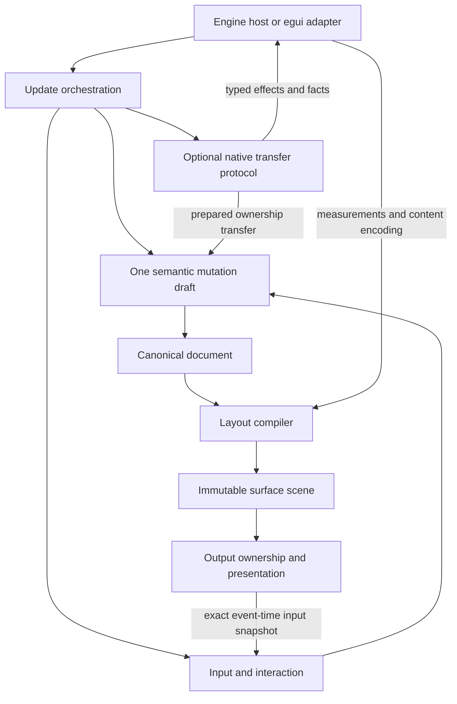

# Dockspace engine-first breaking redesign

Date: 2026-11-03. Status: proposed; no production implementation is implied.
Source baseline: `536c453`; review receipt: `2770d5d`.

This proposal follows the [architecture review](../audits/2026-11-03-dockspace-architecture-review.md).
The primary product is docking for a self-drawn engine editor. Egui is an
interactive reference adapter; the current public interfaces and internal
coordination protocols may be replaced without compatibility wrappers.

Two read-only design challenges checked ordinary-release semantics and
host-update/encoding orchestration. Their source-group counterexample, explicit
staging permits, normal output backpressure, actual egui-run scope and offscreen
input-endpoint limits are incorporated below. This is a design review, not
qualification of the proposed interface; the architecture review's executed
counterexamples remain the baseline evidence.

## Decision

Keep the canonical N-ary forest and replace the coordination around it. Ordinary
logical edits commit when validated input is accepted by a successful update,
including an accepted release. Renderer presentation determines which output
may authorize subsequent input; it does not decide whether an already accepted
ordinary edit happened. Transfers which establish or relinquish a native resource
owner retain their separate preparation and exact first-live publication.

The distinction follows resource obligations, not the pointer provider enum.
A same-window edit delivered through native input can be an ordinary edit.
A Dock Back operation which retires a physical child can require a transfer
transaction even though its destination already exists. Proven logical movement
between two existing engine surfaces need not inherit OS-window creation rules.

Three responsibilities must have independent ownership:

1. The published semantic document and its one mutation draft.
2. Encoded outputs in flight, each retaining its immutable scene.
3. The actually presented output and its currently valid input authority.

## Alternatives

| Design | Benefit | Cost | Decision |
| --- | --- | --- | --- |
| A: keep preview-presentation-gated local edits, queue released intents | Smaller semantic change; preserves current proof relationship | Must queue or block later gestures; adds reservation/conflict lifetime; rendering delay still determines edit completion | Fallback if immediate-commit prototype cannot preserve exact input behavior |
| B: semantic local commit plus exact presented-input snapshots | Predictable local completion; natural immediate/deferred engine rendering; no local release queue | Requires explicit validation of input from an older visible output against current semantic state | Recommended |
| C: synchronous immediate-mode global mutable docking context | Small conceptual render loop and close alignment with ImGui execution | Poor fit for asynchronous outputs, multiple logical surfaces and transactional host/native failures | Not selected for the target engine |

B changes a product contract deliberately. It must replace tests requiring a
new press to cancel a previous released local edit. It must not be implemented
by deleting validation around the old pending mutation representation.

## Target modules

These are responsibility boundaries inside the existing crates, not a mandate
to publish seven new crates.



| Module | Owns | Does not own |
| --- | --- | --- |
| Document | Item/root/surface membership, selection/MRU, split intent, contained placement and stable preferences | OS objects, renderer objects or live input capabilities |
| Mutation | One discardable draft, topology operations, canonicalization, policy and referential validation, final publication | Three nested clone-and-publish wrappers |
| Interaction | Pointer gesture, scoped source continuation, target acquisition, touch/timed behavior and ordinary accepted edit | Renderer completion queue or another graph |
| Layout | Measurements, resolved geometry, paint/hit/semantic records and guide/hit partitioning | Application widgets, fonts, shader resources or native readiness |
| Presentation | Scene retention, bounded admitted outputs, terminal reports and presented authority | Authority to undo an ordinary committed edit |
| Update | Ordered input, private input/layout/encode phases and one publication result | An application event loop or a general workflow engine |
| Native transfer | Source reservation, readiness, transfer publication, compensation and resource retirement | Per-frame local edit completion or a second lifecycle registry |

The scene is a read-only projection. Its hit and semantic records derive from
the same compiled geometry; they are not independently mutable state models.
Only the document changes business layout. Derived indexes remain tied to their
source snapshot and may be shared.

## Ordinary input and release semantics

Input carries the actual presentation it was delivered against, event-time
manipulation and hover routes, capture, and framework clearance. These facts
remain independent. A host must not replace an earlier edge's facts with the
last pointer position of a frame.

For a normal release:

1. Resolve its target from the qualified visible snapshot and exact source
   continuation, including the existing source-suppression rules.
2. Validate the source, destination, relevant policy, coordinate authority and
   item ownership against the current private semantic candidate.
3. Apply its command once in that candidate, end the gesture and emit its result.
4. A successful update publishes the edit. A failed/dropped update publishes
   neither it nor its consumed producer watermark.
5. Compile/encode the new scene when the host can draw it. A later dropped
   renderer output retires that output and requests replacement work; it does
   not roll the accepted edit back.

An old output being visible does not make every old receiver valid forever.
Each referenced receiver must still describe the same relevant semantic object
and route. Unrelated edits can preserve it; changed/removed/relocated objects,
coordinate changes, owner retirement, modal routing and epoch replacement
cannot. Do not reinterpret a point using an unpresented new layout. An actual
new target requires a new presented snapshot.

Source validation is equally important. If visible P0 shows group `[A,B]` and
an accepted edit adds C before a new frame appears, a group-grip press delivered
against P0 must not silently capture current `[A,B,C]`. Compare the visible source
membership, owning root/surface and relevant structure with the current draft.
Likewise, a splitter requires its visible adjacency and geometry basis, not
merely a still-existing node ID. This is a design risk to test, not a claim of a
newly executed defect in the current implementation.

Consequently, rapid independent gestures can complete without waiting for an
intermediate frame. A second press aimed at an object whose visible geometry
has become incompatible is explicitly rejected or consumed as unavailable; it
cannot be silently retargeted or cancel the previous committed edit.

Partition-invariance tests must keep the complete causal trace fixed, including
presentation, route and capability observations. They may vary host batch
boundaries, not pretend different visible outputs are identical input facts.
Use an explicit trace such as `P0 -> release1 -> press2(P0) -> release2(P0) ->
Presented(P1)`. Source/target semantic admission must be identical whether the
two gestures share an update or occur in separate updates; an intermediate
scene demotion cannot make those paths disagree solely because of batching.

Preview and final mutation use one validated proposal geometry. Preview is
feedback about the intended command, not a second command and not a mandatory
renderer acknowledgement for an ordinary edit. Native transfer previews retain
their distinct admission meaning.

## One update, explicit phases

Replace the current need to commit measurements before exposing their compiled
plan. An update has three internal phases:

```text
ingest ordered facts and commands
    -> resolve input and semantic draft
    -> measure / compile / encode requested surfaces
    -> validate and publish once
```

After encoding starts, later semantic commands are staged for a later update.
The interface makes this phase rule explicit instead of discovering it from a
late invariant error. Initially provide no exception for semantic commands that
claim not to invalidate already encoded output.

Illustrative interface, not current compilable API:

```rust,ignore
let mut update = dockspace.begin_update(input)?;
let mut staging = renderer.begin_staging();

for requested in update.surface_work() {
    match update.prepare_surface(requested, &mut measurements)? {
        SurfaceWork::Ready(pass) => pass.encode_into(&mut staging)?,
        SurfaceWork::Deferred(_) => {}
    }
}

let published = update.publish()?;
renderer.submit(staging.authorize(published.output_permits)?)?;
host.schedule(published.work);
```

`encode_into` runs the complete ordered docking program into a staging sink and
stages an internal execution seal. The host can own recording buffers after the
borrow ends. Successful publication yields matching affine output permits;
only the exact permit authorizes conversion of staged payload to a committed
output accepted by the host's submission interface. An execution seal means sink
acceptance, not renderer submission, presentation or GPU scanout. A receipt alone
cannot stop a host from prematurely drawing into a visible framebuffer: the
staging/submission distinction must also exist in the renderer adapter.

Only requested/touched surfaces need new measurement or output. A deferred,
hidden or offscreen unrelated surface must not cause a roster-wide barrier.
The core may publish a semantic edit and request later rendering when ordinary
output capacity is temporarily unavailable; it must not discard accepted input
or manufacture presentation.

`Deferred/Backpressured` is a normal no-encoding outcome, returned before the
pane callback; it must not become a whole-update failure through `?`. Terminal
reports, close continuations and focus facts can publish in zero-output updates.
A host unable to stage its visible painting may explicitly publish semantic
input first and render a later committed snapshot using the same update model;
it cannot claim atomic rollback of visible framebuffer writes.

Perform fallible storage reservation, protocol and measurement checks before
invoking real pane callbacks where possible. A callback can mutate application
data; core rollback cannot undo it. The host buffers rendering until publish,
and a failed candidate must not be automatically replayed through the callback.
Egui may run several actual UI passes. A run-owning adapter holds the docking
candidate until the terminal pass and hooks are complete, preserves original
raw input once, and retires discarded pass payloads. Pane callbacks run once
per actual pass, without extra calls to advance measurement-only docking phases.
Actions generated by pane/chrome UI enter the existing bounded action ingress,
deduplicated by original event identity, for a subsequent update; they must not
be lost with a discarded payload or mutate a sealed plan. Focus/save/platform
side effects execute only from published requests and are not replayed with
encoding. A callback that does not own the run retains its declared limitations.

Each surface output seals its own immutable scene. Later measurement on B
cannot change encoded A. A retained incremental patch names its exact base;
output coalescing must retain that base until all dependent patches retire.
Worker rendering receives owned thread-compatible records and resource
handles, not a pane callback borrowing application state. Offscreen texture
completion becomes input authority only when the host also establishes which
output is displayed at the actual input endpoint.

## Scene and output lifetime

Every admitted output retains its exact scene through a shared immutable
reference. The current candidate, in-flight output owners and last presented
owner reference the same scene objects where appropriate. Remove the arbitrary
candidate-plus-one-fallback limit as an output-retention policy.

Use the existing presentation stream and emission identities. Do not add an
independent scene registry with its own lifetime authority. The output ledger
is responsible for retaining and releasing the referenced scene.

Terminal handling keeps three facts separate:

- Settled prefix: which emitted obligations have final dispositions.
- Last actual presentation: which exact output is known visible.
- Current receiver validity: whether that output still matches the relevant
  semantic, routing, coordinate and ownership dependencies.

Out-of-order reports retain their original order. Dropped output cannot erase
an earlier actually presented output, and retained bytes cannot confer authority
after revocation. Keep bounded scene/output occupancy. On exhaustion, return
explicit output backpressure before admission, continue protected terminal
settlement and avoid an unbounded released-intent queue.

## Transaction and dependency ownership

One logical command batch gets at most one full mutable document draft. The
published immutable snapshot is shared until mutation is needed. Normalize and
validate that owned draft in place; reject by dropping it. Keep an atomic
wrapper only for internal callers which do not already own a discardable draft.

Retain a global published version for observation and replacement epochs. Do
not use it as a universal invalidation dependency for local asynchronous work.
Capture only the existing target identity, relevant content membership/source
fingerprint, policy and lifetime evidence needed by the operation.

Dependencies describe the operation's semantics. A close approval must not
depend on selection, MRU order, scroll offset or text measurements merely
because a general root fingerprint includes them. A resize must retain its
complete touching frontier and relevant geometry; a docking move must retain
its source payload and exact destination meaning. A presented input witness
also needs its owner/coordinate/output identity. Do not introduce a new global
version counter for each operation to simulate this separation.

For deferred close, unrelated selection/open/close may continue. Revalidate
that the approved items still belong to the exact target and that only those
approved items will be removed. Changed target membership, retired owner,
relevant policy changes and epoch replacement still reject. Do not replace a
global version check with unconditional acceptance.

## Focus, document preferences and surface ownership

Keep current focus, pending focus intent and per-surface history distinct within
one focus owner. Add a host fact for focus on a pane/workspace, an external host
scope, no focus, or Unknown. Successor focus is requested only when the current
focus target is removed. History chooses a successor; it does not prove current
focus.

On attach/retire/reset/restore, reconcile durable hosting preferences and their
recovery-host references in the same publication. The default proposed policy
for an unbound child with a removed recovery host is to clear its hosting
declaration while retaining independent placement hints. Live resource owners
must finish their explicit transfer/recovery protocol before removal. Every
successful document mutation must leave a saveable document.

Semantic SurfaceId and runtime host ownership remain separate. Reuse the
existing presentation/native owner incarnations for revocation. A withdrawn
surface cannot lend old output authority to its successor.

## Affordances and device targeting

Compile the active inner/outer guide set together. Each displayed action must
have a distinguishable selectable area, and its visual cue must match its actual
precedence. Outer-first hit priority can remain. Joint placement or suppression
must update draw and hit records together, with deterministic hysteresis to
avoid jitter while crossing guide boundaries. Do not change targets merely
because an adapter paints them in another order.

Partition expanded touch bands against neighboring handles and junctions while
preserving each original visible handle. Apply protected-chrome and occlusion
rules afterward using the same hit manifest. Keep decoration facts with the
gesture's source or full tab member, so scrolling a source offscreen does not
erase its drag feedback. Neither decoration nor a retained source proves hover.

## Native protocol and adapters

Keep one native binding/resource registry and exact first-live transfer. The
source remains authoritative while its destination resource is prepared. Do not
reduce native ownership to a successful Create callback or ordinary local edit.

Make dispatch state explicit: a not-started request may be abandoned as not
dispatched; once dispatch begins, an unfinished guard means Indeterminate and
retains compensation obligations. Classify valid window destruction separately
from invalid work-area geometry while preserving their existing joined order.
Capacity errors must retain protected terminal progress.

Keep egui-specific viewport/output tokens and framework hit observation in the
egui native adapter. First isolate host-side dispatch/retirement mechanics from
those conversions inside the existing implementation. Extract a public native
host helper only after a second small real host demonstrates the same need.
No generic native saga framework or broad new driver trait is required now.

The official egui callback still cannot report a renderer terminal it does not
own. Provide a clear working engine-owned/native example and an explicitly
limited compatibility example. The redesign changes local mutation timing but
does not turn callback return into presentation evidence. Renderer-neutral hosts
never need to know an egui widget ID.

## Deliberate deletion targets

- Ordinary local `PendingDragRelease` and `PendingContainedTransformRelease`
  presentation waits, once the replacement semantics pass their new tests.
- The rule that a new press cancels an already released ordinary local edit.
- Candidate-plus-one-fallback eviction as the lifetime policy for admitted outputs.
- Measurement-commit/paint-commit choreography and adapter report-merging code
  whose only purpose is that choreography.
- Nested full graph clones for one owned transaction and normalization pass.
- Whole-workspace close invalidation and frozen global item-multiset approval.
- Persistence cleanup which removes rows without repairing surviving references.
- Duplicate public methods exposing internal contribution/proof bookkeeping when
  an update-owned operation can express the same behavior.
- Legacy compatibility APIs and tests that enforce the superseded contract.

Retain the behavior oracles and negative stale/foreign/rollback cases. Deleting
an obsolete expectation must be paired with a test of the replacement product
contract. Not every similarly shaped record is redundant: command identity,
scene identity, concrete emission and binding incarnation have different jobs.

The main rewrite scope is `runtime/host_frame`, `runtime/measurement`,
`runtime/paint` contribution orchestration, scene/output retention and the
ordinary-release branches of `engine/pointer_transaction`/`pending_mutation`.
The egui adapters should become consumers of the replacement update rather
than keep their own old multi-commit orchestration behind compatibility methods.
Graph operations, canonical invariants, the touching-boundary resize solver,
typed geometry and proven native first-live transitions can be reused behind
that interface. Their ownership and integration points change where required;
existing code is retained for its demonstrated behavior, not API compatibility.

## Implementation sequence

1. Adopt the review probes as maintained public oracles. Fix admitted-scene
   retention in the existing ledger and make the actual basic workflows CI
   gates. These are useful independently of the larger interface replacement.
2. Prototype B at the public host seam: rapid releases, the same complete causal
   trace split into batches, stale visible receivers and dropped outputs. Freeze
   the new ordinary-edit contract before changing both adapters.
3. Replace transaction draft ownership and introduce one private update's
   input/layout/encode phases. Migrate the public recording host and immediate
   egui adapter; delete the old two-commit path in the same slice.
4. Scope close approvals and reconcile focus/preference publication. Add host
   focus observations and explicit owner-retirement behavior.
5. Jointly compile guides and device target partitions; preserve source feedback.
6. Migrate native effect dispatch to explicit started state, isolate degraded
   facts, and refresh first-live/cancellation/retirement proofs. Native transfer
   remains optional for a purely logical host.
7. Refresh extracted/public consumers, actual editor journeys and complete-update
   cost measurements. Remove the obsolete public facade rather than carrying
   a permanent v1/v2 dual runtime.

## Acceptance criteria

| Criterion | Required evidence |
| --- | --- |
| Ordinary accepted release survives later presses and Dropped outputs | Immediate/deferred hosts; two complete gestures in one input batch; exact order and one mutation per accepted command |
| Input cannot target an unpresented or semantically incompatible layout | Old scene, changed target, foreign owner, modal and coordinate-revocation negatives |
| New measurement and encoding need one core publication | First layout, resize, selection and topology change; failed publish and dropped candidate leave committed watermarks unchanged |
| All admitted outputs retain their scene | At least three changing scenes, reversed/grouped results, bounded-capacity pressure and final reclamation |
| One mutation owns one graph draft | Count every full graph clone on the public command path, including canonicalization; at most one per ordinary mutation batch and zero for a stable read-only update |
| Unrelated asynchronous work remains usable | Deferred close on A while selecting/opening/closing independent content on B; changed target/policy still rejected |
| Published documents remain saveable | Attach/retire/reset/restore with missing/native-preference cases; no dangling recovery-host references |
| Focus and affordances match user intent | Background close does not steal B's focus; guide targets remain identifiable; Touch preserves visible handles |
| Native resource ownership remains conserved | Create/dispatch-unwind/readiness-loss/cancel/late-result/Destroyed/quiescence faults with bounded terminal storage |
| Real consumers validate the interface | Actual eight-pane basic workflows plus public immediate/deferred hosts; no simplified fixture substitutes for their composition |
| Costs are measured at the complete seam | 16/128/1024 panes; idle, select, drag, measurement change and outputs in flight; report time distribution, allocations and retained bytes separately |

Wall-time budgets should follow a fixed workload on the target engine. Do not
claim an ImGui performance comparison from structural counters or choose a
latency target without measurement.

## Risks and mitigations

| Risk | Mitigation |
| --- | --- |
| Local state commits ahead of what the user sees | Bind input to actual presented snapshots; scope semantic revalidation; explicit unavailable result rather than retargeting |
| A failed encoding/publish repeats application side effects | Reserve and preflight before callbacks; buffer sink output; no automatic pane callback replay |
| More retained scenes consume unbounded memory | Admission budgets and explicit backpressure; output-owned Arc retention and protected result slots |
| Broad rewrite grows a second implementation | Migrate one public seam at a time and delete its old path in the same slice; keep one graph, ledger and gesture owner |
| Native ownership loses its stronger guarantees | Classify operations by resource obligations and rerun first-live/retirement faults separately from local edits |
| Design grows hypothetical integration abstractions | Validate with the public renderer and egui first; require a second real native host before extracting host mechanics |

The result should make the host responsible for facts, rendering and external
resources while making docking responsible for the coordination of its own
state. Success is a smaller set of rules a real host must implement correctly,
with the established correctness obligations preserved where they are needed.
