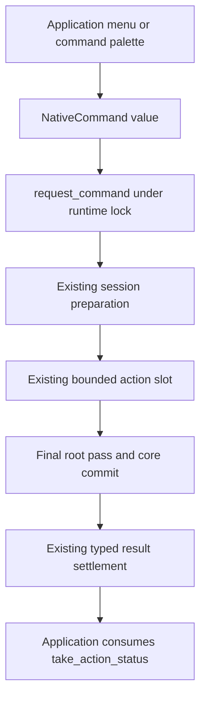
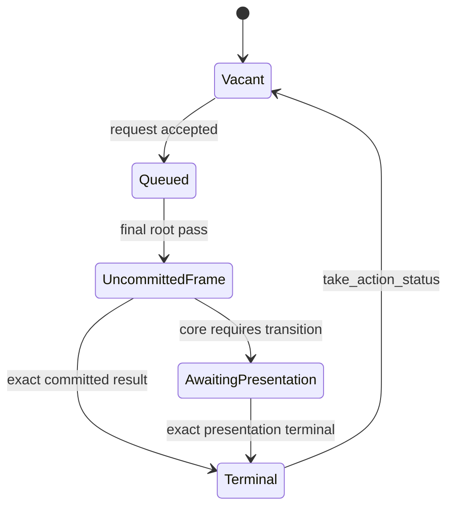

# Native Command Interface - Plan

## Goal Capsule

- **Objective:** Native editor applications can dock, float, raise and recover their panes from menus or command palettes through one consistent command workflow, with observable execution results.
- **Means:** Replace ordinary per-operation request methods with a typed command entry point backed by the existing native action slot (KTD1).
- **Authority:** The user's request permits breaking interface changes, removal of obsolete implementation, local verification and Conventional Commits. Product requirements below govern implementation details.
- **Execution profile:** One cohesive change on the existing feature branch, with serial Cargo verification and an independent review before the final local commit. Publication and merge are separate actions.
- **Stop conditions:** Ask only for essential product information that repository evidence cannot resolve, or authorization for unrelated destructive changes. Preserve existing `docs/reviews/` work.
- **Completion owner:** The implementing agent completes implementation, consumer migration, verification, documentation and local commit.

---

## Product Contract

### Summary

Expose the existing core capabilities through a consistent Native application command interface.
Remove ordinary request-method duplication and demonstrate the same workflow in the native editor's pane inventory.

### Problem Frame

The portable facade supports item docking, contained floating, raising and bringing content into view, but Native applications cannot request those operations through their public facade.
Existing Native methods each repeat the same queue and result rules, making menu integration unnecessarily wide and inviting capability drift.

### Requirements

**Application commands**

- R1. A public Native command entry point covers selection, reopening, item/root docking, Dock Back, item floating, contained raising/recovery, native-window promotion, close requests/decisions and arrangement locking.
- R2. The four newly reachable operations use existing core policy, identity, geometry and result semantics; pane data remains application-owned.
- R3. A contained recovery command changes durable bounds only when explicitly requested; passive painting or resizing does not perform that recovery.

**Execution and migration**

- R4. Admission preserves Busy until the previous result is consumed, Stopped after shutdown, revision checks, and the fixed host surface across closing or moving its final presentation.
- R5. Commands preserve ordered input and exact terminal results, including waiting for native presentation transitions where the core requires them.
- R6. Remove superseded ordinary request methods and migrate all current repository consumers; retain dedicated layout/document preparation entry points.
- R7. The native editor exposes the new operations through its current pane inventory and reports their accepted or rejected outcomes.

### Acceptance Examples

- AE1. Covers R1–R3: Float an open pane on the host surface, raise its contained window, explicitly bring it into current visible bounds, then dock it beside an existing pane; its stable item identity and document data survive.
- AE2. Covers R4–R5: A second command is Busy while a command is queued or its terminal result is unconsumed; consuming that result admits another command.
- AE3. Covers R2, R4–R5: Locked arrangement rejects a move through a committed typed result while selection remains usable; invalid targets and stale commands do not stop the runtime.

### Scope Boundaries

Core docking algorithms, persistence formats, new platform qualification and another queue/execution framework are outside this change.
No compatibility aliases remain for removed ordinary request methods.

---

## Planning Contract

### Key Technical Decisions

- KTD1. **One typed ordinary-command entrance.** Export a small `NativeCommand` enum and `NativeDockspaceApp::request_command`, replacing the ordinary forwarding methods. This provides values that menus can store and removes duplicated public protocol documentation. Adding four more forwarding methods would perpetuate the current drift; the enum is a bounded representation of existing actions rather than a new executor. Governs R1, R6.
- KTD2. **Prepare under the runtime lock.** Translate each command into existing session-issued prepared actions or the existing close/policy representation before enqueueing. Keep the current single action/result owner and terminal settlement. Governs R2, R4, R5.
- KTD3. **Keep heavyweight replacement separate.** Layout and document entry points retain their current fallible preparation and root-rebinding contracts rather than placing prepared objects or recognition closures in the ordinary command enum. Governs R6.
- KTD4. **Use existing evidence seams.** Coordinator-backed semantic tests verify outcomes and failure states; a finite public-app real-window example verifies the new four-operation journey. Keep renderer/platform claims limited to the executed environment. Governs R2–R5, R7.

### High-Level Technical Design

### Assumptions

The approved continuation targets the remaining Native command-interface opportunity from `docs/audits/2026-11-08-interface-and-interaction-ergonomics.md`.
The core action implementations are reused; if implementation demonstrates a newly exposed core defect, correct that specific path and add a regression rather than duplicating its rules in the adapter.
The existing example is the egui host; a separate engine is not required.

### Sources and Constraints

- `crates/egui_dockspace/src/product_dockspace.rs`: portable preparation and synchronous action inventory.
- `crates/egui_dockspace_native/src/surface_driver/application.rs`: queue admission, fixed-host close rule and replacement preparation.
- `crates/egui_dockspace_native/src/application_action.rs`: exact submitted-action correlation, stale results and presentation settlement.
- `crates/egui_dockspace_native/src/surface_driver/application/tests.rs`: real coordinator reductions without GPU/platform assertions.
- `crates/egui_dockspace_native/examples/basic/layout.rs`: existing menu and pending-command feedback.

---

## Implementation Units

### U1. Consolidate command admission and migrate callers

**Goal:** Deliver R1, R4–R6 through KTD1–KTD3.
**Dependencies:** None.
**Files:** `crates/egui_dockspace_native/src/{app,application_action,lib}.rs`, `crates/egui_dockspace_native/src/surface_driver/application.rs`, existing native unit tests and native example/smoke consumers, and a public consumer test in `crates/egui_dockspace_native/tests/application_commands.rs`.
**Approach:** Define the ordinary command values and a single translation point; replace old facade methods and migrate their call sites without retaining an alternate command path.
**Patterns to follow:** Existing prepared actions, `enqueue_application_action`, and `take_action_status`.
**Test scenarios:**

1. Existing close/defer/veto, lock, stale, replacement and shutdown tests continue to cross the unified entrance.
2. A public consumer constructs command values and observes Busy admission while the previous command owns the slot.
3. The removed ordinary request methods have no live source or documentation references.

**Verification:** Native consumers compile in default and serde profiles, and established lifecycle assertions pass.
The public consumer test proves interface usability and admission, while existing coordinator tests own committed semantic outcomes.

### U2. Verify the four newly exposed operations

**Goal:** Deliver R2–R5 and AE1–AE3.
**Dependencies:** U1.
**Files:** `crates/egui_dockspace_native/src/surface_driver/application/tests.rs`; core regression tests only if a concrete defect is found.
**Approach:** Exercise existing core reductions through the command entrance with real surface measurement for geometry-dependent actions.
**Test scenarios:**

1. Float one pane out of a multi-item central root, then dock it into another group; item identity and registry content survive.
2. Raise the lower of two contained windows and repeat; first changes stacking, second reports a no-op.
3. Measure a smaller visible surface, explicitly recover an offscreen contained window, and repeat; bounds change only on recovery and the second result is unchanged.
4. Missing item, missing target surface, a non-contained item, locked arrangement and a queued stale action return existing typed rejections or stale results without fatal shutdown.
5. Confirm singleton/native-root paths retain existing presentation-transition settlement and fixed-host behavior rather than bypassing it.
6. A valid cross-surface move of the fixed host's final non-central singleton is refused without occupying the slot; same-surface floating and moves with another surviving host presentation remain available, while invalid destinations retain core rejection semantics.

**Verification:** Assertions inspect committed views, geometry, status and data, rather than comparing the new dispatch match with itself.

### U3. Complete the editor workflow and migration documentation

**Goal:** Deliver R6–R7 and demonstrate AE1 in a live egui host.
**Dependencies:** U1, U2.
**Files:** `crates/egui_dockspace_native/examples/basic.rs`, `crates/egui_dockspace_native/examples/basic/layout.rs`, a finite example module if needed, `README.md`, `crates/egui_dockspace/README.md`, `docs/ENGINE_FIRST_MIGRATION.md`, `.github/workflows/ci.yml` if the new smoke is added to the existing native lane.
**Approach:** Add context-appropriate pane inventory actions with the current pending-action feedback; provide a bounded real-window journey using only public application commands and existing presentation readiness queries.
**Test scenarios:**

1. The finite live-window journey completes Float → Raise → Bring Into View → Dock, consumes exact terminal results, and retains document content.
2. Example controls remain unavailable while their application command is pending and respect the current arrangement lock.
3. Migration documentation names the replacement entrance and separates queue admission from command success.

**Verification:** Record the real-window outcome and environment; current example/smoke consumers compile and no abandoned implementation remains.

---

## Verification Contract

Run Cargo jobs serially with `CARGO_BUILD_JOBS=1`, reuse existing targets and use nextest with `-j1`.

| Gate | Scope | Passing signal |
| --- | --- | --- |
| `cargo nextest run --manifest-path integration/egui-fork-workspace/Cargo.toml --workspace --all-features --all-targets --locked -j1` | U1–U3 and native consumers | No failures; preserve existing skips |
| Default-feature native tests | U1–U2 feature gating | No failures |
| Workspace all-feature tests if shared core/adapter source changes | Shared contracts | No failures |
| Native doctests and correctness/suspicious Clippy | Public examples and implementation | No errors |
| `cargo fmt --manifest-path integration/egui-fork-workspace/Cargo.toml --all --check` | Changed Rust code | Clean |
| Finite command journey in actual example window | U3 | Four new operations finish, presentation resumes and pane data survives |
| Source search and independent final review | U1–U3 | No stale ordinary request methods, duplicate executor or unresolved blocking defect |

---

## Definition of Done

All requirements and acceptance examples hold in the verified scopes.
All repository consumers use the final interface; obsolete methods, duplicate forwarding code and abandoned attempts are removed.
The migration guide explains the breaking change and result consumption.
Verification evidence identifies the tested commit/source and environment without claiming unrun remote CI or new platform certification.
The final implementation is locally committed with an English Conventional Commit, and unrelated work is preserved.

## Implementation Result

U1–U3 are implemented and independently reviewed. The final native all-feature
and default suites passed 606 and 555 tests respectively, each retaining one
existing skip; the public doctest, Clippy and formatting checks passed. The
actual-window journey completed nine commands, including the four new pane
operations and two singleton native-child round trips. Its discovered singleton
completion defect and the locked-host policy finding are corrected.

The [implementation report](../audits/2026-11-08-native-command-interface.md)
records migration, scope and retained source-bound verification evidence.
