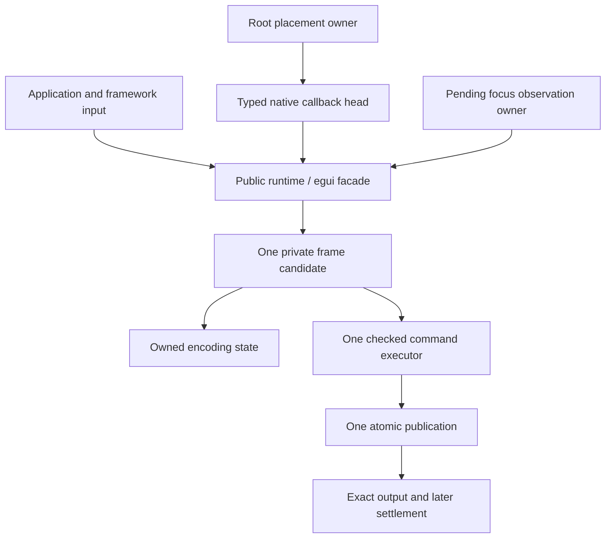

# Prerelease Maintenance Refactor - Plan

## Goal Capsule

Make the docking implementation easier to maintain before publication by removing superseded protocols and consolidating the ownership of related state.
The baseline is `fa73fe1` on `refactor/egui-pane-ergonomics`.
Delivery consists of locally reviewed Conventional Commits, with bounded verification and no remote publication.
The user authorized all findings from the preceding maintenance review, including removal of the old semantic event protocol and breaking internal changes.

## Product Contract

### Problem Frame

Production includes internal entry points used only by tests and an unused semantic receiver inventory.
Frame suspension, egui focus settlement and native Root placement lifecycle also repeat related state management across entry points.
Large implementation and product-test files obscure otherwise established responsibilities.

### Requirements

- R1. Remove the superseded semantic event protocol and its production inventory while preserving keyboard and accessibility behavior through public prepared actions.
- R2. Separate test-only transaction and borrowed-commit conveniences from production execution, and narrow blanket unused-code allowances.
- R3. Give encoding state, pending egui focus observations and native Root placements explicit private owners.
- R4. Dispatch native callbacks from one typed head selection while preserving their total order and retry behavior.
- R5. Organize focus, settlement, command execution and product tests around cohesive responsibilities.
- R6. Preserve current docking, close, presentation, rollback, focus, input and multiview behavior across default and persistence builds.

### Scope Boundaries

All reviewed maintenance findings are in scope.
No new UI framework adapter, public capability, generic event bus, test DSL or alternate mutation authority is introduced.
No persistence migration or compatibility wrapper is required for unpublished internal protocols.
Do not read, search, modify or stage `docs/reviews/**` or `repo-ref/**`.
Do not modify egui upstream, push, open a PR or merge branches.

## Planning Contract

### Key Technical Decisions

- KTD1. Keep current public runtime and adapter interfaces stable while changing private implementation. The user approved private ownership refactoring after reviewing its scope and transaction risks (session-settled: user-approved — chosen over broad public interface redesign because the maintenance findings have private seams).
- KTD2. Delete a replaced protocol family together with its inventory and tests of that protocol. Preserve relevant behavior by exercising the production prepared-action route; do not retain a second production protocol for old tests.
- KTD3. Aggregate related fields by value. Preserve affine handles, candidate identity, input order, output settlement and lease destruction order without adding clones or heap ownership.
- KTD4. Keep core publication in one transaction and native route preparation/publication under the existing host lock. Callback execution must not call external code while holding that lock.
- KTD5. Reuse existing behavioral tests for structural changes. Add or strengthen a test only where migration removes the sole proof of an externally supported behavior.

### High-Level Technical Design

### Sequencing and Assumptions

Use independent file ownership for core encoding, egui and native work.
The primary lane owns obsolete core protocol cleanup, shared internal publication types, lint cleanup, documentation and authoritative verification.
Structural workers do not change the public protocol or run Cargo.
Private helper names and exact file subdivisions may adapt to implementation evidence.
No behavior change is intended; a discovered defect must be reproduced and fixed within the same public contract.

## Implementation Units

### U1. Remove obsolete semantic protocol and production test wrappers

**Requirements:** R1, R2, R6. **Dependencies:** none.

**Files:** `crates/dockspace/src/{lib,semantic_input,semantic_manifest,scene,engine,transaction,operation}.rs`, `crates/dockspace/src/scene/lifecycle.rs`, `crates/dockspace/src/engine/{input,reducer,semantic_receiver,host_frame}.rs`, and affected core tests.

**Approach:** Remove old event construction/reduction and the unused compiled semantic roster. Retain helper algorithms shared by current prepared actions. Move only test conveniences behind test configuration or migrate tests to owned preparation. Preserve the checked transaction draft and final publication helper. Narrow unused-code allowances after tracing actual production consumers.

**Patterns:** `runtime/local_action.rs` and `runtime/host_frame.rs` supply the production action and owned commit routes.

**Test scenarios:**

1. Tab selection, close, keyboard navigation, splitter adjustment and contained resize still operate through prepared actions.
2. Foreign, wrong-epoch and relevant-policy/topology-invalidated action witnesses remain rejected; valid deferred witnesses survive unpublished/discarded passes and unrelated revisions.
3. Failed/dropped candidates publish no topology, producer watermark or presentation authority.
4. Scene reuse preserves current hit and output identity without an unused semantic inventory.

**Verification:** Core tests and public-host action/settlement tests pass; removed symbols have no live references.

### U2. Aggregate encoding state across suspension

**Requirements:** R3, R6. **Dependencies:** none; disjoint from U1's internal engine files.

**Files:** `crates/dockspace/src/runtime/{host_frame,update,session,paint,measurement,interaction}.rs` and existing runtime/public-host suspension tests.

**Approach:** Introduce a private encoding state carried intact by borrowed and suspended updates. Preserve checkpoint, pass identity, receipts and producer guards according to KTD3.

**Test scenarios:**

1. Suspension/resumption preserves the exact in-progress candidate.
2. Restarting encoding rejects earlier receipts without replaying input.
3. Dropping a suspended update releases exclusivity only after owned guards.
4. Output-capacity deferral still permits a zero-output logical commit.

**Verification:** Existing update-publication, deferred-action and public-contract tests pass in default and serde builds.

### U3. Consolidate egui focus settlement and run support

**Requirements:** R3, R5, R6. **Dependencies:** none; public core interfaces remain unchanged.

**Files:** `crates/egui_dockspace/src/product_{dockspace,owned_run,focus}.rs`, `crates/egui_dockspace/src/pass_settlement.rs`, private child modules and affected adapter tests.

**Approach:** Give pending focus observations one private ledger for matching and post-commit cleanup. Separate run input/callback scope and texture restoration from the settlement coordinator. Preserve distinct current-pass and previous-pass framework sampling.

**Test scenarios:**

1. Both adapter entry points submit only observations for the exact admitted artifact.
2. Failed candidates preserve pending observations and cannot confirm them; unpublished new intents cannot request focus, while already published requests keep their existing framework-effect timing.
3. Recursive runs invalidate the run while texture deltas remain recoverable.
4. Multiple passes consume raw input once and settle the exact final output.

**Verification:** Adapter and product focus, owned-run and presentation tests pass with default and optional features.

### U4. Own native Root placement lifecycle

**Requirements:** R3, R6. **Dependencies:** none.

**Files:** `crates/egui_dockspace_native/src/surface_driver.rs`, `crates/egui_dockspace_native/src/surface_driver/` and directly affected native driver tests.

**Approach:** A private owner manages pending declarations, committed-compatible cache, token-frozen input roster and retained backing accounting. Preserve their separate meanings and existing allocation prepayment.

**Test scenarios:**

1. A declaration affects only its exact admitted output/input roster.
2. Layout replacement invalidates preceding declarations.
3. Failed or abandoned output releases only its own token snapshot.
4. Multiple logical placements in one window retain exact origin/scale/clip and bounded backing accounting.

**Verification:** Native Root placement, shared-window, reset, capacity and discarded-pass tests pass.

### U5. Centralize native callback head dispatch

**Requirements:** R4, R6. **Dependencies:** U4 for canonical verification; implementation may proceed after the native driver checkpoint freezes.

**Files:** `crates/egui_dockspace_native/src/{mailbox,coordinator}.rs`, their private callback modules and callback ingress tests.

**Approach:** Select one typed dispatchable head and match it exhaustively. Preserve per-kind reduction, exact acknowledgement and retry rules under KTD4; do not add another queue or consume before core admission.

**Test scenarios:**

1. Interleaved callback kinds retain their captured total order.
2. Capacity refusal and failed candidates leave the exact head retryable.
3. Output boundaries block following callbacks until permitted settlement.
4. Close, destruction and late callbacks preserve predecessor/successor isolation.

**Verification:** Existing callback, overload, retirement and shared-window tests pass without weakening their assertions.

### U6. Organize core focus and command execution

**Requirements:** R5, R6. **Dependencies:** U1.

**Files:** `crates/dockspace/src/viewport_focus.rs`, `crates/dockspace/src/operation.rs`, `crates/dockspace/src/engine/{surface_runtime,pointer_transaction}.rs`, private child modules and their existing tests.

**Approach:** Group focus observation, pane intent and activation implementations around the same coordinator. Separate command authorization, topology mutation and close preparation behind the existing executor. Move click freeze/release together and extract only demonstrably identical native transition postprocessing.

**Test scenarios:** Existing focus causal ordering, close, source/target authority, exact click release and recovery tests continue unchanged through the reorganized implementation.

**Verification:** Core and conformance suites pass; no independent coordinator, duplicate validation layer or public forwarding API is added.

### U7. Organize product integration tests

**Requirements:** R5, R6. **Dependencies:** U3.

**Files:** `integration/egui-product-harness/tests/product.rs`, private `support/` and `product/` modules.

**Approach:** Move run support and observations into cohesive helpers and magnetic scenarios into a dedicated module. Keep one test binary, explicit presentation handling and independent core/product executors.

**Test scenarios:** Shared L08 and the complete 60-case L03 matrix, ordinary widget input and explicit Presented/Dropped journeys retain their behavior assertions.

**Verification:** Product default and persistence suites pass with equivalent supported scenario coverage.

### U8. Qualify and review the complete refactor

**Requirements:** R1-R6. **Dependencies:** U1-U7.

**Files:** Current validation documentation, relevant README references and one bounded audit qualification record.

**Approach:** Run the required gates, inspect the accumulated diff for redundant wrappers and stale references, complete independent correctness/maintenance review and fix confirmed findings. Record actual checks and platform limits.

**Verification:** Every required gate passes on the final implementation; commits contain only attributed files.

## Verification Contract

The user confirmed that this checkout has no competing session. Independent workspaces may run concurrently with `CARGO_BUILD_JOBS=2 CARGO_INCREMENTAL=0`, reusing each existing target directory; feature configurations sharing a workspace run sequentially.

| Scope | Required evidence |
| --- | --- |
| Core and adapters | `cargo nextest run --workspace --all-features --locked --test-threads=1` |
| Minimal core | `cargo nextest run -p dockspace --no-default-features --locked --test-threads=1` |
| External public host | `cargo nextest run --manifest-path integration/dockspace-host-harness/Cargo.toml --locked --test-threads=1`, default and `--features serde` |
| Egui product | `cargo nextest run --manifest-path integration/egui-product-harness/Cargo.toml --locked --test-threads=1`, default and `--features serde` |
| Official egui consumer | `cargo nextest run --manifest-path integration/egui-official-harness/Cargo.toml --locked --test-threads=1` |
| Native adapter | Existing `integration/egui-fork-workspace/Cargo.toml` nextest gate excluding physical smoke targets, with all features |
| Static quality | Formatting for affected workspaces, correctness/suspicious Clippy, core dependency boundary and relevant strict documentation/doctests |
| Removed protocols | Source search confirms no obsolete event/inventory references; targeted compiler diagnostics distinguish retained test helpers from production |

Native verification must not read or modify excluded upstream directories directly.
Existing Cargo dependencies may compile through their pinned manifests; no upstream editing or additional physical-platform qualification is implied.

## Definition of Done

All implementation units are represented by reviewed local commits.
Supported public behavior passes the applicable gates above.
Superseded protocol families and redundant production wrappers are removed or confined to test support with a documented reason.
Each new private owner reduces scattered state management without adding a second authority.
Independent review has no unresolved confirmed P1/P2, and any remaining limitation is named in the final qualification.
